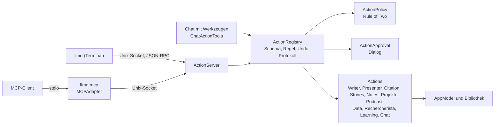
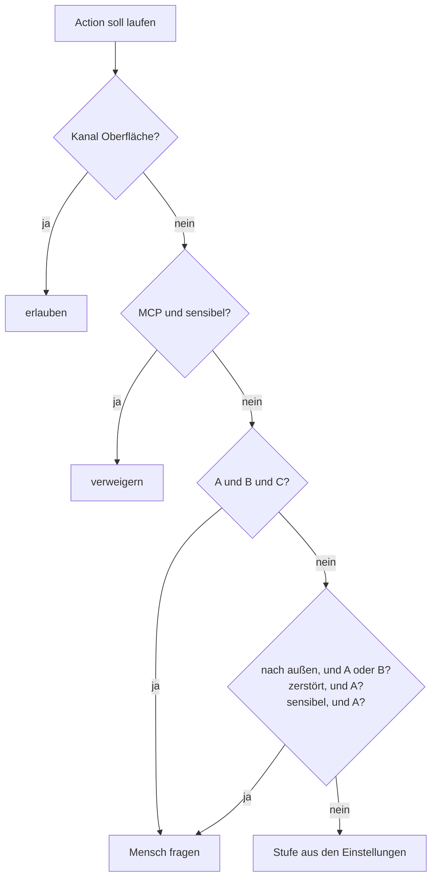

# Action-Schicht: Terminal, MCP, Chat-Werkzeuge

[← Übersicht](index.md) · [Funktionsweise](funktionen.md) · [Architektur](architektur.md) · [Code-Führer](code.md) · [Speicherformate](speicherformate.md)

Was die App kann, ist als **Action** erreichbar: aus dem Terminal (`llmd`), über MCP und aus dem eigenen Chat. Alle Wege laufen durch dieselbe Registry und dieselben Sicherheitsregeln.



## Terminal

Das Werkzeug liegt in der App unter `Contents/Helpers/llmd`. Die Einstellungen legen unter „Terminal und Agenten“ einen Link nach `~/.local/bin` an.

```bash
llmd status
llmd actions --module writer
llmd describe writer.format.bold
```

Befehle entstehen aus den Schemas: Punkte werden Wörter, `camelCase` wird `--kebab-case`, Pflichtparameter dürfen ohne Namen stehen.

```bash
llmd writer text insert-markdown --doc Bericht --markdown "# Titel"
llmd writer format bold --doc Bericht --match "Wort" --state on
llmd writer export --doc Bericht --format pdf
cat kapitel.md | llmd writer text insert-markdown --doc Bericht --stdin
llmd batch < schritte.jsonl
llmd watch
llmd completion zsh > "${fpath[1]}/_llmd"
```

Optionen: `--json`, `--quiet`, `--stdin`, `--stdin-to NAME`, `--no-launch`, `--run ID`. Läuft die App nicht, startet `llmd` sie. Exit-Codes: 0 Erfolg, 1 Fehler, 2 falscher Aufruf, 3 App nicht erreichbar, 4 verweigert, 5 nicht gefunden oder mehrdeutig, 6 Versionskonflikt.

Beispielskripte: [`docs/plan/beispiele/`](https://github.com/AlexEhrenberger/LLMDesigner/tree/main/docs/plan/beispiele).

## Adressen

Writer-Actions arbeiten auf dem Markdown, auch wenn das Dokument nicht offen ist. Nur der betroffene Block wird umgewandelt; alles andere bleibt, wie es geschrieben ist.

| Adresse | Bedeutung |
|---|---|
| `--match "Text" [--occurrence 2]` | eine Fundstelle; bei mehreren Treffern ohne `occurrence` ein Fehler |
| `--block b3-ab12cd` | ein Block aus `writer.blocks.list`; die ID veraltet, wenn sich der Block ändert |
| `--heading "Kapitel 2/Einleitung"` | eine Überschrift über ihren Pfad |
| `--range 120:15` | Zeichenbereich im Markdown |
| `--all` | der ganze Text |

Tabellen, Kästen, Spalten, Bilder, Formeln und Code-Blöcke haben eigene Parameter (`--table`, `--box`, `--section`, `--image`, `--formula`, `--plot`, `--code-block`): eine Nummer im Text ab 1 oder eine Block-ID, ohne Angabe das einzige Objekt dieser Art. Zellen heißen wie in Formeln: `A1` ist links oben, Zeile 1 die Kopfzeile. Bilder und Kästen werden auch in Kästen und Spaltenabschnitten gefunden; Tabellen und Code-Blöcke nur als eigener Block.

Schreibmarke, Auswahl, Sprünge und Seitenleisten (`writer.select`, `writer.caret.set`, `writer.jump.*`, `writer.view.*`) wirken auf den offenen Editor, weil es sie nur dort gibt; alles andere arbeitet auch auf geschlossenen Dokumenten. Listen und Objekte übergibt man als JSON: `--widths '[2,1]'`.

`--doc` nimmt ID oder Titel. `--deck` mit `--slide` oder `--slide-index` (und `--field`, `--notes`) wendet dieselben Actions auf Folien an. Lesen liefert eine `version`; Schreiben nimmt sie als `--if-version` und bricht bei fremden Änderungen ab.

## Sicherheit

Die Regeln stehen im [Sicherheitskonzept](plan/Sicherheitskonzept-Prompt-Injection.md) und im Code (`ActionPolicy`), nicht im Prompt. Ein **Lauf** merkt sich, ob er Fremdes (A) oder Sensibles (B) gelesen hat. Jede Action erklärt, was sie liest und bewirkt (C).



- **Herkunft:** Dokumente tragen `herkunft: fremd` im Kopf, wenn sie von außen kommen. Was ein markierter Lauf schreibt, wird ebenfalls fremd. „Als geprüft bestätigen“ fragt immer, einzeln.
- **Socket:** nur für den eigenen Benutzer (Ordner 0700, Socket 0600), Peer-UID-Prüfung, neues Token je Start. Kein Netzwerkport.
- **Export:** ohne Rückfrage nur in den Exportordner, und nur wenn der Lauf nichts Fremdes gelesen hat.
- **Web-Ansichten:** laden nichts aus dem Netz (`WKContentRuleList`).
- **LaTeX:** Formeln, die Dateien lesen oder Befehle zusammenbauen könnten, werden als Code gesetzt (`LaTeXSafety`).
- **Immer mit Rückfrage außerhalb der Oberfläche:** Mikrofon, Bildschirmfoto, Vollbild und Vortrag mit Stimme, Modellserver umstellen, Bibliothek wechseln, Anhang in einem anderen Programm öffnen. Über Chat und MCP auch jede Datei, deren Pfad der Aufrufer nennt.
- **Protokoll:** Fenster → „Aktivität von Terminal und Agenten“ zeigt Zeit, Kanal, Lauf, Action, A/B, Entscheidung und Ergebnis, aber keine Inhalte.
- **Katalog:** Fenster → „Action-Katalog für Agenten“ zeigt alle Actions mit Parametern, Art, A/B, Wirkung und Aufruf.

## Folien, die passen

Folien-Actions (`presenter.slide.add`, `setText`, `addFromText`, `field.addText`) messen den Text wie der Editor und liefern `fit`: `fits`, `overflowPercent`, `overflowingFields` und einen Hinweis. Mit `splitOverflow` wandert, was nicht passt, auf Folgefolien „(Forts.)“; `presenter.slide.split` tut das nachträglich, `presenter.slides.checkFit` prüft alle Folien. Hintergründe wählt man nach Namen (`design`) oder nur nach Helligkeit (`background: hell|dunkel`) in `presenter.deck.create`, `presenter.design.apply`, `presenter.ai.createDeck` und `presenter.fromDocument`; `presenter.designs.list` zeigt die Helligkeit jedes Designs. `presenter.slide.add --blank` legt eine leere Folie an, `presenter.slide.placeholder` blendet den Hinweis aus oder ein; `presenter.field.crop` beschneidet ein Bild (je Seite oder `--aspect 1:1`), `presenter.field.pictureStyle` gibt Rahmen und Schlagschatten. `presenter.ai.createDeck --with-notes --present` schreibt Folien und Karten und trägt danach selbst vor (fragt außerhalb der Oberfläche nach).

## Notes

Notes und ToDos werden über ihren Titel bzw. ihre Nummer in der Liste angesprochen (`--todo 2.1`, `--todo "Konzept/Zielgruppe"`). Ein Note gehört mit `--doc` zu einem Dokument oder mit `--world`/`--part` zu einer Romanwelt; `notes.note.list --doc Bachelorarbeit` zeigt genau dessen Notes. Katalog: [Notes-Actions](plan/Notes-Actions.md).

```bash
llmd notes note create --doc Bachelorarbeit --markdown $'- [ ] Einleitung\n- [ ] Methodik'
llmd notes todo check --note Bachelorarbeit --todo 1
llmd notes note progress --note Bachelorarbeit
```

## Projekte

Projekte, Aufgaben, Spalten, Bausteine, ToDos und Meilensteine nimmt jede Action als ID, Nummer (wie in der Ausgabe) oder eindeutigen Titel. Verknüpft wird mit `--chat`, `--doc`, `--note` oder `--world` (mit `--part` oder `--element figure:Mara`). `projects.link.find --doc …` sagt, zu welchen Projekten und Aufgaben ein Dokument gehört. Katalog: [Projekte-Actions](plan/Projekte-Actions.md).

```bash
llmd projects project create --title "Hausarbeit Statistik" --columns Offen --columns "In Arbeit" --columns Fertig
llmd projects task add --project "Hausarbeit Statistik" --title "Kapitel 3" --criteria "Quellen geprüft" --doc Hausarbeit
llmd projects task move --project "Hausarbeit Statistik" --task "Kapitel 3" --column Fertig
llmd projects block add --project "Hausarbeit Statistik" --kind diagramm --chart gantt --source aufgaben --width 12
```

## Podcasts

`podcast.generate` startet die Recherche, das Skript und die Sprachaufnahme im Hintergrund und kehrt sofort zurück; `podcast.status` zeigt Phase und Prozent. `--from fortsetzen` (Vorgabe) macht nur, was fehlt – nach geänderten Zeilen (`podcast.line.update`) also nur deren Aufnahme. Katalog: [Podcast-Actions](plan/Podcast-Actions.md).

```bash
llmd podcast create --question "Was ist Predictive Coding?" --minutes 10
llmd podcast participants suggest --podcast "Was ist Predictive Coding?"
llmd podcast generate --podcast "Was ist Predictive Coding?"
llmd podcast export --podcast "Was ist Predictive Coding?"
```

## Data Studio, Rechercherista, Learning Studio

Datenblöcke nimmt jede Action als ID, Kürzel oder Name; ihre Werte zu lesen (`data.block.read`, `data.resolve`) gilt als **privat** und ist über MCP gesperrt. Recherchen und Kurse lesen gilt als fremd (Webseiten, PDFs). `research.start` und `research.answer` wirken nach außen (Suchwörter verlassen den Mac) und fragen deshalb nach. Kataloge: [Data-Actions](plan/Data-Actions.md), [Rechercherista-Actions](plan/Rechercherista-Actions.md), [Learning-Actions](plan/Learning-Actions.md).

```bash
llmd data block create --name Absender --structure person --values '{"vorname":"Mara","ort":"Neustadt"}'
llmd data template use --template brief-din5008 --blocks '{"absender":"absender","empfaenger":"finanzamt"}' --title "Brief ans Finanzamt"
llmd research start --question "Predictive Coding" --focus Kognitionswissenschaft --depth gruendlich
llmd learning course create --name "Statistik 2" --discipline Psychologie --exam 2027-02-10
llmd learning card addMany --course "Statistik 2" --text "Was ist Varianz? ; Mittlere quadratische Abweichung"
llmd learning pause --until 2026-12-28 --reason Urlaub
```

## MCP

`llmd mcp` ist ein stdio-Server nach Spezifikation 2026-07-28 und versteht auch das ältere `initialize`.

```bash
claude mcp add llmd -- "/Pfad/LLM Designer.app/Contents/Helpers/llmd" mcp --profile core
```

| Profil | Inhalt |
|---|---|
| `core` | der kleine Satz zum Lesen, Schreiben, Präsentieren, Zitieren und Fragen |
| `writer`, `presenter`, `citation`, `stories`, `notes`, `projects`, `podcast`, `data`, `research`, `learning`, `chat` | ein Studio |
| `full` | alles außer privaten Daten |

Jedes Profil hat zusätzlich `llmd_search_actions` und `llmd_run_action`, damit kleine Modelle nicht alle Tools laden müssen. Dazu kommen Resources (`llmd://writer/doc/{id}`, `llmd://presenter/deck/{id}`, `llmd://citation/source/{key}`, `llmd://stories/world/{id}`, `llmd://notes/note/{id}`, `llmd://projects/project/{id}`, `llmd://podcast/podcast/{id}`), Prompts aus Skills und `subscriptions/listen`.

Der Kanal gilt immer als fremd. `memory.*` und `persona.files.*` sind gesperrt, Chats mit privaten Dateien ebenso. Eine Runde, die von hier ausgeht, läuft in einem Chat ohne dessen Werkzeuge.

## Werkzeuge im Chat

Der Blitz im Eingabefeld schaltet Gruppen zu (Writer, Presenter, Citation, Stories, Notes, PodcastStudio, andere Chats, Gedächtnis) und stellt ein, wie viel ohne Rückfrage geht. Jede Gruppe enthält nur den Minimalsatz, weil ihre Schemas bei jeder Frage den Kontext belegen. Über `llmd` und die MCP-Profile der Studios sind alle Actions erreichbar. Jeder Schritt erscheint in der Antwort, und der Pfeil unter der Antwort nimmt alle ihre Änderungen zurück, solange die App läuft.

Fremde Ergebnisse kommen in einem Rahmen mit zufälliger Kennung zum Modell. Das hilft dem Modell, schützt aber nicht: Geschützt wird durch die Registry. Ein Chat kann sich keine Nachrichten schicken und seine eigenen Freigaben nicht ändern.

## Eine Action hinzufügen

```swift
struct WriterDocStatsAction: LLMDAction {
    static let descriptor = ActionDescriptor(
        id: "writer.doc.stats", summary: "Zählt Wörter", kind: .read, security: .plainRead,
        input: .object(["doc": .string("Dokument")], required: ["doc"]), output: .freeObject()
    )
    static func run(_ args: Args, context: ActionContext) async throws -> Output { … }
}
```

Sie wird in `register…Actions()` eingetragen und bekommt einen Test über die Registry. `kind` und `security` haben absichtlich keine Vorgaben. Liest sie je nach Ziel Fremdes oder Privates, sagt das `preflight`.
