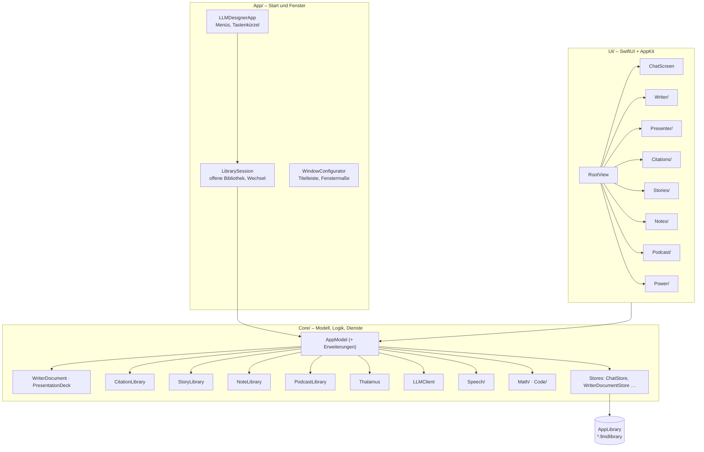
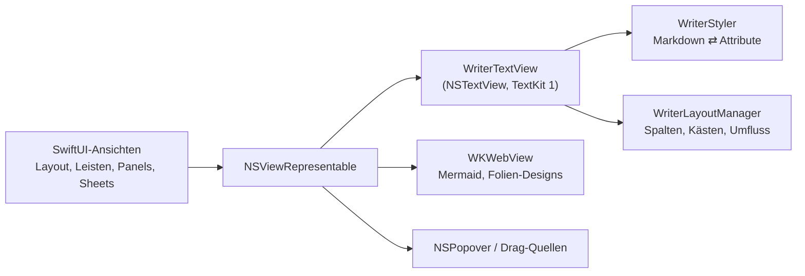
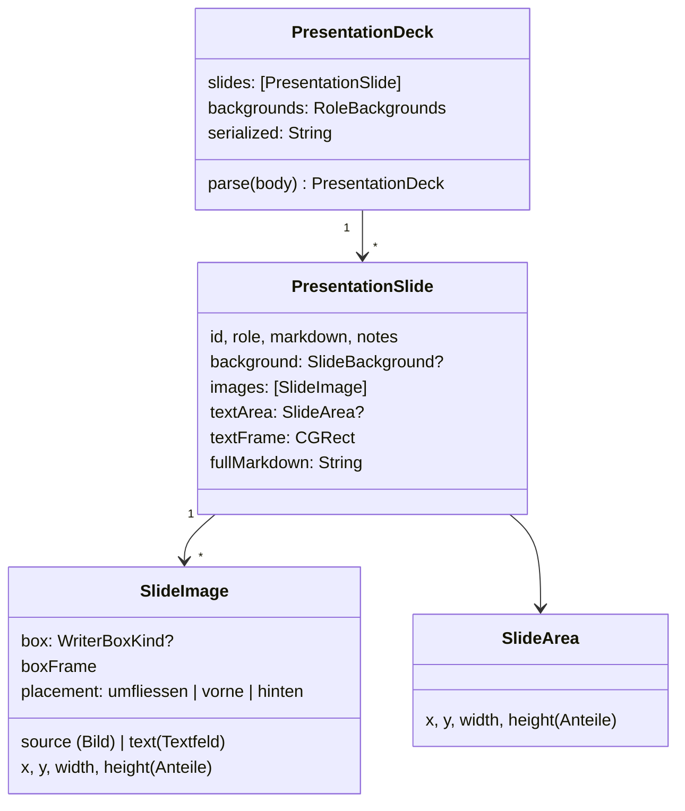
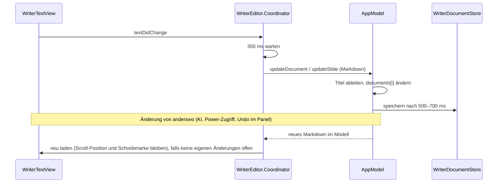
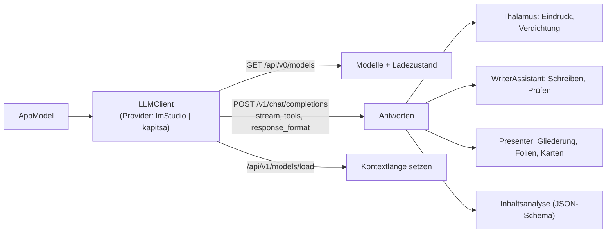
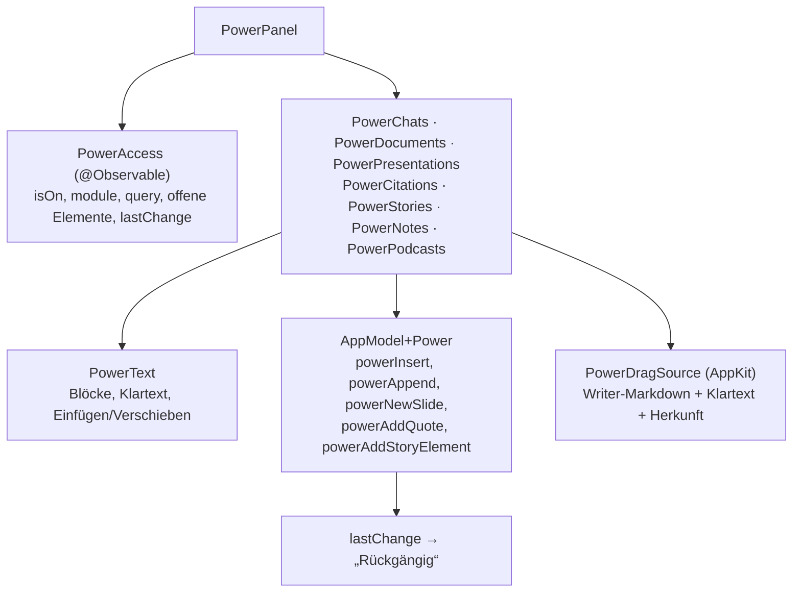
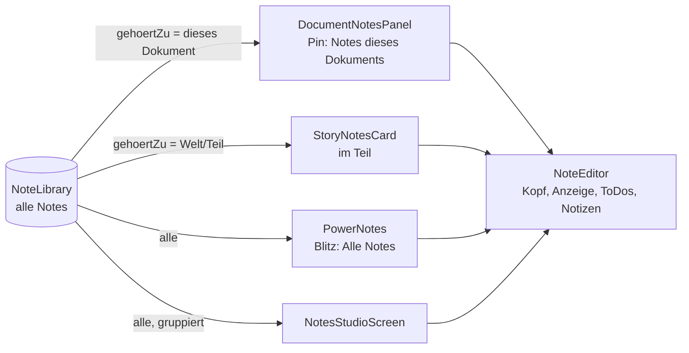
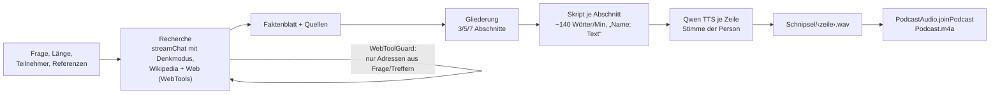

# Architektur

[← Übersicht](index.md) · [Funktionsweise](funktionen.md) · [Code-Führer](code.md) · [Speicherformate](speicherformate.md)

## Schichten

LLM Designer ist eine einzige ausführbare SwiftPM-Zielgruppe (`LLMDesigner`) plus die mitgelieferte Bibliothek **SwiftMath** (Formelsatz). Der Code ist in drei Schichten geteilt:

- **`AppModel`** (`@Observable`, auf dem Main Actor) ist der zentrale Zustand: Chats, Dokumente, Auswahl, Verbindungen, laufende Aufgaben. Er ist in viele Dateien `AppModel+….swift` aufgeteilt – je eine pro Bereich (Writer, Presenter, Personas, Thalamus, Speech, Power …).
- **`LibrarySession`** hält die geöffnete `AppLibrary` und baut beim Bibliothekswechsel einen neuen `AppModel`. Nichts Globales überlebt den Wechsel, außer der Liste der zuletzt geöffneten Bibliotheken.
- Die **Studios** haben eigene Bibliotheken/Modelle: `CitationLibrary` (Quellen, Zitate, Ordner) und `StoryLibrary` (Romanwelten), beide `@Observable`, lazy geladen, mit verzögertem Speichern (500 ms). `StoryLibrary` hält getippten Text als Entwurf und übernimmt ihn nach 350 ms Pause; geschrieben wird auf einer eigenen Queue. Die Formularfelder des Stories Studio sind `StoryTextEditor` (AppKit-`NSTextView`) statt `TextField(axis: .vertical)`: Sie melden SwiftUI nur eine neue Höhe, nicht jeden Tastendruck – sonst richtete SwiftUI bei jeder Taste das ganze Fenster neu aus. Tab-Leisten (`StoryTabBar`) wählen ihre Kurzform rechnerisch aus der gemessenen Breite statt mit `ViewThatFits` und liegen nie in einer ScrollView.
- **Notes** (`NoteLibrary`, `Notizen/<id>.json`) folgen demselben Muster: Entwürfe beim Tippen, Speichern nach 500 ms auf einer eigenen Queue. Sie werden beim Start gelesen, weil die Titelleisten von Writer und Presenter den Stand der Notes des offenen Dokuments zeigen. Änderungen aus der Oberfläche laufen über `NoteLibrary.change(_:_:undo:_:)`, das den Stand davor beim `UndoManager` des Fensters ablegt (⌘Z). ToDo-Zeilen sind `NoteLineEditor` (AppKit-`NSTextView`) mit Outliner-Tasten.
- **Podcasts** (`PodcastLibrary`, `Podcasts/<id>/`) werden beim Start gelesen, weil jeder Podcast ein Eintrag der Seitenleiste ist (`SidebarEntry.podcast`, mit Ordnern, Stapeln und Ziehen wie Chats und Dokumente). Gespeichert wird nach 500 ms auf einer eigenen Queue. Das Erzeugen läuft in einer Warteschlange im `AppModel` (`podcastQueue`, ein `Task` zur Zeit); der Fortschritt (`podcastProgress`) wird nicht gespeichert, die Phase schon.
- **UI-Ansichten** lesen den `AppModel` über die SwiftUI-Umgebung (`@Environment(AppModel.self)`).

## Darstellung: SwiftUI außen, AppKit innen

- Der Texteditor ist ein eigenes **`NSTextView` mit TextKit 1** (`WriterTextView`, verteilt auf `WriterTextView+….swift`). Er wandelt Markdown in Attribute (`WriterMarkdown.attributedString`) und zurück (`WriterMarkdown.markdown`). Tabellen sind echte `NSTextTable`-Zellen; Bilder, Formeln, Zitationen und das Inhaltsverzeichnis sind `NSTextAttachment`s.
- Spalten, schwebende Kästen und Textumfluss entstehen in `WriterTextContainer.lineFragmentRect` und dem Layout-Manager-Delegate (TextKit 1 kennt dafür keine fertige Lösung).
- **Folien** benutzen denselben Editor auf einer festen Leinwand von 720 × 405 pt (`WriterTextView.SlideLayout`), die ein `SlideScrollView` auf den verfügbaren Platz vergrößert. So sehen Editor, Miniaturen, Präsentation und PDF identisch aus. Ein `SlideLayout` hat eine eigene Leinwandgröße und einen Textrahmen – dadurch funktionieren auch **freie Textfelder** (eigene kleine Leinwand) und der verschiebbare Textbereich.
- Mermaid-Diagramme und die CSS-Folien-Designs laufen in **`WKWebView`s** (offline, `mermaid.min.js` liegt im App-Bundle).

### Freie Elemente auf Folien

Beim Bearbeiten eines Textfelds bleibt es **ein** `WriterEditor` mit **einem** `WriterEditorController`: Der Editor bekommt als Inhalt das Feld (`WriterSlideContent(id: Feld, slideID: Folie)`), wird an die Position des Felds gelegt, und der Text der Folie wird solange statisch gezeichnet. Dadurch wirken Werkzeugleiste, KI-Leiste, Diktat und Zitate unverändert im Feld. Änderungen meldet der Editor wie gewohnt über `AppModel.updateSlide`, das Feld-IDs erkennt.

## Datenfluss beim Schreiben

## Sprachmodelle

- Strukturierte Antworten laufen über **JSON-Schema mit fester Reihenfolge** (`complete(orderedSchema:)`), weil kleine Modelle in der Reihenfolge der Eigenschaften schreiben.
- Diagramme der Inhaltsanalyse baut die App selbst aus JSON – das Modell schreibt nie Mermaid-Code für sie, damit die Diagramme immer gültig sind. (Nur das Mermaid-Werkzeug in Writer lässt Qwen Mermaid schreiben, mit Syntax-Beispiel und Reparaturrunden.)
- Eigenheit von LM Studio: Ein unbekannter Modellname fällt still auf das geladene Modell zurück. Die App vertraut deshalb dem `model`-Feld im Stream.
- **Der Anfang einer Anfrage bleibt gleich.** Kapitsa und LM Studio heben den Anfang eines Prompts auf (Präfix-Cache) und lesen nur Neues. Ändert sich im System-Prompt ein einziges Zeichen, liest Kapitsa den ganzen Chat neu (gemessen: 11 s statt 0,3 s bei 2 200 Token). Darum steht im System-Prompt nur, was für den ganzen Chat gilt (Datum ohne Uhrzeit, Erinnerungen nach Kalendertagen); was zu einer Runde gehört (Erinnerungen der Runde, Hinweis für gesprochene Antworten), kommt gerahmt vor die neueste Nachricht (`ChatPayloadBuilder`). Anfragen gehen mit sortierten Schlüsseln hinaus, weil Swift die Reihenfolge sonst bei jedem Start neu würfelt. Unter jeder Antwort steht, wie viele Token aus dem Cache kamen; `PromptPrefixTests` hält die Regel fest.

## Action-Schicht

Terminal, MCP und Chat erreichen die App über dieselbe Registry, die Parameter prüft, die Sicherheitsregel anwendet und Undo-Gruppen und Protokoll führt. Details: [Action-Schicht](actions.md).

## Weitere lokale Dienste

| Dienst | Wofür | Anbindung |
|---|---|---|
| Draw Things | Bilder, Folien-Hintergründe | HTTP `:7860` (`/sdapi/v1/txt2img`), `ImageGenerationCenter` (eine Aufgabe nach der anderen) |
| Qwen TTS | Vorlesen, Gesprächsmodus | `QwenTTSClient`, in kurzen Stücken |
| Apple Speech | Diktat | `DictationEngine` (SpeechTranscriber) |
| Tectonic | PDF-Satz von Dokumenten | `LaTeXExport` → `tectonic` |
| Python + matplotlib | Plots, Diagramme aus Tabellen | `MathPlotRenderer`, `Agg`-Backend |
| Crossref, DNB, Open Library, Google Books, arXiv | Quellen importieren | `CitationLookup` |

## Nebenläufigkeit

- UI und Modell laufen auf dem **Main Actor**. Netzwerk und Prozesse (Python, Tectonic) laufen in `Task`s; Ergebnisse kommen auf den Main Actor zurück.
- Streams werden pro Chat verfolgt (`streamingMessageIDs`), damit mehrere Chats gleichzeitig antworten können.
- Lange Modellaufgaben (Gedächtnis-Verdichtung, Gliederung, Moderatorenkarten) weichen, sobald der Nutzer schreibt.

## Power-Zugriff

Das Ziehen nutzt eine **AppKit-Drag-Quelle** statt SwiftUIs `onDrag`: Nur so nehmen AppKit-Textansichten (Dokument, Folie, Chat-Eingabe) den Text an. Auf das Pasteboard kommen Writer-Markdown (die Editoren behalten Formatierung, Zitationen werden zu Pillen), Klartext für alle anderen und – bei Blöcken aus dem Panel – deren Herkunft, damit Ziehen innerhalb desselben Dokuments verschiebt statt kopiert.

### Notes: eigene oder alle

Alle Orte benutzen denselben `NoteEditor`; sie unterscheiden sich nur darin, welche Notes sie zeigen und wie ihr Kopf aussieht. Die Zugehörigkeit steht im Note, nicht im Dokument: Ein Dokument, dessen Note gelöscht wird, ändert sich nicht, und ein gelöschtes Dokument hinterlässt im Note einen Hinweis statt eines Fehlers.

### Podcast: Recherche, Skript, Sprachaufnahme

Die Recherche benutzt dieselben Werkzeuge und Regeln wie der Chat: `WebTools` für die Aufrufe, `WebToolGuard` für das Öffnen von Seiten, `ForeignFrame` für Gefundenes und für das Material der Referenzen. Hat ein referenzierter Chat Persona-Dateien gelesen, bekommt die Recherche nur Wikipedia. Gemma 4 bekommt sein `<|think|>`, Kapitsa `enable_thinking`; der Gedankengang wird verworfen. Die Schnipsel bleiben liegen: Eine geänderte Zeile verliert nur ihren eigenen, und „Fortsetzen“ spricht nur, was fehlt.

