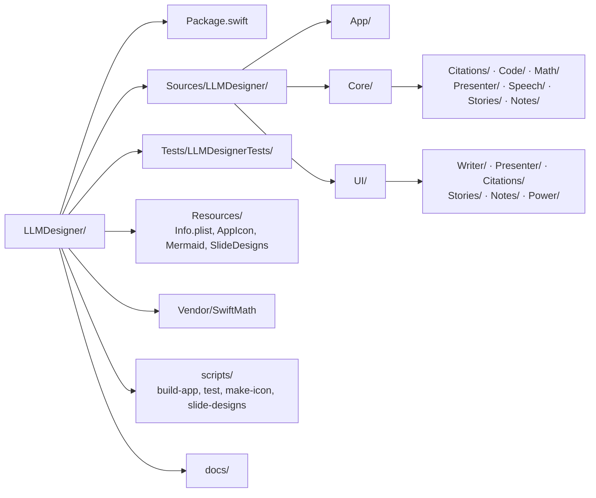
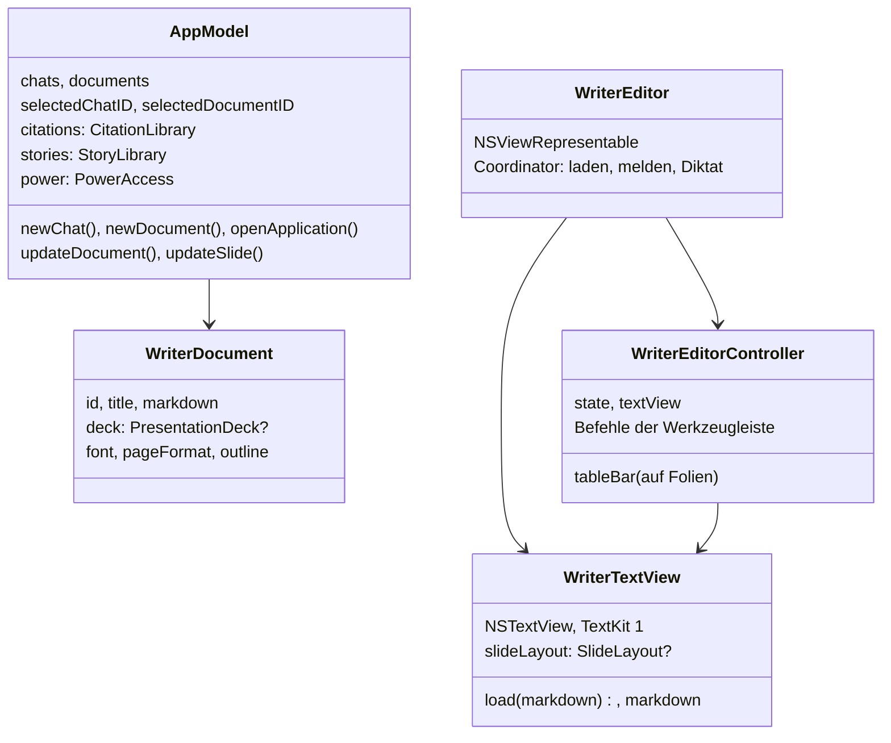

# Code-Führer

[← Übersicht](index.md) · [Funktionsweise](funktionen.md) · [Architektur](architektur.md) · [Speicherformate](speicherformate.md)

## Bauen und Testen

Es gibt **kein Xcode-Projekt**. Gebaut wird mit den Xcode Command Line Tools (Swift 6) als Swift Package:

```bash
scripts/build-app.sh release --open   # baut build/LLM Designer.app und startet sie
scripts/build-app.sh debug            # Debug-Variante
scripts/test.sh                       # alle Tests (Swift Testing)
scripts/test.sh --filter PowerTextTests
```

`build-app.sh` erzeugt beim ersten Lauf das App-Icon, kopiert `mermaid.min.js`, die Folien-Designs (`Resources/SlideDesigns/*.css`) und die Schrift-Bundles von SwiftMath ins Bundle und signiert ad hoc. `test.sh` ergänzt die Suchpfade für Swift Testing, die bei den Command Line Tools fehlen.

Voraussetzungen zur Laufzeit (optional, je nach Funktion): LM Studio oder Kapitsa, Draw Things, Python mit matplotlib/numpy, Tectonic.

## Ordnerstruktur



| Ort | Inhalt |
|---|---|
| `App/` | `LLMDesignerApp` (Szene, Menüs, Tastenkürzel), `LibrarySession` (offene Bibliothek), `WindowConfigurator`, `MenuBarMenu` (Symbol in der Menüleiste), `GlobalHotKey` (Kürzel der Suchleiste) |
| `Core/AppModel.swift` + `AppModel+*.swift` | Zentraler Zustand und Abläufe, nach Bereichen getrennt |
| `Core/AppLibrary.swift` | Bibliotheken: Ort, Einstellungen (`Einstellungen.plist`), Liste der zuletzt geöffneten |
| `Core/LLMClient.swift` | LM Studio / Kapitsa: Modelle, Streaming, Werkzeuge, JSON-Schema |
| `Core/ChatPayloadBuilder.swift` | Anfrage eines Chats: fester System-Prompt, Hinweise der Runde vor der neuesten Nachricht (Präfix-Cache) |
| `Core/Thalamus*.swift` | Gedächtnis der Personas: Eindrücke, Verdichtung, Abruf |
| `Core/WriterMarkdown.swift`, `WriterSpans`, `WriterBox`, `WriterTableCalc` … | Markdown-Erweiterungen von Writer: Stile, Kästen, Spalten, Formeln in Tabellen |
| `Core/LaTeXExport.swift` | Dokument → LaTeX → PDF (Tectonic) |
| `Core/Presenter/` | `Presentation.swift` (Deck, Folien, freie Elemente, Speicherformat), Designs, Player, Handout, KI-Prompts |
| `Core/Citations/` | Modell, Bibliothek, Import (Crossref, DNB …), Dublettenprüfung, APA-Formatierer |
| `Core/Stories/` | Romanwelten, Elemente, Zeitleisten |
| `Core/Notes/`, `AppModel+Notes.swift` | `NoteModel` (Note, ToDo, Zugehörigkeit, Fortschritt, Baum-Operationen, Aufgabenliste ⇄ ToDos), `NoteLibrary` (Speichern, Entwürfe, Rückgängig); Öffnen, Zuordnen, Besitzernamen |
| `Core/Math/`, `Core/Code/` | Formelbaum, Plots über Python, Code-Hervorhebung, Flussdiagramme |
| `Core/Speech/` | Diktat, Vorlesen, Qwen TTS, Gesprächsmodus |
| `Core/PowerText.swift`, `AppModel+Power.swift` | Power-Zugriff: Blöcke, Klartext, Änderungen mit Rückgängig |
| `Actions/` | Action-Schicht: `ActionRegistry`, `ActionPolicy`, `ActionServer`, Adressen, Herkunft, je Studio ein Ordner; siehe [Action-Schicht](actions.md) |
| `Sources/LLMDProtocol/` | Protokoll zwischen App und `llmd`: JSON-Werte, Schemas, Descriptoren, Nachrichten |
| `Sources/llmd/` | Terminal-Werkzeug und MCP-Adapter (`MCP/`) |
| `UI/RootView.swift` | Seitenleisten, Arbeitsfläche, Einklappen bei schmalen Fenstern |
| `UI/Writer/` | `WriterScreen`, `WriterEditor` (Representable + Controller), `WriterTextView+*` (Editor nach Themen), Sheets |
| `UI/Presenter/` | `PresenterScreen`, `SlideImageEditor` (Bilder/Textfelder/Textbereich verschieben), `SlideViews`, `SlidePrinter` (PDF) |
| `UI/Notes/` | `NotesStudioScreen`, `NoteEditor` (Kopf, ToDo-Zeilen, Auswahl von Dokumenten und Notes), `NoteLineEditor` (Zeile mit Outliner-Tasten), `NoteProgressArt` (zwölf Anzeigen, Auswahl, Konfetti), `NoteLinks` (Panel „Notes dieses Dokuments“, Knopf in der Titelleiste, Karte im Stories Studio) |
| `UI/Power/` | `PowerPanel` (Rahmen, Ziehen, gemeinsame Bausteine), `PowerModules` (fünf Miniatur-Apps), `PowerNotes` (alle Notes) |
| `UI/QuickBar/` | `QuickBarPanel` (Panel vor allen Apps, Controller), `QuickBarView` (Feld, Chat, Besen, `AuroraView` mit Core-Animation-Farbe); Zustand und Werkzeugwahl in `Core/AppModel+QuickBar.swift` |
| `Tests/` | Swift-Testing-Suiten für Markdown, Layout, Tabellenformeln, Präsentationen, Power-Zugriff … |

## Wichtige Typen



## Konventionen

- **Sprache**: Code und Kommentare englisch, Oberfläche deutsch. Kommentare erklären das *Warum* in ganzen Sätzen.
- **Alles in die Bibliothek**: Neue Daten und Einstellungen gehören in `AppLibrary.current` bzw. `AppModel.settings` – nie nach Application Support oder in `UserDefaults`. Einzige Ausnahme sind Socket und Token von `llmd`: Laufzeitdateien ohne Daten.
- **Nachsichtiges Dekodieren**: Fehlende Felder bekommen Vorgaben, leere Felder werden nicht geschrieben. So bleiben alte Dateien lesbar.
- **Neue Felder in Folien-JSON** sind optional und haben deutsche Schlüssel (`bilder`, `inhalt`, `kasten`, `textbereich` …), passend zum bestehenden Format.
- **Undo** läuft über den `UndoManager` des Textfelds; Änderungen am Modell registrieren ihre Umkehrung (z. B. `setSlideImages`, `setSlideTextArea`).
- **Kein `@Entry`-Makro**: Die Command Line Tools haben keine SwiftUI-Makro-Plugins; Umgebungswerte werden mit `EnvironmentKey` geschrieben.

## Fallen

- **TextKit 1 und Zeilen nebeneinander**: Spalten und schwebende Kästen verschieben Zeilenfragmente; `WriterLayoutManager` überschreibt deshalb Suchen nach Position. Nie die 3-Argument-Variante von `glyphIndex(for:in:)` überschreiben (Endlosrekursion).
- **macOS 26 übermalt** alles, was der Layout-Manager außerhalb des Textcontainers zeichnet: Randmarken werden in `drawBackground(in:)` gezeichnet.
- **Folien sind vergrößert**: Unteransichten im Textfeld werden mitvergrößert. Darum steht die Formelleiste von Tabellen auf Folien außerhalb der Leinwand (`controller.tableBar`).
- **Drag & Drop**: SwiftUIs `onDrag` erreicht AppKit-Textansichten nicht zuverlässig; der Power-Zugriff benutzt `PowerDragSource` (AppKit).
- **LM Studio** antwortet bei unbekanntem Modellnamen mit dem geladenen Modell – immer das `model`-Feld des Streams anzeigen.
- **LaTeX liest Dateien**: Tectonic mit `--untrusted` sperrt nur Shell-Aufrufe. Alles, was roh an die Engine geht, muss durch `LaTeXSafety`; Text läuft durch `LaTeXWriter.escape`.
- **Qwen-Image** malt jedes Wort über Schrift ins Bild, auch verneint: Hintergrund-Prompts filtern solche Wörter.
