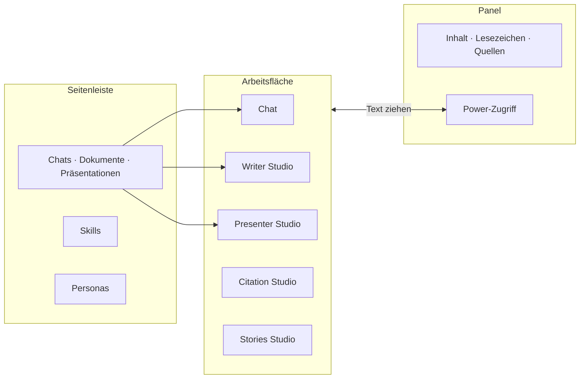
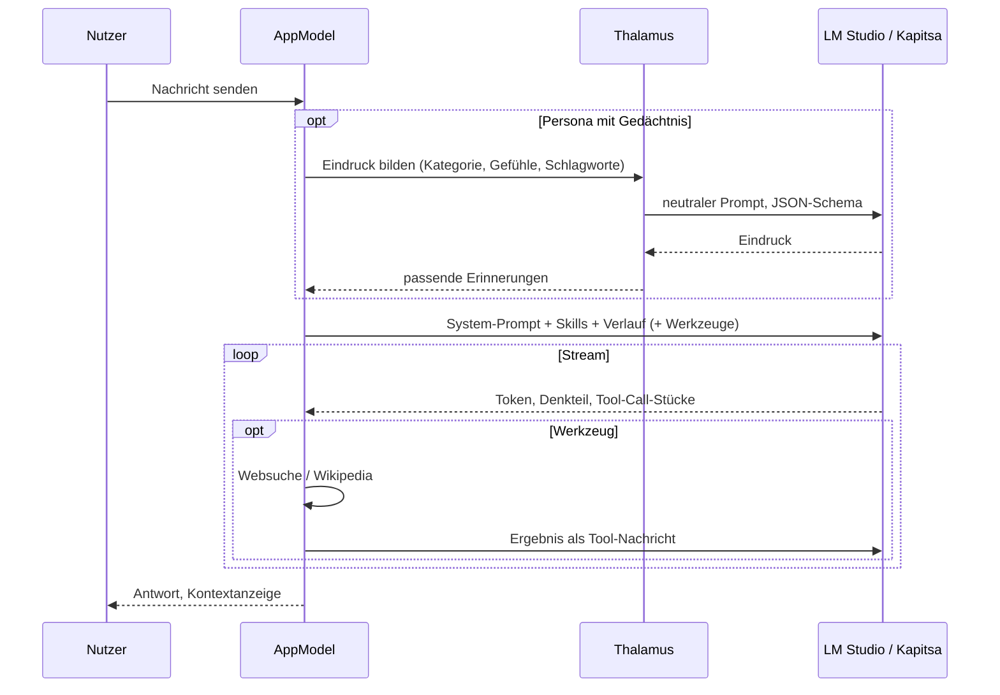
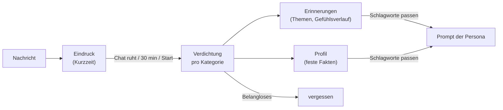
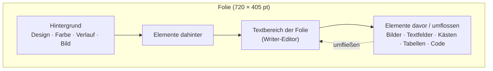
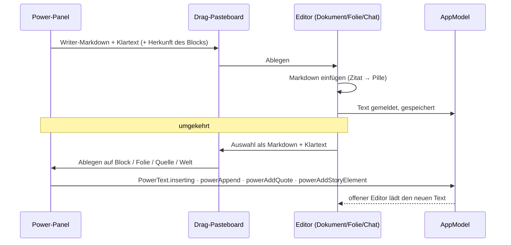

# Funktionsweise

[← Übersicht](index.md) · [Architektur](architektur.md) · [Code-Führer](code.md) · [Speicherformate](speicherformate.md)

Das Fenster hat drei Bereiche: links die **Seitenleiste** (Chats, Dokumente, Präsentationen in Ordnern; Skills; Personas), in der Mitte die **Arbeitsfläche** (Chat oder eine der Anwendungen), rechts ein **Panel** (Inhaltsverzeichnis, Lesezeichen, Quellen – oder der Power-Zugriff). Wird das Fenster schmal, klappen die Seitenleisten weg und legen sich bei Bedarf über den Inhalt.

## Neu anlegen

Das Stift-Symbol oben in der Seitenleiste (und in den Titelleisten, wenn die Seitenleiste zu ist) öffnet ein Menü: **Neuer Chat** und alle Applikationen – Writer Studio (neues Dokument), Citation Studio, Presenter Studio (neue Präsentation), Stories Studio; Notes folgt. Darunter „Präsentation aus Dokument …“.

## Chat

- Antworten werden gestreamt (`/v1/chat/completions` mit `include_usage`), Denkprozesse (Gemma `<|think|>`, Qwen `enable_thinking`) aufklappbar angezeigt.
- **Skills** sind Bausteine des System-Prompts; pro Chat beliebig kombinierbar.
- **Web- und Wikipedia-Suche** sind Werkzeuge (Tool Calls), pro Chat einschaltbar, nie automatisch.
- **Kontextlänge** (8K/16K/32K) pro Chat; die App lädt das Modell bei Bedarf mit der passenden Länge neu.
- **Inhaltsverzeichnis** und Lesezeichen des Chats rechts; Abzweigen, Fragen bearbeiten, Folgefragen, Bilder, Formeln, PDF-Export.
- **Gesprächsmodus**: Diktat (Apple SpeechTranscriber) und Sprachausgabe (Qwen TTS) im Wechsel.

## Personas und Gedächtnis (Thalamus)

Eine Persona hat Profilbild, Beschreibung und eigene Dateien. Mit eingeschaltetem **Thalamus** ordnet ein neutraler Modellaufruf jede Nachricht ein (Kategorie, bis zu drei Gefühle je Seite mit Stärke, Merkwürdigkeit). Wenn der Chat ruht, werden die Eindrücke pro Kategorie zu **Erinnerungen** und einem **Profil** verdichtet; passende Erinnerungen fließen in spätere Antworten ein.

## Writer Studio

Ein WYSIWYG-Textverarbeitungsprogramm auf Markdown-Basis:

- Formatierung: Schriften, Größen, Farben, fett/kursiv/unterstrichen/durchgestrichen, hoch- und tiefgestellt, Code, Ausrichtung, Einzüge, Zeilenabstand.
- Struktur: Kapitel, Überschriften, Listen, Zitate, Trennlinien, Seitenumbrüche, Inhaltsverzeichnis (formal oder dynamisch von der KI), Lesezeichen, Kommentare.
- Objekte: Bilder (auch von Draw Things generiert), Tabellen mit **Formeln** (SUMME, MITTELWERT …), Sortieren und Diagrammen, Formeleditor mit Plots (Python/matplotlib), Zeichnungen, Mermaid-Diagramme, Kästen (Definition, Merksatz …) mit Textumfluss, zweispaltige Abschnitte, Code mit Hervorhebung und Flussdiagrammen (Python/SQL).
- Seitenformate DIN A4, Taschenbuch, Normseite, eigene Formate, Kopf- und Fußzeilen.
- **KI im Dokument**: eine Eingabeleiste mit eigenem KI-Cursor (schreiben, umformulieren, ausformulieren, Fragen beantworten), Rechtschreib- und Plausibilitätsprüfung, Inhaltsanalyse mit Mermaid-Diagrammen.
- Audio: Diktat ins Dokument, Vorlesen mit Hervorhebung.
- Export: PDF (über LaTeX/Tectonic), `.tex`, Markdown, Drucken.

## Presenter Studio

Präsentationen sind Dokumente einer eigenen Art: jede Folie hat Text (derselbe Editor wie Writer), eine Rolle (Titel-, Kapitel-, Inhaltsfolie), einen Hintergrund (17 CSS-Designs, Farbe, Verlauf, Draw-Things-Bild) und eine Moderatorenkarte.

- **Alles aus Writer**: hoch-/tiefgestellt, durchgestrichen, Code im Text, Tabellen mit Formeln (die Formelleiste steht über der Folie), Diagramme, Zeichnungen, Mermaid, Formeln, Zitate.
- **Frei verschiebbar**: Bilder, **Textfelder**, **Kästen**, **Tabellen**, **Code** und Abbildungen liegen als eigene Elemente auf der Folie. Ein Klick wählt, Ziehen verschiebt (mit Einrasten an Mitte und Rändern), die Ecken ändern die Größe, ein **Doppelklick öffnet ein Textfeld zum Schreiben** – der Editor wandert dann in das Feld, die Werkzeugleiste wirkt dort. Esc kehrt zum Folientext zurück. Jedes Element kann den Text umfließen lassen, davor oder dahinter liegen.
- Auch der **Textbereich der Folie** selbst lässt sich verschieben und in der Größe ändern („Frei platzieren → Textbereich der Folie verschieben“).
- „Markierung als Textfeld herauslösen“ nimmt markierten Text aus der Folie und legt ihn als freies Feld ab.
- Die KI erstellt ganze Präsentationen aus einer Anweisung, schreibt Moderatorenkarten und trägt vor (Vollbild auf dem zweiten Bildschirm, Vorlesen, automatisches Weiterschalten).
- Export als PDF (Text bleibt Text) und Handout.

## Citation Studio

Ein persönliches Citavi: **Quellen** (Bücher, Artikel, Webseiten …) mit Zitierschlüssel und **Wissensbausteine** (wörtliche Zitate, Paraphrasen, Seiten, Schlagworte, Verknüpfungen), in Gruppen und Ordnern. Import über DOI (Crossref), ISBN (DNB, Open Library, Google Books), arXiv und Webseiten-Metadaten, mit Dublettenprüfung. In Writer und Presenter werden Zitate als Pillen eingefügt (`[@schluessel, S. 12]`); das Literaturverzeichnis entsteht automatisch im Stil APA 7 (deutsch).

## Stories Studio

Romanwelten mit Büchern → Akten → Kapiteln → Abschnitten. Jeder Teil beschreibt **Was / Mit wem / Wo / Warum / Wozu**. Die Welt verwaltet Figuren (ausführliches Profil, Szenenbuch), Orte (verschachtelt), Events (Ursachenketten, Folgen, Wissen), Reasons (Argumente mit Annahmen und Prämissen) und Purposes (literarische Funktion, Setup/Payoff). Jede Ebene hat eine Zeitleiste im Gantt-Stil.

Dazu kommen **Spezies** (Wesen der Welt: Gestalt, Fähigkeiten und Schwächen, Lebensraum mit verknüpften Orten, Kultur; Figuren gehören einer Spezies an) und **Fakten** (einfache Notizen mit Schlagworten, Bildern, Quelle und Verknüpfungen zu Figuren, Spezies, Orten und Events; die Liste durchsucht Titel, Text und Quelle; Schlagworte werden in einem Dropdown mit Mehrfachauswahl angekreuzt – auf der Faktseite zum Vergeben und Anlegen, in der Liste zum Filtern). Figuren haben einen Tab **Videocards** für kurze Videos, die in der Karte abspielen. Die Romanwelt und jedes Buch haben eine **Galerie**: Bilder mit kurzer Beschreibung, groß ansehbar mit Pfeiltasten.

Getippter Text geht zuerst in einen Entwurf und erst nach einer kurzen Pause (350 ms) in die Romanwelt; so muss das Studio nicht bei jedem Tastendruck neu gezeichnet werden. Gespeichert wird im Hintergrund.

## Power-Zugriff

Der Blitz in der Titelleiste (⌥⌘J) verwandelt das rechte Panel in **kompakte Miniaturversionen aller Anwendungen** – neben dem, was in der Mitte offen ist. Das Panel ist dann breiter (400 pt).

| Modul | Was es zeigt | Hinein ziehen | Heraus ziehen |
|---|---|---|---|
| Chats | Chats, Nachrichten als Blöcke | – | Antworten in Dokument oder Folie |
| Writer | Dokumente, ein Dokument als Blöcke (Überschriften, Absätze, Listen, Tabellen, Code, Kästen) | Text wird zu Blöcken an der Ablagestelle; Blöcke im Panel verschieben; „neues Dokument“ | Block mit Formatierung |
| Presenter | Präsentationen, Folien als Karten mit Miniatur und Text | auf eine Folie: unter ihren Text; „neue Folie“: erste Zeile wird Titel, der Rest Stichpunkte | ganze Folie oder einzelne Blöcke |
| Citation | Quellen, Zitate einer Quelle; DOI/ISBN-Import | Text wird ein neues Zitat; Eingabefeld mit Seite | Zitat mit Quellenangabe (im Dokument als Zitations-Pille) |
| Stories | Romanwelten, Figuren/Spezies/Orte/Events/Reasons/Purposes/Fakten | Text wird ein neues Element (erste Zeile = Name) | Name und Haupttext |

Die **Suche** filtert in der Liste (Titel und Inhalt, mit Textausschnitt) und markiert im geöffneten Element die Treffer, mit Zähler und Pfeilen zum Springen. Jede Änderung aus dem Panel lässt sich unten mit **Rückgängig** zurücknehmen. Rechtsklick auf einen Block: Kopieren, **An der Schreibmarke einfügen**, Bearbeiten (Markdown), Löschen.

## Bibliotheken

Alles – Chats, Dokumente, Bilder, Personas, Gedächtnis, Skills, Zitate, Romanwelten, Einstellungen – liegt in einer **Bibliothek** (`Name.llmdlibrary`). Unten links wechselt man zwischen Bibliotheken; sie sehen nichts voneinander. Details: [Speicherformate](speicherformate.md).
