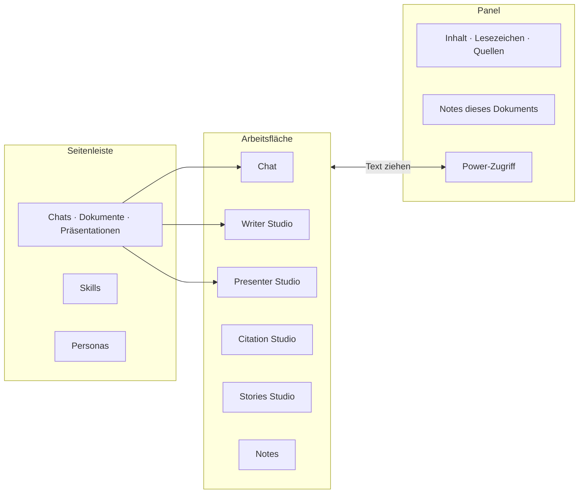
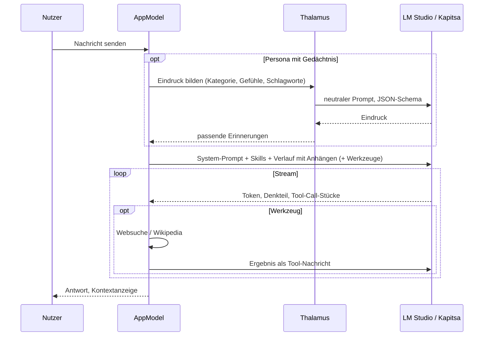
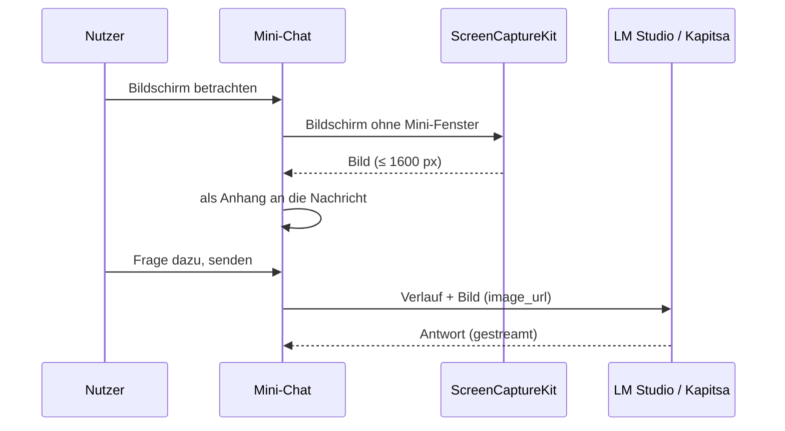
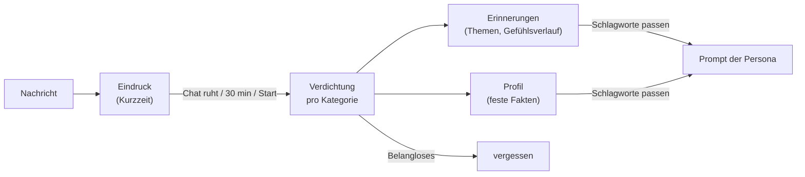
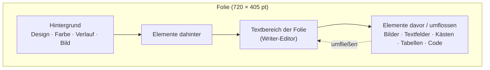
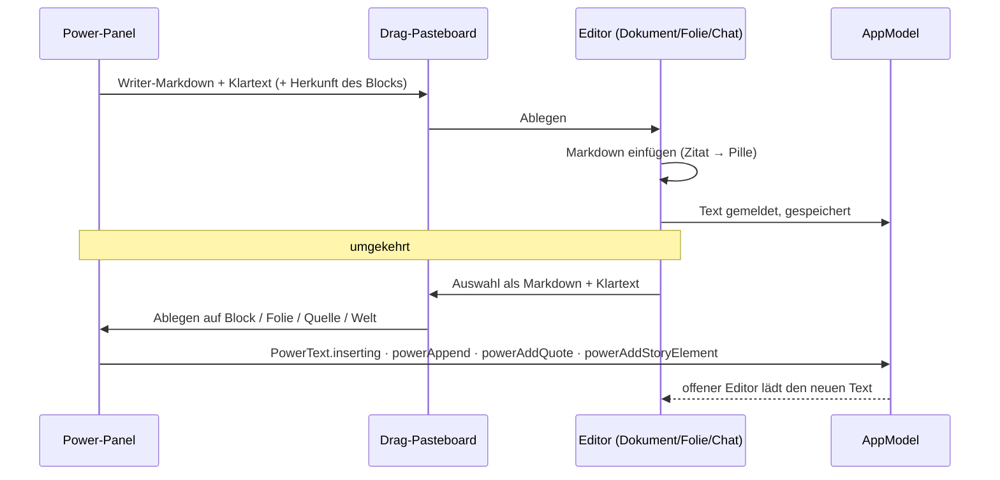

# Funktionsweise

[← Übersicht](index.md) · [Architektur](architektur.md) · [Code-Führer](code.md) · [Speicherformate](speicherformate.md)

Das Fenster hat drei Bereiche: links die **Seitenleiste** (Chats, Dokumente, Präsentationen in Ordnern; Skills; Personas), in der Mitte die **Arbeitsfläche** (Chat oder eine der Anwendungen), rechts ein **Panel** (Inhaltsverzeichnis, Lesezeichen, Quellen – oder der Power-Zugriff). Wird das Fenster schmal, klappen die Seitenleisten weg und legen sich bei Bedarf über den Inhalt.

## Neu anlegen

Das Stift-Symbol oben in der Seitenleiste (und in den Titelleisten, wenn die Seitenleiste zu ist) öffnet ein Menü: **Neuer Chat** und alle Applikationen – Writer Studio (neues Dokument), Citation Studio, Presenter Studio (neue Präsentation), Stories Studio und Notes. Darunter „Präsentation aus Dokument …“.

**Ordner** haben eine zweite Ebene: „Neuer Unterordner“ im Menü eines Ordners, oder einen Ordner auf einen anderen ziehen. Ein Unterordner, der nach draußen gezogen wird, kommt wieder nach oben. Löscht man einen Unterordner und behält den Inhalt, wandert er in den Ordner darüber.

Was in keinem Ordner liegt, steht normal nach Datum. Das Stapel-Symbol neben der Suche schaltet auf **automatisches Stapeln** (eigenes Symbol, kein Ordner; nichts lässt sich hineinziehen):

- **Nach Typen**: Dokumente, Präsentationen und Chats getrennt.
- **Nach Relevanz**: „Gerade in Arbeit“ (an drei Tagen der letzten zwei Wochen oder zwei der letzten drei geöffnet oder geändert), „Ab und zu“ (letzter Monat), „Ruht seit Wochen“ (bis ein halbes Jahr), „Seit Ewigkeiten unberührt“.
- **Nach Themen**: Das Modell sortiert nach Inhalt (Titel und ein kurzer Anfang). Es läuft im Leerlauf – drei Minuten ohne Eingabe am Mac, kein anderer Auftrag, höchstens alle 15 Minuten – und sortiert dann nur Neues ein; „Jetzt aufräumen“ und „Alle Themen neu bilden“ stehen im Menü. Ein Themenstapel lässt sich umbenennen oder als echter Ordner anlegen.

Fenster → **Action-Katalog für Agenten** (auch unter Einstellungen → Terminal und Agenten) listet alle Actions nach Modul, mit Suche, Parametern, A/B/Wirkung und dem `llmd`-Aufruf. Er führt nichts aus.

## Chat

- Antworten werden gestreamt (`/v1/chat/completions` mit `include_usage`), Denkprozesse (Gemma `<|think|>`, Qwen `enable_thinking`) aufklappbar angezeigt.
- **Skills** sind Bausteine des System-Prompts; pro Chat beliebig kombinierbar.
- **Web- und Wikipedia-Suche** sind Werkzeuge (Tool Calls), pro Chat einschaltbar, nie automatisch.
- **Kontextlänge** (8K/16K/32K) pro Chat; die App lädt das Modell bei Bedarf mit der passenden Länge neu.
- **Inhaltsverzeichnis** und Lesezeichen des Chats rechts; Abzweigen, Fragen bearbeiten, Folgefragen, Bilder, Formeln, PDF-Export.
- **Dokumente als Anhang** (Büroklammer, ⇧⌘A, Einfügen oder Ziehen): PDF, Word, RTF, OpenDocument, HTML und Text. Ein PDF wird Seite für Seite gelesen, Seiten ohne Text (Scans) erkennt die App selbst. Abbildungen schneidet sie aus und setzt an ihre Stelle einen Platzhalter mit Bildunterschrift; „Abbildungen beschreiben“ lässt ein Modell, das Bilder versteht (Gemma 4, Qwen 3.5 in Kapitsa), jede einmal beschreiben, danach geht die Beschreibung als Text mit. Eine einzelne Abbildung lässt sich mit der nächsten Frage als Bild mitschicken. Der Chip zeigt Seiten und Tokens; ist ein Dokument länger als gut ein Drittel des Kontexts, kommt nur der Anfang mit, und das Modell liest den Rest mit `search_files`/`read_file` nach.
- **Code-Blöcke** stehen in einem eigenen Textfeld, das beim Streamen nur anhängt; die Antwort liest den Strom abseits des Main Threads (`StreamRound`), sodass sie auch bei langem Code mit dem Modell Schritt hält.
- **Gesprächsmodus**: Diktat (Apple SpeechTranscriber) und Sprachausgabe (Qwen TTS) im Wechsel.

## Mini-Chat und „Bildschirm betrachten“

Ein Chat lässt sich in einem eigenen, schmalen Fenster öffnen (400 pt wie der Power-Zugriff): über das Bild-im-Bild-Symbol in der Titelleiste des Chats, „Im Mini-Chat öffnen“ im Kontextmenü der Seitenleiste, **Neuer Mini-Chat** im Neu-Menü oder ⇧⌘M. Das Fenster ist unabhängig vom Hauptfenster: eigener Chat, eigenes Eingabefeld, eigenes Senden – im Hauptfenster kann man derweil weiterarbeiten. Die Stecknadel hält es vor allen Fenstern, auch vor anderen Apps. Oben steht der Titel des Chats (daran lässt sich das Fenster ziehen); daneben startet man einen neuen Chat oder öffnet ihn im Hauptfenster. Andere Chats holt man über die Seitenleiste ins Mini-Fenster. Solange das Mini-Fenster vorne ist, wirken Stoppen (⌘.), Neu generieren, Denkmodus, Bilder anhängen und Diktieren auf seinen Chat.

**Bildschirm betrachten** (⇧⌘B oder der Knopf im Mini-Chat) nimmt den Bildschirm auf, auf dem der Mini-Chat steht – ohne das Mini-Fenster und ohne Mauszeiger – und hängt das Bild an die nächste Nachricht (höchstens 1600 Pixel, wie alle Bilder). Modelle mit Bildverständnis (Gemma 4, Qwen 3.5) sehen dann, woran man arbeitet. Bei mehreren Bildschirmen wählt ein Rechtsklick den Bildschirm. Die Aufnahme läuft über ScreenCaptureKit und braucht die Erlaubnis „Bildschirm- & Systemaudioaufnahme“ in den Systemeinstellungen; die App ist ad hoc signiert, darum vergisst macOS diese Erlaubnis nach jedem Neubau.

## Menüleiste und Suchleiste

Ein Symbol in der Menüleiste (Zauberstab) startet ohne Umweg über das Fenster: Suchleiste, neuer Chat, neues Dokument, Präsentation (neu oder eine der zuletzt bearbeiteten), Zitat erfassen, Stories Studio, Mini-Chat, Gespräch und Bildschirmfoto in den Mini-Chat. Die App läuft weiter, wenn das letzte Fenster geschlossen ist; beendet wird sie über das Symbol oder ⌘Q.

Die **Suchleiste** erscheint mit ⌥ Leertaste vor jeder App, wie Spotlight, ohne LLM Designer nach vorne zu holen. Darin chattet man oder gibt einen Auftrag („Erstelle eine Präsentation über …“), getippt oder diktiert (Mikrofon im Feld). Hinter dem Feld wandert sanft etwas Farbe, während das Modell arbeitet etwas heller und schneller, dazu ein feines Licht an der Unterkante. Das bewegt Core Animation im Render-Server (`AuroraView`), die App rechnet dafür nichts; mit „Bewegung reduzieren“ steht es still. Am freien Rand und an der Fußzeile lässt sich die Leiste verschieben, sie öffnet dann dort wieder, solange die App läuft. Escape oder ein Klick daneben schließt sie; Antworten und Aufträge laufen weiter und stehen beim nächsten Öffnen da. Nach zehn Minuten ohne Benutzung beginnt sie mit einem neuen Chat, der Besen (⌘N) leert sie jederzeit; ⌘O öffnet den Chat im Hauptfenster. Ihre Chats stehen wie alle anderen in der Seitenleiste.

Die Chats der Suchleiste dürfen alles ohne Rückfrage („Auch Löschen und Export erlauben“), dazu Web und Wikipedia. Was die Sicherheitsregel verlangt, fragt trotzdem: private Daten, und Änderungen oder Export, nachdem der Lauf fremde Inhalte gelesen hat. Mitgeschickt werden nur die Werkzeuggruppen, die der Auftrag nennt (`QuickBarTools`: Dokument, Präsentation, Quelle, Roman …; „erstelle“ ohne Ziel heißt Writer). Alle Gruppen zusammen sind rund 60 Beschreibungen, die ein 9B-Modell auf diesem Mac über eine Minute lesen würde, auch vor „Hallo“. Gruppen, die eine spätere Frage nennt, kommen dazu und bleiben. Der Chat bekommt mindestens 32K Kontext.

Tastenkürzel und Ein/Aus stehen in den Einstellungen unter „Suchleiste“ und liegen in der Bibliothek. Das Kürzel ist ein Carbon-Hotkey (`GlobalHotKey`): keine Bedienungshilfen-Erlaubnis nötig, aber ⌘, ⌥ oder ⌃ müssen dabei sein. Ist die Kombination schon von einer anderen App belegt, sagen es die Einstellungen.

## Personas und Gedächtnis (Thalamus)

Eine Persona hat Profilbild, Beschreibung und eigene Dateien. Mit eingeschaltetem **Thalamus** ordnet ein neutraler Modellaufruf jede Nachricht ein (Kategorie, bis zu drei Gefühle je Seite mit Stärke, Merkwürdigkeit). Wenn der Chat ruht, werden die Eindrücke pro Kategorie zu **Erinnerungen** und einem **Profil** verdichtet; passende Erinnerungen fließen in spätere Antworten ein.

## Writer Studio

Ein WYSIWYG-Textverarbeitungsprogramm auf Markdown-Basis:

- Formatierung: Schriften, Größen, Farben, fett/kursiv/unterstrichen/durchgestrichen, hoch- und tiefgestellt, Code, Ausrichtung, Einzüge, Zeilenabstand.
- Struktur: Kapitel, Überschriften, Listen, Zitate, Trennlinien, Seitenumbrüche, Inhaltsverzeichnis (formal oder dynamisch von der KI), Lesezeichen, Kommentare, Fußnoten (⌥⌘F; im Editor eine hochgestellte Nummer, im PDF unten auf der Seite).
- Objekte: Bilder (auch von Draw Things generiert), Tabellen mit **Formeln** (SUMME, MITTELWERT …), Sortieren und Diagrammen, Formeleditor mit Plots (Python/matplotlib), Zeichnungen, Mermaid-Diagramme, Kästen (Definition, Merksatz …) mit Textumfluss, zweispaltige Abschnitte, Code mit Hervorhebung und Flussdiagrammen (Python/SQL).
- Seitenformate DIN A4, Taschenbuch, Normseite, eigene Formate, Kopf- und Fußzeilen.
- **KI im Dokument**: eine Eingabeleiste mit eigenem KI-Cursor (schreiben, umformulieren, ausformulieren, Fragen beantworten), Rechtschreib- und Plausibilitätsprüfung, Inhaltsanalyse mit Mermaid-Diagrammen.
- Audio: Diktat ins Dokument, Vorlesen mit Hervorhebung.
- Export: PDF (über LaTeX/Tectonic), `.tex`, Markdown, Drucken.
- **Code-Ansicht** (Reiter „Code“): das Markdown des Dokuments zum Bearbeiten (Änderungen gehen direkt ins Dokument) und das LaTeX des PDFs mit Vorschau. Das LaTeX lässt sich von Hand korrigieren und setzen (⌘↩); diese Änderungen gelten nur für das so gesicherte PDF, das Dokument bleibt, wie es ist. Meldet LaTeX einen Fehler, springt ein Knopf zur Zeile.

## Presenter Studio

Präsentationen sind Dokumente einer eigenen Art: jede Folie hat Text (derselbe Editor wie Writer), eine Rolle (Titel-, Kapitel-, Inhaltsfolie), einen Hintergrund (17 CSS-Designs, Farbe, Verlauf, Draw-Things-Bild) und eine Moderatorenkarte.

- **Alles aus Writer**: hoch-/tiefgestellt, durchgestrichen, Code im Text, Tabellen mit Formeln (die Formelleiste steht über der Folie), Diagramme, Zeichnungen, Mermaid, Formeln, Zitate.
- **Frei verschiebbar**: Bilder, **Textfelder**, **Kästen**, **Tabellen**, **Code** und Abbildungen liegen als eigene Elemente auf der Folie. Ein Klick wählt, Ziehen verschiebt (mit Einrasten an Mitte und Rändern), die Ecken ändern die Größe, ein **Doppelklick öffnet ein Textfeld zum Schreiben** – der Editor wandert dann in das Feld, die Werkzeugleiste wirkt dort. Esc kehrt zum Folientext zurück. Jedes Element kann den Text umfließen lassen, davor oder dahinter liegen.
- **Textbox** (Symbol in der Werkzeugleiste, Einfügen → „Textbox auf der Folie“, ⌥⌘T): ein freies Textfeld, sofort zum Schreiben offen, mit der Maus verschieb- und skalierbar.
- **Leere Folie** (Pfeil neben „+ Folie“ oder Kontextmenü der Folienliste): ohne Hinweis „Folientitel“, für Bilder und freie Elemente. Auf einer leeren Folie nimmt Löschen (⌫) den Hinweis weg; das Kontextmenü holt ihn zurück. Präsentation, PDF und Folienliste zeigen den Hinweis nie.
- **Bilder** lassen sich **beschneiden** (Zuschneide-Symbol: je Seite oder Format 1:1, 4:3, 3:2, 16:9, 3:4 aus der Mitte; die Datei bleibt ganz) und bekommen einen **Rahmen** (dünn, mittel, dick; weiß, schwarz, grau, gold, blau) und einen **Schlagschatten**.
- Auch der **Textbereich der Folie** selbst lässt sich verschieben und in der Größe ändern („Frei platzieren → Textbereich der Folie verschieben“).
- „Markierung als Textfeld herauslösen“ nimmt markierten Text aus der Folie und legt ihn als freies Feld ab.
- Die KI erstellt ganze Präsentationen aus einer Anweisung, schreibt Moderatorenkarten und trägt vor (Vollbild auf dem zweiten Bildschirm, Vorlesen, automatisches Weiterschalten).
- **Text passt auf die Folie**: Läuft der Text über, zeigt der Editor einen Hinweis. Agenten erfahren es im Ergebnis jeder Folien-Action (`fit`), `presenter.slides.checkFit` prüft eine ganze Präsentation, `splitOverflow` bzw. `presenter.slide.split` verteilen die Punkte auf Folgefolien „(Forts.)“. Die eigene Folienerzeugung teilt überlaufende Folien selbst.
- Export als PDF (Text bleibt Text) und Handout.

## Citation Studio

Ein persönliches Citavi: **Quellen** (Bücher, Artikel, Webseiten …) mit Zitierschlüssel und **Wissensbausteine** (wörtliche Zitate, Paraphrasen, Seiten, Schlagworte, Verknüpfungen), in Gruppen und Ordnern. Import über DOI (Crossref), ISBN (DNB, Open Library, Google Books), arXiv und Webseiten-Metadaten, mit Dublettenprüfung. In Writer und Presenter werden Zitate als Pillen eingefügt (`[@schluessel, S. 12]`); das Literaturverzeichnis entsteht automatisch im Stil APA 7 (deutsch).

## Stories Studio

Romanwelten mit Büchern → Akten → Kapiteln → Abschnitten. Jeder Teil beschreibt **Was / Mit wem / Wo / Warum / Wozu**. Die Welt verwaltet Figuren (ausführliches Profil, Szenenbuch), Orte (verschachtelt), Events (Ursachenketten, Folgen, Wissen), Reasons (Argumente mit Annahmen und Prämissen) und Purposes (literarische Funktion, Setup/Payoff). Jede Ebene hat eine Zeitleiste im Gantt-Stil.

Dazu kommen **Spezies** (Wesen der Welt: Gestalt, Fähigkeiten und Schwächen, Lebensraum mit verknüpften Orten, Kultur; Figuren gehören einer Spezies an) und **Fakten** (einfache Notizen mit Schlagworten, Bildern, Quelle und Verknüpfungen zu Figuren, Spezies, Orten und Events; die Liste durchsucht Titel, Text und Quelle; Schlagworte werden in einem Dropdown mit Mehrfachauswahl angekreuzt – auf der Faktseite zum Vergeben und Anlegen, in der Liste zum Filtern). Figuren haben einen Tab **Videocards** für kurze Videos, die in der Karte abspielen. Die Romanwelt und jedes Buch, jeder Akt, jedes Kapitel und jeder Abschnitt haben eine **Galerie**: Bilder mit kurzer Beschreibung, groß ansehbar mit Pfeiltasten. Unter „Dazugehörige Dokumente“ verknüpft man Writer-Dokumente und Präsentationen mit der Welt oder einem Teil (Recherche, Entwürfe, ein Vortrag); ein Klick öffnet sie, die Dokumente bleiben in ihren Ordnern.

Getippter Text geht zuerst in einen Entwurf und erst nach einer kurzen Pause (350 ms) in die Romanwelt; so muss das Studio nicht bei jedem Tastendruck neu gezeichnet werden. Gespeichert wird im Hintergrund. Die Textfelder wachsen mit dem Text (ohne Obergrenze, die Seite scrollt); Return beginnt eine neue Zeile, in Namen und Titeln beendet es die Eingabe; Tab springt ins nächste Feld. Kopf und Tabs einer Figur bleiben beim Scrollen stehen.

## Notes

Ein **Note** ist eine ToDo-Liste mit Titel, einer Fortschrittsanzeige und freiem Notiztext. ToDos haben beliebig tiefe **Unter-ToDos**, die sich ein- und ausklappen lassen. Der Kreis vor einem ToDo hakt es ab; ein ToDo mit Unter-ToDos zeigt im Kreis, wie weit sie sind, und ist erledigt, wenn alle erledigt sind. Gelöscht wird über das Papierkorb-Symbol oder das Kontextmenü, ⌘Z holt es zurück.

- **Tastatur wie in einem Outliner**: Return legt das nächste ToDo an (teilt den Text an der Schreibmarke), Tab rückt ein (Unter-ToDo), ⇧Tab rückt aus, ⌫ in einer leeren Zeile löscht sie, ↑/↓ wechseln die Zeile. Mehrere eingefügte Zeilen werden mehrere ToDos.
- **Verknüpfte Dokumente**: Ein ToDo („Konzept ausarbeiten“) verknüpft Writer-Dokumente und Präsentationen; das Ketten-Symbol sucht ein vorhandenes oder legt ein neues mit dem Namen des ToDos an. Ein Klick auf die Kapsel öffnet es.
- **Zwölf Fortschrittsanzeigen**, wählbar mit einem Klick auf die Anzeige: Balken, Ringe (einer je Hauptaufgabe), Glas (füllt sich, mit Strohhalm bei 100 %), Pflanze (wächst und blüht), Rakete (von der Erde zum Mond), Gipfel, Akku, Mond (Neumond bis Vollmond), Pizza, Schnecke (kriecht zum Salat), Tacho und Pixel (Ladebalken wie 1989). Ist alles erledigt, gibt es kurz Konfetti. Neue Notes nehmen die zuletzt gewählte Anzeige.

**Wo Notes erscheinen:**

| Ort | Was | Erkennbar an |
|---|---|---|
| Notes (Studio) | alle Notes, links gruppiert: Allgemein, Zu Dokumenten, Zu Romanwelten | eigenes Studio im Neu-Menü und in der Menüleiste |
| Writer, Presenter: Checklisten-Symbol in der Titelleiste | **nur die Notes dieses Dokuments**, rechts im Panel; ein kleiner Ring am Symbol zeigt ihren Stand | Pin und „Gehört zu diesem Dokument“ im Kopf |
| Stories Studio: Karte „Notes“ bei der Welt und jedem Buch, Akt, Kapitel, Abschnitt | **nur die Notes dieses Teils**, zum Aufklappen | Karte im Teil |
| Power-Zugriff, Modul „Notes“ | **alle Notes**, die des offenen Dokuments oben | Blitz und „Alle Notes“ |

Ein Note gehört dem Dokument, in dessen Panel es angelegt wurde; „Vorhandenes Note verknüpfen“ ordnet ein bestehendes zu, das Pin-Symbol mit Strich löst es wieder. Im Studio zeigt „Gehört zu“ alle Zuordnungen.

## Terminal, MCP und Werkzeuge im Chat

Die App lässt sich aus dem Terminal (`llmd`) und über MCP steuern, und der Chat kann auf Wunsch selbst in den Studios arbeiten. Heikle Schritte fragt die App nach, und jeder Schritt ist im Aktivitätsfenster und in der Antwort sichtbar. Siehe [Action-Schicht](actions.md).

## Power-Zugriff

Der Blitz in der Titelleiste (⌥⌘J) verwandelt das rechte Panel in **kompakte Miniaturversionen aller Anwendungen** – neben dem, was in der Mitte offen ist. Das Panel ist dann breiter (400 pt).

| Modul | Was es zeigt | Hinein ziehen | Heraus ziehen |
|---|---|---|---|
| Chats | Chats, Nachrichten als Blöcke | – | Antworten in Dokument oder Folie |
| Writer | Dokumente, ein Dokument als Blöcke (Überschriften, Absätze, Listen, Tabellen, Code, Kästen) | Text wird zu Blöcken an der Ablagestelle; Blöcke im Panel verschieben; „neues Dokument“ | Block mit Formatierung |
| Presenter | Präsentationen, Folien als Karten mit Miniatur und Text | auf eine Folie: unter ihren Text; „neue Folie“: erste Zeile wird Titel, der Rest Stichpunkte | ganze Folie oder einzelne Blöcke |
| Citation | Quellen, Zitate einer Quelle; DOI/ISBN-Import | Text wird ein neues Zitat; Eingabefeld mit Seite | Zitat mit Quellenangabe (im Dokument als Zitations-Pille) |
| Stories | Romanwelten, Figuren/Spezies/Orte/Events/Reasons/Purposes/Fakten | Text wird ein neues Element (erste Zeile = Name) | Name und Haupttext |
| Notes | alle Notes (die des offenen Dokuments oben), ein Note zum Abhaken | Text wird ein neues Note (Überschrift = Titel, jede Listenzeile ein ToDo); auf ein offenes Note: ToDos ans Ende | das Note als Aufgabenliste (`- [ ]`) |

Die **Suche** filtert in der Liste (Titel und Inhalt, mit Textausschnitt) und markiert im geöffneten Element die Treffer, mit Zähler und Pfeilen zum Springen. Jede Änderung aus dem Panel lässt sich unten mit **Rückgängig** zurücknehmen. Rechtsklick auf einen Block: Kopieren, **An der Schreibmarke einfügen**, Bearbeiten (Markdown), Löschen.

## Bibliotheken

Alles – Chats, Dokumente, Bilder, Personas, Gedächtnis, Skills, Zitate, Romanwelten, Notes, Einstellungen – liegt in einer **Bibliothek** (`Name.llmdlibrary`). Unten links wechselt man zwischen Bibliotheken; sie sehen nichts voneinander. Details: [Speicherformate](speicherformate.md).
