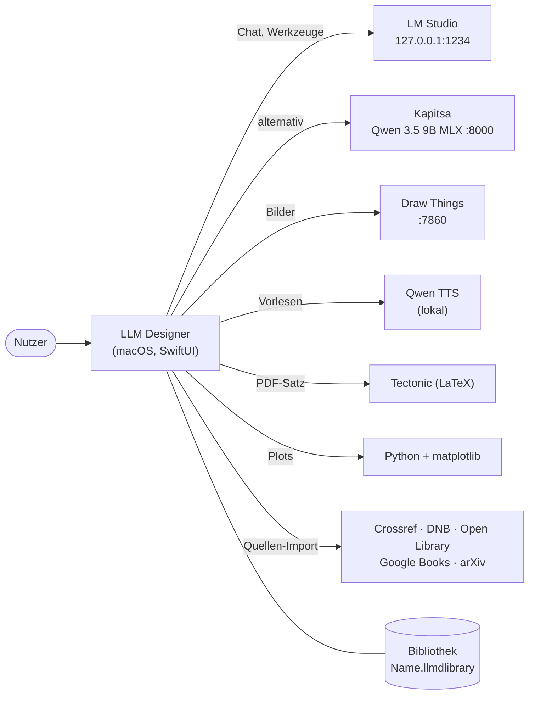

# LLM Designer – Dokumentation

LLM Designer ist eine native macOS-App (SwiftUI + AppKit), die auf lokalen Sprachmodellen aufsetzt – **LM Studio** oder **Kapitsa** – und daraus eine Arbeitsumgebung macht: ein Chat im Stil von ChatGPT, dazu eigene Anwendungen („Studios“) zum Schreiben, Präsentieren, Zitieren und Romane-Planen. Alles läuft lokal; die Daten liegen in portablen Bibliotheken.

## Inhalt

| Seite | Worum es geht |
|---|---|
| [Funktionsweise](funktionen.md) | Was die App kann: Chat, Personas und Gedächtnis, Writer, Presenter, Citation, Stories Studio, Power-Zugriff – und wie die Teile zusammenspielen |
| [Architektur](architektur.md) | Schichten, zentrale Typen, Datenflüsse, Nebenläufigkeit, Darstellung (TextKit 1, WKWebView), externe Dienste |
| [Code-Führer](code.md) | Ordnerstruktur, wo was steht, Bauen und Testen ohne Xcode, Konventionen, Fallen |
| [Speicherformate](speicherformate.md) | Aufbau einer Bibliothek, Markdown-Erweiterungen, Präsentationen, Zitate, Romanwelten |
| [Action-Schicht](actions.md) | Registry, Sicherheitsregeln, Terminal-Werkzeug `llmd`, MCP |
| [Plan: Action-Schicht](plan/Implementierungsplan.md) | Implementierungsplan mit Fortschritt, [Sicherheitskonzept](plan/Sicherheitskonzept-Prompt-Injection.md), [CLI](plan/CLI-Konzept.md), [MCP](plan/MCP-Schicht.md), Kataloge: [Writer](plan/WriterStudio-Actions.md), [Presenter](plan/PresenterStudio-Actions.md), [Citation](plan/CitationStudio-Actions.md), [Stories](plan/StoriesStudio-Actions.md), [Chat](plan/Chat-Actions.md) |

## Auf einen Blick

- **Native App ohne Xcode-Projekt**: Swift Package (Swift 6, Sprachmodus 5), gebaut mit den Command Line Tools über `scripts/build-app.sh`.
- **Hell, dunkel oder wie das System**: Das Design ist in den Einstellungen wählbar.
- **Lokale Modelle**: Haupt-Modelle sind Gemma 4 E4B und Qwen 3.5 9B (beide mit Tool-Aufrufen). Die App liest aus dem Stream, welches Modell wirklich antwortet.
- **Bibliotheken statt Application Support**: Jede Bibliothek ist ein Paket `*.llmdlibrary` mit allen Daten und Einstellungen – kopierbar, verschiebbar, auf externen Laufwerken nutzbar.
- **Markdown als Speicherformat** für Dokumente und Präsentationen, mit Pandoc-kompatiblen Erweiterungen (Divs, Spans, Zitationen).

> Diese Seiten rendern ihre Diagramme direkt auf github.com (GitHub kennt Mermaid in Markdown). Für GitHub Pages lädt das Layout in `docs/_layouts/default.html` mermaid.js nach, weil der Jekyll-Build von Pages Mermaid nicht von selbst zeichnet.
