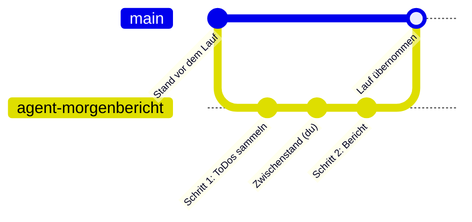

# AgentSteps

_Von Claude Code · Stand: 15.11.2026 · Branch `feature/agentsteps` · Grundlage: [Epics](Epics.md) (E1 Agentenzentrale), [Sicherheitskonzept](Sicherheitskonzept-Prompt-Injection.md)_

AgentSteps ist das Modul, in dem du agentische Aufgaben definierst, zeitlich einstellst und beobachtest. Es hat ein eigenes Dashboard (Seitenleiste → Neu → AgentSteps) und einen eigenen Reiter im Power-Zugriff, neben den Tools.

## 1. Was du damit tust

- **Aufgabe beschreiben:** im Chat („Fasse mir werktags um 7:30 meine offenen ToDos zusammen und schick den Mac danach schlafen“). Das Modell macht daraus einen Entwurf mit Schritten, Werkzeugen und Zeitplan; du speicherst, startest oder baust ihn im Baukasten weiter.
- **Aufgabe zusammenklicken:** im Baukasten aus Bausteinen. Ein **KI-Schritt** ist ein Auftrag in Worten mit einer kleinen Werkzeugauswahl; ein **Action-Schritt** ist eine Action aus dem Katalog mit festen Parametern, die ohne Modell genau das tut.
- **Zeitplan:** nur von Hand, einmalig, täglich, an Wochentagen oder im Abstand (ab 5 Minuten). Verpasste Zeiten holt die App auf Wunsch einmal nach.
- **Beobachten:** Das Terminal unten im Dashboard und im Power-Zugriff zeigt, was die Agenten gerade tun. Ein Lauf hat eine Zeitleiste in Sätzen, seine Ergebnisse, seinen Branch und „Zurücknehmen“.
- **Eingreifen:** Anhalten, Fortsetzen, Abbrechen je Lauf oder „Alle anhalten“. Im Chat wirken „halt an“, „weiter“ und „brich ab“ (Abbrechen mit Bestätigung).

## 2. Entscheidungen

| Frage | Entscheidung | Von |
|---|---|---|
| Wo liegen die Daten? | `AgentSteps/Aufgaben/<id>.json` in Git, `AgentSteps/Protokolle/<id>.json` außerhalb von Git | Person, 15.11. |
| Was passiert mit dem Branch am Ende? | Automatisch übernehmen (Merge-Commit), Zurücknehmen per Klick | Person, 15.11. |
| Wie viele Läufe zugleich? | einer; die übrigen warten in der Schlange | Claude: ein Modell, eine Arbeitskopie |
| Wer hat das Modell? | Die Person: Antwortet ein Chat (oder der Planungs-Chat), wartet der Lauf vor seiner nächsten Modellrunde | Claude, nach dem Wunsch „Chats können die Aktivität pausieren“ |
| Wer beantwortet Fragen eines Laufs? | nur die Oberfläche (Dashboard, Power-Zugriff); keine Action, kein Kanal | E1.3 |
| Neuer Kanal | `agent` mit eigener Stufe in den Einstellungen (lesen erlaubt, schreiben fragen, destruktiv fragen); die Aufgabe stellt standardmäßig „Änderungen erlauben“ ein | Claude |

## 3. Datenformat

```
Name.llmdlibrary/
└── AgentSteps/
    ├── Aufgaben/<id>.json     die Definition (in Git)
    └── Protokolle/<id>.json   ein Lauf mit Schritten und Protokoll (nicht in Git)
```

```json
{ "format": 1, "aufgabe": {
  "id": "…", "titel": "Morgenbericht", "ziel": "Überblick über offene ToDos",
  "schritte": [
    { "id": "…", "art": "agent", "titel": "ToDos sammeln", "auftrag": "Lies alle Notes …",
      "werkzeuge": ["notes.core"], "runden": 12, "nachdenken": false, "beiFehler": "abbrechen" },
    { "id": "…", "art": "action", "titel": "Dokument anlegen", "action": "writer.doc.create",
      "parameter": { "title": "Bericht {{heute}}", "markdown": "{{schritt1.satz}}" }, "beiFehler": "abbrechen" }
  ],
  "zeitplan": { "art": "woechentlich", "uhrzeit": "07:30", "wochentage": [1,2,3,4,5], "alleMinuten": 60,
                "zeitpunkt": null, "nachholen": true, "aktiv": true, "seit": "2026-11-15T20:00:00Z" },
  "optionen": { "freigabe": "allowWrites", "branch": true, "danachRuhezustand": true, "modell": null },
  "herkunft": "eigen", "angelegt": "…", "geaendert": "…" } }
```

```json
{ "format": 1, "lauf": {
  "id": "…", "aufgabe": "…", "titel": "Morgenbericht", "ziel": "…", "anlass": "zeitplan",
  "zustand": "fertig",   // wartet | laeuft | pausiert | frage | fertig | fehler | abgebrochen | unterbrochen | zurueckgenommen
  "plan": [ … die Schritte, wie sie beim Start waren … ],
  "schritte": [ { "id": "…", "titel": "…", "zustand": "fertig", "satz": "12 offene ToDos gefunden …",
                  "ausgabe": { "id": "…", "title": "…" }, "aufrufe": [ { "action": "notes.note.list", "ziel": null, "ok": true } ],
                  "runden": 3, "commit": "…", "gestartet": "…", "beendet": "…" } ],
  "ergebnisse": [ { "art": "writer", "id": "…", "titel": "Bericht 16.11.2026" } ],
  "frage": null, "pause": null, "fehler": null,
  "branch": "agent/morgenbericht-1a2b3c4d", "ausgangsbranch": "main", "ausgangscommit": "…", "mergecommit": "…",
  "fremd": false, "sensibel": false,
  "protokoll": [ { "zeit": "…", "art": "git", "text": "Branch agent/… angelegt" } ],
  "angelegt": "…", "gestartet": "…", "beendet": "…", "geaendert": "…" } }
```

Wie im Aktivitätsprotokoll stehen **keine Inhalte** im Lauf: Titel, IDs, Sätze und Verweise. „ausgabe“ nimmt nur kurze Werte (höchstens 200 Zeichen). Es bleiben die letzten 120 Läufe; ihre Commits bleiben in Git.

**Platzhalter** in Action-Parametern: `{{schritt2.id}}`, `{{schritt2.title}}`, `{{schritt2.satz}}`, `{{vorher.id}}`, `{{ziel}}`, `{{heute}}` (TT.MM.JJJJ), `{{jetzt}}`, `{{datum}}` (JJJJ-MM-TT). Ein Text, der nur aus einem Platzhalter besteht, übernimmt den Wert mit seinem Typ.

## 4. Git: ein Branch pro Lauf



1. Offene Änderungen kommen als „Stand vor dem Lauf“ in einen Commit; dann wechselt die Bibliothek auf `agent/<titel>-<kurz-id>`. Die Dateien bleiben, wie sie sind.
2. Nach jedem Schritt ein Commit mit den Trailern `Auftrag: <Titel> (<kurz-id>)`, `Schritt: n/m`, `Lauf: <id>`, Autor „AgentSteps“. Das Git Studio zeigt sie mit dem CPU-Symbol.
3. Was du während eines Laufs änderst, bekommt vor dem nächsten Schritt einen eigenen Commit ohne Trailer. So nimmt „Zurücknehmen“ nur den Lauf zurück.
4. Am Ende ein Merge-Commit in den Ausgangsbranch, **ohne eine Datei anzufassen** (`commit-tree` + `update-ref`): Der Ausgangsbranch hat sich nicht bewegt, solange die Bibliothek auf dem Branch des Laufs stand. Nichts lädt neu. Hat er sich doch bewegt (Terminal), bleibt die Bibliothek auf dem Branch, und das Dashboard bietet „Übernehmen und beenden“ (normales Zusammenführen).
5. **Zurücknehmen:** `git revert --no-commit` aller Schritt-Commits und ein Commit „Lauf … zurückgenommen“. Kollidiert das mit späteren Änderungen, passiert nichts.
6. Der Lauf liest zwischen den Schritten keinen Verlauf: Der nächste Schritt bekommt einen Satz je erledigtem Schritt. Der Zwischenstand liegt in Git, darum kann ein unterbrochener Lauf nach einem Neustart beim ersten offenen Schritt weitermachen.

Ohne Git läuft eine Aufgabe ohne Branch; Zurücknehmen geht dann nicht.

## 5. Gebaut für Qwen 3.5 9B

- **Die App führt den Plan, nicht das Modell.** Jeder KI-Schritt beginnt mit frischem Kontext: Ziel, je erledigtem Schritt ein Satz, was angelegt wurde (mit IDs), sein eigener Auftrag.
- **Wenige Werkzeuge:** die gewählten Gruppen (Minimalsätze wie im Chat), Schemas ohne `range` und `ifVersion`, dazu `schritt_fertig(ergebnis, erfolg)`. Agenten-Actions und private Daten sind nie Werkzeuge.
- **Regeln als nummerierte Liste** im System-Prompt, Temperatur 0,2, höchstens drei Aufrufe pro Runde, Ergebnisse höchstens 4 000 Zeichen, ältere Ergebnisse weichen, wenn der Kontext voll wird.
- **Werkzeugaufrufe im Text** (`<tool_call>{…}</tool_call>` und `<function=…><parameter=…>`) werden gelesen und ausgeführt.
- **Parametertypen:** Was das Modell als Text schickt (`"general": "true"`, `"position": "3"`, ein einzelner Text statt einer Liste), wird vor der Registry an das Schema angeglichen; unbekannte Parameter fallen weg, und das Ergebnis sagt es. Die Registry prüft danach unverändert.
- **Übergabe:** `schritt_fertig` verlangt die Dinge selbst, nicht ihre Anzahl. Enthält das Ergebnis keine Aufzählung und ist der Text der letzten Runde deutlich länger, geht dessen Ende (höchstens 800 Zeichen) mit an die nächsten Schritte.
- **Fehler mit Hilfe:** Passen Parameter nicht, bekommt das Modell die Liste der erwarteten Parameter; ein unbekanntes Werkzeug nennt die vorhandenen; dreimal derselbe Aufruf beendet den Schritt.
- **Antwortet es in Prosa,** wird es einmal an die Werkzeuge erinnert; danach gilt der Text als Ergebnis.
- **Der Planungs-Chat** antwortet mit JSON nach Schema (`response_format`), der Plan zuerst, der Satz an dich zuletzt. **Zeitangaben** liest die App selbst aus deinen Worten („jeden Freitag um 17 Uhr“, „werktags 7:30“, „alle 2 Stunden“, „morgen um 9“, „am 20.11. um 8“), ebenso „danach schlafen“; die Wahl des Modells zählt nur, wenn diese Regeln nichts finden.

### Probe mit dem echten Qwen 3.5 9B (Kapitsa, 15.11.2026)

| Was | Ergebnis |
|---|---|
| Aufgabe „ToDo-Bericht“ (Notes lesen → Dokument schreiben), 2 KI-Schritte | fertig in 83 s, Branch, Commit für Schritt 2, Merge nach `main` ohne Neuladen |
| Falscher Parametertyp im ersten Aufruf | 1. Lauf: nach der Fehlermeldung ohne Parameter erneut versucht; jetzt angeglichen |
| Übergabe zwischen den Schritten | 1. Lauf: nur Anzahlen übergeben, Schritt 2 schrieb „ToDo 1, ToDo 2“; 2. Lauf (neue Beschreibung von `schritt_fertig`): Dokument mit „Brot, Äpfel / Statistik Übung 3, Hausarbeit Gliederung“ |
| Planungs-Chat „Jeden Freitag um 17 Uhr … danach schlafen“ | 22–52 s; Schritte brauchbar, Zeitplan vom Modell „stündlich“ → jetzt aus den Worten „Fr um 17:00“; ein erfundener Aufräum-Schritt → Regel im Prompt |

## 6. Sicherheit

- Kanal `agent`; die Rule of Two gilt unverändert. Fragen landen im Eingang des Laufs (`ActionApproval.agentPresenter`), nicht in einem Dialog; nach 24 Stunden gelten sie als abgelehnt, der Lauf hält an.
- Ein Agent kann keine Agenten-Actions aufrufen (kein `agents.*`, weder als Werkzeug noch als Action-Schritt).
- Aufgaben, die ein Chat oder ein MCP-Client schreibt, sind `herkunft: fremd`: Ihre Läufe starten als fremd und fragen vor jeder Änderung. Die Freigabestufe einer Aufgabe stellt nur die Person ein (Oberfläche oder Terminal).
- Einen Lauf aus einem Chat oder über MCP zu starten oder fortzusetzen, fragt immer.
- Websuche und Seiten nach den Regeln des Chats: Adressen nur aus dem Auftrag oder den Suchergebnissen des Laufs; hat der Lauf private Daten gelesen, fragt er vorher.

## 7. Wach bleiben und schlafen

- Solange ein Lauf arbeitet, hält die App eine `ProcessInfo`-Aktivität (kein Ruhezustand bei Untätigkeit, kein App Nap). Der Bildschirm darf dunkel werden; den Deckel zuzuklappen schickt einen MacBook trotzdem schlafen.
- „Danach Ruhezustand“: Nach einem fertigen Lauf wartet die App 60 Sekunden (Leiste „Wach bleiben“). Wartet ein weiterer Lauf oder hat jemand den Mac benutzt, schläft er nicht. Sonst `pmset sleepnow`.
- Zeitpläne laufen, solange die App offen ist. Wecken zu einer Uhrzeit bräuchte Administratorrechte (`pmset schedule wake`) und ist nicht eingebaut.

## 8. Actions

`agents.status`, `agents.catalog`, `agents.task.list|read|create|update|delete`, `agents.step.add|remove|move`, `agents.schedule.set`, `agents.run.start|list|read|pause|resume|cancel|undo`, `agents.approvals.list` (nur lesen), `agents.halt`, `agents.plan` (Entwurf, legt nichts an). MCP-Profil `agents`.

## 9. Fortschritt

| Baustein | Stand | Datum |
|---|---|---|
| Datenmodell, Zeitplan, Speichern | fertig, getestet | 15.11.2026 |
| Runner: Warteschlange, Pausen, Fragen-Eingang, Wachhalten, Ruhezustand | fertig, getestet | 15.11.2026 |
| Git: Branch pro Lauf, Commit pro Schritt, Übernehmen ohne Neuladen, Zurücknehmen | fertig, getestet | 15.11.2026 |
| KI-Schritte für Qwen 9B, Textaufrufe, Planungs-Chat | fertig, mit `FakeLLMServer` getestet und mit echtem Qwen 3.5 9B geprobt (siehe 5) | 15.11.2026 |
| Dashboard, Baukasten, Terminal, Power-Reiter | gebaut, als Bild geprüft (offscreen gerendert); nicht von Hand geklickt | 15.11.2026 |
| 21 Actions mit Tests über die Registry | fertig; `llmd agents …` gegen die laufende App geprobt | 15.11.2026 |

**Offen:** Klicktest der Oberfläche in der laufenden App; Probe über LM Studio (Kapitsa ist geprobt); Chat-Läufe mit Werkzeugen als Lauf im Dashboard (E1.2 für Chat und MCP); eine Modell-Warteschlange für alle Modellaufrufe (E1.1); Frage als Karte im auslösenden Chat.
