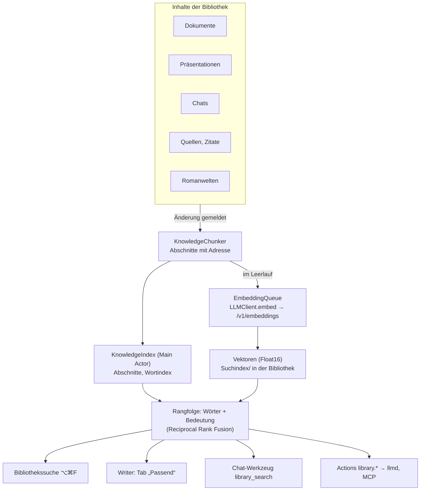

# Implementierungsplan: Bibliothekswissen – Suche nach Bedeutung und „Bibliothek fragen“

_Vorschlag von Claude Code · Stand: 07.11.2026 · Basis-Commit: `60354a5`_
_Status: **zur Entscheidung**. Gebaut wird erst nach deinem Ja._

---

## 1. Warum

Die Bibliothek ist inzwischen groß und vielseitig: Dokumente, Präsentationen, Chats, Quellen mit Zitaten, Romanwelten. Finden kann man darin aber nur **pro App** und nur **nach Wortlaut**:

| Wo | Wie heute gesucht wird | Code |
|---|---|---|
| Seitenleiste | „Chats durchsuchen“, Titel | `SidebarView.swift:47` |
| Chats | Teilwort, erster Treffer je Nachricht | `chat.search` → `PowerText.snippet` |
| Citation Studio | Filter mit `#tag @autor 2021 typ:buch` | `citation.search`, `CitationLibrary.search` |
| Stories Studio | Namen und Texte einer Welt | `stories.element.search` |
| Persona-Dateien | eine kleine BM25-Rangfolge | `PersonaFileTools.search` |
| Writer-Dokumente | nur im offenen Dokument (⌘F) | `DocumentFind.swift` |

Es fehlt:

- **Eine Suche über alles.** „Wo hatte ich das mit der Falsifizierbarkeit?“ kann in einem Dokument, einer Folie, einem Chat oder einem Zitat stehen.
- **Suche nach Bedeutung.** „Wie entstehen Wolken?“ findet „Kondensation von Wasserdampf …“ nicht, weil kein Wort übereinstimmt.
- **Die eigenen Modelle kennen die Bibliothek nicht.** Gemma (8K) und Qwen (32K Arbeitsbudget, langsames Prefill) können nicht ganze Dokumente lesen. Sie brauchen die drei passenden Absätze, nicht 40 Seiten. Genau das ist die Stärke einer Suche vor der Antwort (Retrieval).
- **Belege beim Schreiben.** In Writer muss man das passende Zitat heute selbst im Citation Studio suchen.

Das Feature ist Infrastruktur: Chat, Writer, `llmd`/MCP und später Learning Studio, Chatbook und Thalamus bauen darauf auf.

---

## 2. Was du bekommst

1. **Bibliothekssuche** (⌥⌘F, frei): ein Fenster wie Spotlight über die ganze Bibliothek. Treffer nach Art gruppiert (Dokumente, Folien, Chats, Zitate, Quellen, Romanwelt), mit Ausschnitt und markierten Wörtern. Ein Klick springt **an die Stelle**: Absatz im Dokument, Folie, Nachricht im Chat, Zitat, Figur.
2. **„Bibliothek fragen“ im Chat**: ein Knopf neben Web und Wikipedia (Buch-Symbol), pro Chat, **aus als Vorgabe**. Das Modell sucht selbst, liest die Treffer und antwortet mit Verweisen `[1]`, die anklickbar zur Stelle führen.
3. **„Passend“ im Writer**: ein neuer Tab im rechten Panel (neben Inhalt, Lesezeichen, Quellen, Kommentare). Er zeigt zum Absatz an der Schreibmarke passende Zitate aus dem Citation Studio und ähnliche Stellen aus anderen Dokumenten. Ziehen fügt ein Zitat als Pille ein, wie aus dem Quellen-Tab.
4. **Actions** für Terminal, MCP und Persephone: `library.search`, `library.related`, `library.index.status`, `library.index.rebuild`.
5. **Einstellungen → „Suche und Wissen“**: ein/aus, Bedeutungssuche mit welchem Modell (oder nur Wörter), was in den Index kommt, Stand des Index, „Neu aufbauen“.

**Nicht-Ziele:** Persona-Dateien und Thalamus-Gedächtnis im Index (bleiben privat), Suche im Web, automatisches Umschreiben von Texten, Thalamus-Abruf über Vektoren (später, eigener Schritt), Themenstapel über Vektoren (später).

---

## 3. Gemessen vorab (07.11.2026, dieser Mac)

| Was | Ergebnis | Folgerung |
|---|---|---|
| Apple `NLEmbedding.sentenceEmbedding(.german)` | da, 640 Dimensionen; „Wolken entstehen …“ vs. „Kondensation …“ Abstand 0,95, vs. „Steuererklärung …“ 1,15 | trennt kaum |
| Apple `NLContextualEmbedding(.german)`, gemittelt | Kosinus 0,85 (passend) vs. 0,80 (unpassend), 79 ms für 5 Sätze | trennt kaum, als Hauptsignal untauglich |
| LM Studio | `nomic-embed-text-v1.5` ist mitgeliefert (`~/.lmstudio/.internal/bundled-models`) | sofort nutzbar, aber vor allem Englisch |
| Kapitsa | `kapitsa serve --help` nennt keine Embeddings | Bedeutungssuche über LM Studio, auch in Kapitsa-Bibliotheken |

**Empfehlung:** Wortsuche immer (ohne Modell, sofort), Bedeutungssuche über `/v1/embeddings` von LM Studio. Für Deutsch ein mehrsprachiges Modell, z. B. Qwen3-Embedding 0.6B (rund 0,6 GB). Welches, entscheidet die Messung in Phase 0.

---

## 4. Aufbau



### Neue Dateien (Vorschlag)

| Datei | Inhalt |
|---|---|
| `Core/Knowledge/KnowledgeChunk.swift` | Abschnitt: Art, Adresse, Titel, Text, Herkunft, Inhalts-Hash |
| `Core/Knowledge/KnowledgeChunker.swift` | zerlegt jede Art in Abschnitte |
| `Core/Knowledge/PassageRanker.swift` | die BM25-Rangfolge aus `PersonaFileTools`, herausgelöst und geteilt |
| `Core/Knowledge/KnowledgeIndex.swift` | Abschnitte, Wortsuche, Vektorsuche, Verschmelzen der Rangfolgen |
| `Core/Knowledge/EmbeddingQueue.swift` | Einbetten im Leerlauf, weicht Chat, Vorlesen und Bildern |
| `Core/Knowledge/KnowledgeStore.swift` | Lesen und Schreiben von `Suchindex/` |
| `Core/AppModel+Knowledge.swift` | Änderungsmeldungen, Sprung zur Stelle, Einstellungen |
| `Actions/Library/LibraryActions.swift` | `library.*` |
| `UI/Knowledge/LibrarySearchPanel.swift`, `UI/Writer/RelatedPanel.swift` | Oberfläche |

### Abschnitte und Adressen

Adressen sind **IDs und Textanker, nie Zeichenpositionen** (wie bei den Actions), damit ein Treffer auch nach Änderungen noch zur Stelle führt.

| Art | Abschnitt | Adresse | Sprung |
|---|---|---|---|
| Dokument | Text unter einer Überschrift, höchstens etwa 1000 Zeichen, an Absatzgrenzen geteilt | Dokument-ID + Überschriftenpfad + Anker (erster Satz) | Dokument öffnen, Anker suchen und markieren (wie `writer.find` und `writer.select`, `TextSearch`) |
| Folie | eine Folie: Text, Textfelder, Moderatorenkarte | Präsentations-ID + Folien-ID | Präsentation an der Folie öffnen |
| Chat | eine Nachricht, lange geteilt | Chat-ID + Nachrichten-ID | Chat öffnen, `ScrollRequest` |
| Quelle | Titel, Autoren, Jahr, Abstract | Quellen-ID | Citation Studio, Quelle wählen |
| Zitat | Text, Kommentar, Seite, Schlagworte, dazu Titel und Autor der Quelle | Zitat-ID | Citation Studio, Zitat wählen |
| Romanwelt | ein Element (Figur, Ort, Event, Fakt …) oder ein Teil (Was/Wer/Wo/Warum/Wozu) | Welt-ID + Element- oder Teil-ID | `storiesStudioCommand` |

Bilder, Formeln, Code und Tabellen gehen als Text ein (Unterschrift, Zelleninhalt); Markdown-Auszeichnung wird vorher entfernt.

### Wann indiziert wird

- **Wortindex:** sofort und im Speicher. Er wird beim Öffnen der Bibliothek im Hintergrund aufgebaut und bei jeder Änderung für das eine Element erneuert (Hash gleich → nichts zu tun). Andockstellen: `updateDocument`/`updateSlide`, Ende einer Chat-Runde, Speichern von `CitationLibrary` und `StoryLibrary`.
- **Vektoren:** nur im Leerlauf, in kleinen Stapeln (16 Abschnitte). Nicht, während ein Chat antwortet, vorgelesen wird, ein Bild entsteht oder eine Präsentation erzeugt wird (dieselben Bedingungen wie `startStackIdleWatch`), und nicht in den ersten Sekunden nach einer Eingabe. Grund: Auf dem 16-GB-M1-Pro teilen sich Qwen, TTS und das Einbettungsmodell die GPU.
- Nur geänderte Abschnitte werden neu eingebettet: Vektoren hängen am Hash des Abschnitttexts, nicht am Element.

### Speicherformat (Rückfrage nötig, siehe Abschnitt 8)

```
Name.llmdlibrary/
└── Suchindex/
    ├── Index.json      {"format":1, "modell":"…", "dimensionen":512, "abschnitte":[{"hash":"…","art":"zitat","id":"…"}]}
    └── Vektoren.bin    Float16 hintereinander, in der Reihenfolge von „abschnitte“
```

- Abgeleitete Daten: Der Ordner darf jederzeit gelöscht werden, er entsteht neu.
- Wechselt das Modell oder die Dimension, wird alles neu eingebettet.
- Größe: 512 Dimensionen × 2 Byte = 1 KB pro Abschnitt, bei 10 000 Abschnitten also etwa 10 MB.
- Inhalte stehen **nicht** in `Suchindex/`, nur Hashes und IDs. So liegen private Texte nicht doppelt.

### Rangfolge

1. Wortsuche: `PassageRanker` (seltene Wörter zählen mehr, Teilwörter für deutsche Komposita, Satz als Ganzes gibt einen Zuschlag), Normalisierung über `TextSearch.folded`.
2. Bedeutung: Kosinus über normierte Vektoren mit Accelerate (`vDSP`), alle Abschnitte durchgehen. Das reicht bis etwa 50 000 Abschnitte; einen ANN-Index braucht es nicht.
3. Beide Listen werden mit Reciprocal Rank Fusion verschmolzen, danach höchstens zwei Abschnitte je Element, damit ein langes Dokument nicht alles füllt.
4. Ohne Modell oder ohne fertige Vektoren läuft nur Schritt 1. Die Oberfläche sagt das („Bedeutungssuche: 312 von 1 840 Abschnitten fertig“).

---

## 5. Sicherheit

Die Regeln stehen im Code, nicht im Prompt (`ActionPolicy`, Rule of Two).

| Thema | Regel |
|---|---|
| Fremdes | `library.search` und `library.related` deklarieren `readsUntrusted: true` wie `chat.search` und `citation.search`. Mit `onlyOwn: true` sucht die Action nur in eigenen Inhalten (ohne `herkunft: fremd`, ohne importierte Webseiten-Zitate), und `preflight` meldet dann `plainRead`. So kann ein Lauf suchen, ohne danach für jede Änderung fragen zu müssen. |
| Privates | Persona-Dateien und Thalamus kommen nie in den Index. Chats mit privaten Persona-Dateien (`chatPreflight(chat).readsSensitive`) sind im Index, werden außerhalb der Oberfläche aber herausgefiltert, wie bei `chat.search`. |
| MCP | wie oben; der Kanal gilt ohnehin als fremd. |
| Treffer im Chat | fremde Abschnitte kommen in `ForeignFrame`. |
| Einbetten | geht nur an den eingestellten LM-Studio-Endpoint (Vorgabe `127.0.0.1`). Kein neuer Netzwerkport, kein Schlüssel in Protokoll oder Fehlern. |
| Angriffssammlung | neuer Fall in `Tests/LLMDesignerTests/Security/`: ein fremdes Dokument mit eingeschleustem Auftrag wird über `library.search` gefunden; ein folgender Export muss nachfragen. |

---

## 6. Phasen

Jede Phase endet mit grünem `scripts/test.sh`, Fortschritt in Abschnitt 9 und einem Commit (nach deiner Freigabe).

### Phase 0 – Messung und Entscheidungen (klein)

| # | Aufgabe |
|---|---|
| 0.1 | Neutraler deutscher Testsatz: 8 Themen × 5 Absätze, 24 Fragen mit erwarteten Treffern, als Testdaten in `Tests/` erzeugt (keine Dateien des Nutzers). |
| 0.2 | Treffer unter den ersten 5 (Recall@5) messen für: nur Wörter, nomic v1.5, Qwen3-Embedding 0.6B (falls du es lädst), Wörter + Bedeutung. Dazu ms pro Abschnitt und Speicher in LM Studio, während Qwen 9B geladen ist. |
| 0.3 | Ergebnis vorlegen; du entscheidest Modell und die offenen Fragen aus Abschnitt 8. |

### Phase 1 – Wortindex über die ganze Bibliothek (mittel, ohne Modell nutzbar)

| # | Aufgabe |
|---|---|
| 1.1 | `PassageRanker` aus `PersonaFileTools.search` herauslösen; `PersonaFileTools` benutzt ihn weiter (bestehende Tests bleiben grün). |
| 1.2 | `KnowledgeChunk` und `KnowledgeChunker` für alle sechs Arten, mit Adressen und Hashes. |
| 1.3 | `KnowledgeIndex` im Speicher, Aufbau im Hintergrund beim Öffnen der Bibliothek, Erneuern bei Änderungen. Ziel: 1 000 Dokumente in unter 1 s, Suche unter 100 ms. |
| 1.4 | Actions `library.search` (Anfrage, Arten, `onlyOwn`, `limit`) und `library.index.status`, mit `preflight` wie in Abschnitt 5. Ergebnis: Art, Titel, Ausschnitt, Adresse, `fremd`. |
| 1.5 | Tests über die Registry auf `TestApp.model()`: jede Art wird gefunden, Änderungen kommen an, Löschen entfernt, private Chats fehlen außerhalb der Oberfläche, `onlyOwn` meldet `plainRead`. |

### Phase 2 – Bibliothekssuche in der Oberfläche (mittel)

| # | Aufgabe |
|---|---|
| 2.1 | `LibrarySearchPanel`: Fenster über dem Hauptfenster (⌥⌘F, Menü Bearbeiten → „In der Bibliothek suchen …“), Ergebnisse gruppiert, Pfeiltasten, Return springt. |
| 2.2 | Sprung zur Stelle für jede Art in `AppModel+Knowledge`, über die bestehenden Ansichtsbefehle (Writer öffnen und Anker markieren, `ScrollRequest`, Citation- und Stories-Befehle). |
| 2.3 | In der Seitenleiste unter den Chat-Treffern eine Zeile „In der ganzen Bibliothek suchen“, die das Panel mit dem Suchtext öffnet. |
| 2.4 | Offscreen gerendert ansehen, hell und dunkel; schmale Fenster beachten. |

### Phase 3 – Bedeutungssuche (groß)

| # | Aufgabe |
|---|---|
| 3.1 | `LLMClient.embed(_ texts:, model:)` für `/v1/embeddings`; Modelle mit `type == "embeddings"` aus `/api/v0/models` (die App liest das Feld schon, `LMModel.isChatCapable`). |
| 3.2 | `EmbeddingQueue` mit den Leerlauf-Regeln aus Abschnitt 4; bricht ab, sobald der Nutzer schreibt oder ein Chat startet. |
| 3.3 | `KnowledgeStore` für `Suchindex/` nach dem bestätigten Format; Neuaufbau bei Modellwechsel. |
| 3.4 | Vektorsuche mit `vDSP` und Verschmelzen der Rangfolgen; Actions `library.related` (zu einem Text oder einer Adresse) und `library.index.rebuild`. |
| 3.5 | Einstellungen „Suche und Wissen“: ein/aus, Modell, Arten, Stand, Neu aufbauen. In der Bibliothek gespeichert (`Einstellungen.plist`). |
| 3.6 | `FakeLLMServer` bekommt `/v1/embeddings` mit festen Vektoren (Wortbeutel mit Hash), damit Rangfolge und Warteschlange ohne echtes Modell testbar sind. |

### Phase 4 – „Bibliothek fragen“ im Chat (mittel)

| # | Aufgabe |
|---|---|
| 4.1 | Knopf im Eingabefeld neben Web und Wikipedia, pro Chat gespeichert, aus als Vorgabe. |
| 4.2 | Werkzeuge `library_search` (bis 5 Treffer, je höchstens 600 Zeichen) und `library_read` (Umgebung eines Treffers), im Muster von `WebTools`. Ergebnisse klein halten: Gemma hat oft nur 8K. |
| 4.3 | Verweise `[1]` in der Antwort als Links, die zur Stelle springen; die Liste der Fundstellen unter der Antwort wie bei der Websuche. |
| 4.4 | Werkzeuggruppe `library.core` für die Action-Werkzeuge; `QuickBarTools` erkennt „in meinen Dokumenten“, „hatte ich“, „Bibliothek“. MCP-Profil `core` bekommt `library.search`. |
| 4.5 | Durchlauf mit Qwen 3.5 9B auf einer Wegwerf-Bibliothek: drei Fragen, deren Antwort nur in der Bibliothek steht. |

### Phase 5 – „Passend“ im Writer (mittel)

| # | Aufgabe |
|---|---|
| 5.1 | `SidePanelTab.related` und `RelatedPanel`: Absatz an der Schreibmarke, 1,5 s nach der letzten Eingabe, Zitate zuerst, dann andere Dokumente; das eigene Dokument fehlt. |
| 5.2 | Ziehen und „Als Beleg einfügen“ über die vorhandene Zitat-Ablage (Pille `[@schlüssel, S. …]`). |
| 5.3 | Nur Wortsuche, solange keine Vektoren da sind; der Tab sagt das. |

### Phase 6 – Doku (klein)

`docs/funktionen.md`, `docs/architektur.md`, `docs/speicherformate.md` (`Suchindex/`), `docs/actions.md`, Action-Katalog.

---

## 7. Risiken

| Risiko | Gegenmittel |
|---|---|
| Speicher und GPU auf 16 GB, wenn neben Qwen 9B ein Einbettungsmodell läuft | kleines Modell (0,1–0,6 GB), nur im Leerlauf, Messung in Phase 0; ohne Modell bleibt die Wortsuche |
| LM Studio läuft nicht (Kapitsa-Bibliothek) | Wortsuche bleibt, Vektoren warten; Status sagt es |
| nomic v1.5 ist schwach auf Deutsch | Messung in Phase 0, mehrsprachiges Modell empfohlen |
| Treffer veralten | Hash je Element, Wortindex immer aktuell, Anker statt Positionen |
| Große Bibliotheken | Durchgehen aller Vektoren reicht bis etwa 50 000 Abschnitte; darüber eigener Schritt |
| Fremder Text in Antworten | Rule of Two in der Registry, `ForeignFrame`, neuer Angriffsfall |

---

## 8. Offene Entscheidungen

1. **Ort des Index:** in der Bibliothek unter `Suchindex/` (Regel „alles in die Bibliothek“, wandert mit, einige MB) – empfohlen – oder als Cache außerhalb (bräche die Regel).
2. **Modell:** Qwen3-Embedding 0.6B in LM Studio laden (mehrsprachig) oder mit dem mitgelieferten nomic v1.5 anfangen? Entscheidung nach Phase 0.
3. **Was in den Index kommt:** Vorschlag Dokumente, Präsentationen, Chats, Citation, Stories; Persona-Dateien und Gedächtnis nie.
4. **Name in der Oberfläche:** „Bibliothekssuche“ und „Bibliothek fragen“, oder lieber anders?
5. **Reihenfolge:** Phase 5 (Writer) vor Phase 4 (Chat), wenn dir Belege beim Schreiben wichtiger sind.

---

## 9. Fortschritt

| Phase | Status | Datum | Notizen |
|---|---|---|---|
| 0–6 | offen | | wartet auf Entscheidung |

---

## 10. Andere Kandidaten, die ich erwogen habe

- **Versionen für Dokumente, Präsentationen und Welten:** Agenten schreiben über MCP, `llmd` und Chat, aber „Rückgängig“ lebt nur, solange die App läuft. Ein dauerhafter Verlauf mit Vergleich und Wiederherstellen wäre das Sicherheitsnetz dafür. Zweitbester Kandidat.
- **Stabiler Prompt-Anfang für Kapitsa:** Die Uhrzeit im System-Prompt der Websuche macht den Präfix-Cache wertlos; bei 120–180 Token/s Prefill kostet das spürbar Zeit. Kleiner, schneller Gewinn.
- **Rezepte (feste Abläufe für kleine Modelle):** passt zur Vision, berührt aber Persephone und das „Thema“-Objekt, die du selbst entwerfen willst. Darum nicht vorgeschlagen.
