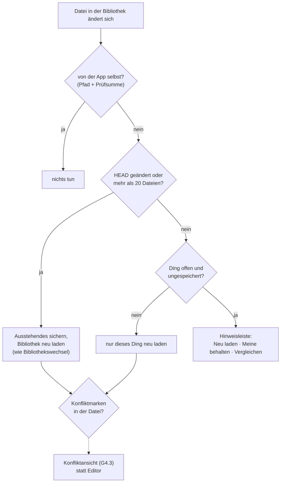

# Git: Versionen, Vergleichen, Zusammenführen

_Von Claude Code · Stand: 14.11.2026 · Basis-Commit: `1cc0f19`_
_Status: **Konzept, nichts gebaut.** Entschieden am 14.11.: **Jede Bibliothek ist ein eigenes Git-Repository.** Die offenen Fragen stehen in Abschnitt 9._

---

## 0. Kurzfassung

Jede Bibliothek wird auf Wunsch ein eigenes Git-Repository, mit `.git` direkt im Paket `Name.llmdlibrary`. LLM Designer ruft dafür das normale `git` auf. Terminal, Fork, Tower oder VS Code sehen also genau dasselbe Repository, und alles, was dort passiert, zeigt die App sofort an.

Darauf setzen fünf Bausteine auf:

| # | Baustein | Was du davon hast | Sitzungen |
|---|---|---|---|
| **G1** | Fundament | Git einschalten. Die App bemerkt Änderungen von außen (`git checkout`, `git revert` im Terminal) und lädt neu, statt sie zu überschreiben. Sie zeigt Titel statt UUIDs. | 2 |
| **G2** | Git im Power-Zugriff | Aus jedem Modul heraus: Änderungen sehen, Nachricht schreiben (auch als KI-Vorschlag), committen, pushen, den Verlauf des offenen Dokuments ansehen und eine alte Fassung wiederherstellen. | 1–2 |
| **G3** | Vergleichen | Zwei Stände nebeneinander, so dargestellt, wie das jeweilige Studio sie zeigt: Absätze und Wörter, Folien, To-dos, Figuren. Einzelne Änderungen lassen sich übernehmen. Dazu kommen **Fassungen**: zwei Versionen eines Dokuments nebeneinander, auch ohne Branch. | 2 |
| **G4** | Zusammenführen | Merge nach Bausteinen (Absatz, Folie, To-do) statt nach Zeilen. Echte Konflikte löst du in einer Ansicht mit drei Spalten. Der Merge-Treiber gilt auch für `git merge` im Terminal. | 2 |
| **G5** | Git Studio | Der Baum aller Commits mit Branches, Merges und Tags. Dazu Branches anlegen, wechseln und zusammenführen, und bei jedem Commit lesbar, was sich geändert hat. | 2 |

Zusammen sind das etwa **9–10 Sitzungen**. Die Reihenfolge G1 → G2 → G3 → G4 → G5 folgt deiner Gewichtung: zuerst das tägliche Committen, dann Vergleichen und Zusammenführen, dann der Baum.

**Für Agent Steps** ist Git das Rückgrat langer Läufe: Jeder fertige Schritt wird ein Commit, nach dem Aufwachen setzt der Lauf beim letzten Commit an, und „Was hat der Agent nachts gemacht?“ zeigt dir die Vergleichsansicht. Mehr dazu in Abschnitt 8.

---

## 1. Was ich im Code gesehen habe

| Befund | Folge für Git | Fundstelle |
|---|---|---|
| **Die App beobachtet keine Dateien.** Sie lädt beim Öffnen alles in den Speicher und schreibt verzögert, Dokumente zum Beispiel nach einer Tipp-Pause. | Ein `git checkout` im Terminal würde beim nächsten Speichern **überschrieben**. Das ist der wichtigste Punkt von G1. | kein FSEvents in `Sources/`; `AppModel+Writer.swift:310` |
| Neu laden gibt es schon: Beim Bibliothekswechsel schreibt `AppModel.close()` alles und baut ein neues Modell. | Derselbe Weg dient für „dieselbe Bibliothek neu laden“ nach einem Branch-Wechsel oder Merge. | `App/LibrarySession.swift:83` |
| **API-Schlüssel stehen in `Einstellungen.plist`** (`apiKey`, `<anbieter>ApiKey`). | Diese Datei darf so nie in einen Commit, sonst landen die Schlüssel bei GitHub. | `Core/AppModel.swift:125, 183` |
| `Einstellungen.plist` und `SidebarStacks.json` halten Fensterzustand und Öffnungstage fest. | Ohne Ausschluss wäre jeder Commit verrauscht, obwohl sich nichts geändert hat. | `Core/Library.swift:196` |
| Die meisten Formate lassen sich gut vergleichen: JSON mit `prettyPrinted, sortedKeys`, Markdown mit Kopf, Plist als XML. | Git vergleicht und führt sie zeilenweise schon brauchbar zusammen. | `RecordStore.swift:93`, `ChatStore.swift:14` |
| **Ausnahmen:** Die Metadaten einer Folie stehen in einer einzigen JSON-Zeile (`<!-- folie {…} -->`). Kommentare, Zeichnungen und der Dokumentkopf werden kompakt geschrieben. | Ein Zeilen-Merge ist hier zu grob: Zwei Änderungen an derselben Folie werden immer ein Konflikt. G4 führt deshalb nach Bausteinen zusammen. | `Presentation.swift:641`, `WriterComments.swift:56`, `WriterDrawing.swift:114`, `WriterDocument.swift:192` |
| Dateinamen sind UUIDs und bleiben beim Umbenennen gleich. | Für Git ist das ideal, weil die Pfade stabil bleiben. Für dich ist es unlesbar: `Documents/3BC4….md`. Die App muss überall Titel zeigen. | `speicherformate.md` |
| Gelöschtes kommt in den Papierkorb. | Git sieht das als Löschung. Wiederherstellen geht dann auch aus dem Verlauf. | `RecordStore.swift:103` |
| Große Dateien: „Roman“ hat 118 MB, darunter ein Video mit 68 MB und 40 WAV-Schnipsel (35 MB). | GitHub warnt ab 50 MB und lehnt Dateien über 100 MB ab. `git-lfs` ist nicht installiert. | Messung 14.11. |
| `git` 2.54 (Homebrew) und `gh` sind installiert. `~/Documents` liegt nicht in iCloud Drive. | Gut so: Git und iCloud-Synchronisation vertragen sich schlecht. Das prüft die App beim Einschalten und warnt. | – |
| **Nebenbei gefunden:** In `Roman.llmdlibrary` liegt `llmd.token` vom 07.11., wahrscheinlich von einem Probelauf mit `LLMD_HOME` in der Bibliothek. | Die Datei gehört nicht dorthin. `.gitignore` schließt sie aus. Löschen würde ich sie erst nach deinem Okay. | – |

---

## 2. Grundentscheidungen

1. **Ein Repository je Bibliothek** (entschieden). `.git` liegt im Paket, der Finder zeigt die Bibliothek weiter als ein Objekt, und eine kopierte Bibliothek nimmt ihren Verlauf mit. Im Terminal reicht `cd ~/Documents/"LLM Designer"/"Alex Bibliothek.llmdlibrary"`. Bibliotheken ohne Git laufen wie heute; Git schaltest du je Bibliothek ein.
2. **Die App ruft das normale `git` auf** (`Process` in einem `Task`). Eine eingebaute Bibliothek wie libgit2 nehme ich nicht: Das wäre eine Fremdabhängigkeit und könnte sich vom Terminal unterscheiden. Die App sucht `git` erst in der Einstellung, dann in `/opt/homebrew/bin`, `/usr/local/bin` und zuletzt `/usr/bin`. Den letzten Pfad nimmt sie nur, wenn die Command Line Tools da sind, denn sonst öffnet `/usr/bin/git` einen Installationsdialog.
3. **Ein Branch umfasst die ganze Bibliothek.** Das passt zu Experimenten und zu Agenten-Läufen. Für „zwei Versionen eines Dokuments“ ist ein Branch-Wechsel zu grob, weil dabei alles andere mitwechselt. Dafür gibt es **Fassungen** (G3.5).
4. **Git hält den Verlauf, die App ist die Oberfläche.** Die App legt keine eigene Versionsverwaltung daneben. Was sie tut, sind normale Commits, und was im Terminal passiert, zeigt sie sofort an.
5. **Git läuft sicher, durch Regeln im Code.** Bibliotheken sind tragbar und können von woanders kommen. Eine fremde `.git/config` oder Hooks können beim Aufruf von Git Programme starten. Deshalb:
   - Die App ruft Git immer mit `-c core.hooksPath=/dev/null -c core.fsmonitor=false` auf, mit `GIT_TERMINAL_PROMPT=0` und ohne Pager und Editor.
   - Vor dem ersten Aufruf in einer Bibliothek prüft sie die lokale Konfiguration auf Schlüssel, die Programme starten: `core.sshCommand`, `core.pager`, `core.editor`, `filter.*`, `diff.*.command`, `diff.external`, `merge.*.driver` außer dem eigenen, `include.*`, `includeIf.*`, `gpg.program`, `credential.helper`. Findet sie einen, fragt sie einmal in der Oberfläche nach.
   - Hooks lassen sich in den Einstellungen bewusst einschalten.
6. **Die Anmeldung bei GitHub und GitLab übernimmt Git selbst**: Schlüsselbund, SSH-Schlüssel oder `gh auth`. Die App sieht nie ein Token. Fehlt die Anmeldung, nennt sie den einen Befehl, den du einmal im Terminal ausführst.
7. **Vor jeder eigenen Git-Aktion schreibt die App alles Ausstehende** (`savePendingDocuments`, `saveAll` aller Stores) und **hält Schreibvorgänge im Hintergrund an** (Thalamus, Aufräumen der Anhänge). Laufen Podcast-, Recherche- oder Agenten-Arbeiten, sind Branch-Wechsel, Merge und Pull gesperrt, mit Hinweis auf die laufende Arbeit.

### Was versioniert wird (Vorschlag)

| Versioniert | Nicht versioniert (`.gitignore`) |
|---|---|
| `Bibliothek.json`, `Skills.json` | `Einstellungen.plist`: Schlüssel und Fensterzustand, siehe Frage 1 |
| `Documents/` mit `Bilder/` und `Inhaltsanalysen/` | `SidebarStacks.json`: Öffnungstage, die sich bei jedem Öffnen ändern |
| `Attachments/`, `Zitate/`, `Geschichten/` | `llmd.token`, `llmd.sock`: Laufzeitdateien; `Chats/`, `ChatFolders.json`, `Personas/`: bleiben lokal (Frage 6) |
| `Notizen/`, `Projekte/`, `Daten/`, `Vorlagen/`, `Recherchen/`, `Lernen/` | `Podcasts/*/Schnipsel/`: lassen sich neu sprechen, siehe Frage 2 |
| `Podcasts/*/podcast.json`, `Podcast.m4a`, `Quellen/` | `Aufträge/*/vorher/`: Schnappschüsse aus E1, Git hat den Verlauf ohnehin |
| `Präsentationen/Designs/`, `.gitignore`, `.gitattributes` | `.DS_Store`, Zwischendateien beim atomaren Schreiben |

---

## 3. Was du am Ende hast

> Du schreibst an der Hausarbeit. Unten links steht neben dem Namen der Bibliothek **„⎇ main · 3 Änderungen“**. Du öffnest den Power-Zugriff (⌥⌘J) und dort das Modul **Git**. Statt UUIDs steht da:
> - „📄 Hausarbeit Statistik: 2 Absätze geändert“
> - „📊 Referat: 1 Folie neu“
> - „✅ Bachelorarbeit: 1 To-do erledigt“
>
> Du lässt dir eine Nachricht vorschlagen, korrigierst sie und drückst **Commit & Push**. Das Ganze dauert zehn Sekunden.
>
> Abends willst du eine radikal kürzere Einleitung ausprobieren: Rechtsklick auf das Dokument → **„Neue Fassung“**. Am nächsten Tag zeigt **„Fassungen vergleichen“** Absatz für Absatz und Wort für Wort, was anders ist. Zwei Absätze aus der kurzen Fassung übernimmst du per Pfeil in die Hauptfassung.
>
> Im Terminal tippst du `git switch -c experiment`. Die App merkt es und zeigt kurz „Branch gewechselt: experiment“. Im **Git Studio** siehst du den Baum: main, experiment, den Merge von gestern und die Commits des Agenten von heute Nacht, jeweils mit einem Roboter-Symbol.

---

## 4. Bausteine

### G1 Fundament

| # | Baustein | Inhalt | Wo |
|---|---|---|---|
| G1.1 | **GitClient** | `git` als `Process` abseits des Main Actors. Die Ausgabe wird maschinenlesbar abgefragt (`--porcelain=v2 -z`, eigene `--format`-Zeichenketten mit NUL), dazu feste Sicherheitsoptionen (2.5), ein Zeitlimit und Fehler auf Deutsch. | `Core/Git/GitClient.swift` |
| G1.2 | **Git einschalten** | Ein Knopf in den Einstellungen und im Git-Modul: <br>• vorher prüfen: iCloud-Ordner, Dateien über 50 MB, `git` vorhanden <br>• `git init -b main`, `.gitignore` und `.gitattributes` schreiben <br>• Identität aus der globalen Konfiguration, sonst einmal fragen und lokal in `.git/config` speichern <br>• erster Commit „Ausgangsstand“ | `Core/Git/GitSetup.swift` |
| G1.3 | **Titel statt Pfade** | `LibraryItemResolver`: Pfad → Art, Titel, Symbol, Studio. Bei aktuellen Dateien kommt der Titel aus dem Speicher, bei alten Ständen aus `git show <rev>:<pfad>`. Bilder, Schnipsel und Anhänge ordnet er dem Ding zu, zu dem sie gehören („Bild in *Hausarbeit*“). Alle Listen in G2 bis G5 bauen darauf auf. | `Core/Git/LibraryItemResolver.swift` |
| G1.4 | **Änderungen von außen** | Siehe Diagramm unten. FSEvents auf dem Paket mit Ereignissen je Datei. Eigene Schreibvorgänge erkennt die App an Pfad und Inhaltsprüfsumme. In `.git/` zählen nur `HEAD`, `index` und `refs/`. <br>• Einzelne Datei geändert: Neu geladen wird nur dieses Ding, jeder Store bekommt dafür `reload(id:)`. <br>• Ist das Ding gerade offen und ungespeichert: Hinweisleiste mit [Neu laden] [Meine Fassung behalten] [Vergleichen]. <br>• `HEAD` geändert oder mehr als 20 Dateien auf einmal (Checkout, Merge, Reset): Die ganze Bibliothek wird über den Weg des Bibliothekswechsels neu geladen (`LibrarySession.reload()`). | `Core/Git/LibraryWatcher.swift` |
| G1.5 | **Spülen und Sperre** | Vor eigenen Git-Aktionen schreibt die App alles (2.7). Fürs Terminal gibt es `llmd library flush`. Auf Wunsch richtet die App ihn als `pre-commit`-Hook ein: Ein Commit im Terminal enthält dann auch die letzten Sekunden Tippen. | `AppModel+Git.swift`, `llmd` |
| G1.6 | **Statuszeile** | Unten links neben dem Namen der Bibliothek: Branch und Zahl der Änderungen, dazu ↑/↓ für Commits vor und hinter dem Remote. Ein Klick öffnet das Git-Modul im Power-Zugriff. | `SidebarView.swift` |



### G2 Git im Power-Zugriff

```
┌ Power-Zugriff ─ Git ─────────────────────────────┐
│ ⎇ main   ↑1 ↓0   origin: github.com/…/Bibliothek │
├──────────────────────────────────────────────────┤
│ ÄNDERUNGEN (3)                          [alle ☑] │
│ ☑ 📄 Hausarbeit Statistik   2 Absätze, 1 Bild    │
│ ☑ 📊 Referat               1 Folie neu           │
│ ☐ 💬 Chat „Fragen an Prof.“ 4 Nachrichten        │
│                                                  │
│ ┌──────────────────────────────────────────────┐ │
│ │ Kapitel 3 überarbeitet, Folie zu Regression  │ │
│ └──────────────────────────────────────────────┘ │
│ [✨ Vorschlagen]          [Commit] [Commit & Push]│
├──────────────────────────────────────────────────┤
│ VERLAUF VON „HAUSARBEIT STATISTIK“               │
│ ● heute 10:12  Kapitel 3 überarbeitet  [⇆] [↺]   │
│ ● gestern      Einleitung gekürzt      [⇆] [↺]   │
│ ● 11.11.       Gliederung              [⇆] [↺]   │
└──────────────────────────────────────────────────┘
  ⇆ = mit jetzt vergleichen   ↺ = diese Fassung wiederherstellen
```

| # | Baustein | Inhalt |
|---|---|---|
| G2.1 | **Modul „Git“** | Neuer `PowerModule`. Die Änderungen erscheinen nach Studio gruppiert, mit Titel und Kurzsatz aus G3.1. Angehakt wird je Ding, nicht je Datei: Ein Dokument nimmt seine Bilder mit. Dazu kommen das Nachrichtenfeld und **„Vorschlagen“**: Das lokale Modell bekommt nur die Liste der Änderungen als Sätze, keine ganzen Inhalte. Das geht schneller und bringt kaum Fremdes ins Modell. Der Vorschlag ist nur Text im Feld. |
| G2.2 | **Nur das offene Ding** | Das Modul weiß, was gerade offen ist, und bietet „Nur *Hausarbeit* committen“ an. |
| G2.3 | **Verlauf und Wiederherstellen** | Die Commits, die das offene Ding geändert haben (`git log --follow -- <pfad>`). Je Eintrag gibt es „Vergleichen“ und „Wiederherstellen“. Vor dem Wiederherstellen committet die App den jetzigen Stand („Stand vor Wiederherstellen“), damit nie etwas verloren geht. |
| G2.4 | **Remote** | „Mit GitHub oder GitLab verbinden“: <br>• eine URL einfügen (`git remote add origin`) <br>• oder, wenn `gh` angemeldet ist, „Neues privates Repository auf GitHub“ (`gh repo create --private --source . --push`) <br>Push und Pull per Knopf. Pull übernimmt von selbst nur, was ohne Merge geht (`--ff-only`); sonst geht es weiter in G4.4. |
| G2.5 | **Kontextmenüs** | In allen Studios bei Dokumenten, Präsentationen, Romanwelten, Notes, Projekten und Kursen: „Versionen …“ und „Mit letztem Commit vergleichen“. |

### G3 Vergleichen

```
┌ Vergleichen: Hausarbeit Statistik ──────── 11.11. „Gliederung“ ⇆ jetzt ─┐
│ Kopf: Schrift serif → sans · Format DIN A4 (gleich)                    │
├───────────────────────────────────┬────────────────────────────────────┤
│ 1 Einleitung                      │ 1 Einleitung                       │
│ Die Regression ist ein ~~sehr~~   │ Die Regression ist ein             │
│ ~~altes~~ Verfahren, das …        │ **bewährtes** Verfahren, das …     │
│                                   │                                    │
│ ░░░ Absatz entfernt ░░░      [→]  │                                    │
│                                   │ ▓▓▓ Absatz neu: „Datensatz …“ [←]  │
│ Abb. 1  [Bild vorher]             │ Abb. 1  [Bild nachher] Überblenden │
├───────────────────────────────────┴────────────────────────────────────┤
│ 4 Änderungen · ↑↓ springen · [Alle übernehmen]   nebeneinander | ineinander │
└────────────────────────────────────────────────────────────────────────┘
```

| # | Baustein | Inhalt |
|---|---|---|
| G3.1 | **Vergleichskern** | `CollectionDifference` aus der Standardbibliothek, also ohne Abhängigkeit. Erst werden die Blöcke zugeordnet (Absätze, Tabellen, Bilder, Kästen), dann die Wörter in geänderten Blöcken verglichen. Verschiebungen werden erkannt. Kopffelder werden zu Sätzen („Schrift: serif → sans“). Daraus entstehen auch die Kurzsätze in G2. |
| G3.2 | **Ansichten je Art** | **Dokument:** gerendert wie im Editor, nebeneinander oder ineinander. <br>**Präsentation:** Folien nach `id` zugeordnet (neu, entfernt, verschoben, geändert), Vorschaubilder vorher und nachher, Text und Moderatorenkarte Wort für Wort, Elemente als Sätze („Bild verschoben“, „Kasten neu“). <br>**Notes, Projekte, Romanwelten, Quellen, Kurse, Daten:** nach den IDs der Einträge, als Sätze wie „To-do *Literatur* erledigt“, „Figur *Lena*: Beschreibung geändert“, „12 Karten neu“. <br>**Chats:** neue und geänderte Nachrichten. <br>**Bilder:** nebeneinander und Überblenden. <br>**Audio und Video:** Größe und Dauer, abspielbar. |
| G3.3 | **Was sich vergleichen lässt** | Zwei Commits; ein Commit und jetzt; zwei Branches; Speicher und Platte (bei einer Änderung von außen, G1.4); zwei beliebige Dokumente, auch ohne Git. |
| G3.4 | **Übernehmen** | Jede Änderung hat „→“ bzw. „←“. Darauf bauen Fassungen und Konflikte auf. |
| G3.5 | **Fassungen** | „Neue Fassung“ legt eine Kopie mit Verweis auf das Original an (Kopffeld `fassungVon`, Frage 4). In der Seitenleiste steht sie eingerückt unter dem Original. Dazu kommen „Fassungen vergleichen“ und „In Hauptfassung übernehmen“. Das funktioniert auch in Bibliotheken ohne Git. |

### G4 Zusammenführen

```
┌ Zusammenführen: experiment → main ── 1 von 2 Konflikten ──────────────────────┐
│ 📊 Referat · Folie 4 „Ergebnisse“                                             │
├─────────────────────┬─────────────────────────┬───────────────────────────────┤
│ GEMEINSAMER STAND   │ MAIN (deine)            │ EXPERIMENT                    │
│ # Ergebnisse        │ # Ergebnisse            │ # Ergebnisse im Überblick     │
│ - R² = 0,61         │ - R² = 0,64             │ - R² = 0,61                   │
├─────────────────────┴─────────────────────────┴───────────────────────────────┤
│ [Meine] [Andere] [Beide] [Selbst bearbeiten]         ✓ 31 Änderungen ohne Konflikt │
│                                     [Abbrechen]  [Zusammenführen abschließen] │
└───────────────────────────────────────────────────────────────────────────────┘
```

| # | Baustein | Inhalt |
|---|---|---|
| G4.1 | **Merge nach Bausteinen** | Ein neues Modul `LibraryMerge` ohne AppKit, das App und `llmd` gemeinsam nutzen: <br>• Markdown nach Blöcken, den Kopf nach Feldern <br>• Folien nach `id`, ihre Elemente nach `id` <br>• JSON-Dateien nach den IDs ihrer Einträge (To-dos, Figuren, Karten, Aufgaben) <br>Ein Konflikt entsteht nur, wenn beide Seiten dasselbe ändern: dieselbe Folie, denselben Absatz, dasselbe Feld. Dafür muss die Lesearbeit der Formate in ein eigenes Target, damit `llmd` sie ohne laufende App nutzen kann. |
| G4.2 | **Merge-Treiber fürs Terminal** | `.gitattributes` nennt `merge=llmd` für `Documents/*.md` und `*.json`. Die App trägt in `.git/config` den Treiber mit dem Pfad zu `llmd` ein und hält den Pfad bei jedem Start aktuell. Fehlt der Eintrag (anderer Mac, Klon), führt Git wie gewohnt zeilenweise zusammen, und nichts geht kaputt. Optional zeigt `diff=llmd` mit `textconv` im Terminal bei `git diff` Titel und lesbaren Text statt JSON. |
| G4.3 | **Konfliktansicht** | Drei Spalten wie oben. Gelöstes wird gespeichert und mit `git add` vorgemerkt; erst wenn alles gelöst ist, geht „Abschließen“. „Abbrechen“ ist `git merge --abort`. **Konfliktmarken (`<<<<<<<`) öffnet die App nie als Dokument:** Findet sie welche, etwa nach einem Merge im Terminal ohne Treiber, zeigt sie statt des Editors die Konfliktansicht. |
| G4.4 | **Pull mit Abweichung** | Geht Pull nicht ohne Merge, sagt die App: „GitHub hat 2 Commits, die du nicht hast; du hast 1, den GitHub nicht hat“, und bietet [Zusammenführen] an. Ich schlage Merge statt Rebase vor, siehe Frage 7. |

### G5 Git Studio

```
┌ Git Studio ─ Alex Bibliothek ─────────────────────────────────────────────────────────┐
│ ⎇ main ▾   [＋ Branch] [Zusammenführen …] [Pull] [Push ↑1]               🔍 Verlauf   │
├──────────────────┬────────────────────────────────────────┬───────────────────────────┤
│ BRANCHES         │  ●     main  Kapitel 3 überarbeitet  10:12 │ Kapitel 3 überarbeitet    │
│ ● main      ↑1   │  │ ●  experiment  Kürzere Einleitung   gestern │ Alexander · heute 10:12   │
│ ○ experiment     │  │ │                                       │ a3f9c21 [kopieren]        │
│ ○ auftrag/kurs ✓ │  ●─┘  Merge experiment-alt          12.11. │                           │
│ REMOTE           │  │ 🤖  Kurs „Statistik“: 40 Karten   12.11. │ 📄 Hausarbeit Statistik   │
│ ○ origin/main    │  │ 🤖  Kurs „Statistik“: Lektionen   12.11. │    2 Absätze geändert [⇆] │
│ TAGS             │  ● 🏷 Abgabe-Exposé                  11.11. │ 📊 Referat                │
│ 🏷 Abgabe-Exposé  │  ●     Ausgangsstand                 10.11. │    1 Folie neu         [⇆] │
│ ZURÜCKGELEGT (1) │                                        │ [Diesen Stand ansehen]    │
└──────────────────┴────────────────────────────────────────┴───────────────────────────┘
```

| # | Baustein | Inhalt |
|---|---|---|
| G5.1 | **Studio** | Ein neuer Eintrag in `StudioApplication`. Der Name ist offen (Frage 5). Im Neu-Menü steht dann „Branch anlegen“. |
| G5.2 | **Commit-Baum** | `git log --all --topo-order` mit Hash, Eltern, Autor, Zeit, Betreff und Refs. Die Spuren berechnet die App in Swift und zeichnet sie mit `Canvas`. Branches erscheinen in den Ordnerfarben, Merges als Knoten mit zwei Linien, Tags als Fähnchen. Geladen wird in Seiten zu 500 Commits. |
| G5.3 | **Seitenleiste** | Lokale und Remote-Branches mit voraus/zurück, gemergte mit ✓, Tags und Zurückgelegtes (stash). Suche nach Nachricht, Autor oder „hat *Hausarbeit* geändert“. |
| G5.4 | **Commit-Details** | Die geänderten Dinge mit Titeln und Sätzen; ein Klick öffnet den Vergleich. „Diesen Stand ansehen“ zeigt alte Inhalte nur zum Lesen, ohne Checkout. |
| G5.5 | **Handgriffe** | Branch anlegen, wechseln, umbenennen und löschen (bei ungemergten Branches mit Rückfrage), Merge in den aktuellen Branch (G4), Commit rückgängig (`revert`), Tag setzen (etwa „Abgabe Hausarbeit“), Zurücklegen und Hervorholen. `reset --hard` und Force-Push gibt es in der Oberfläche nicht; dafür ist das Terminal da. |
| G5.6 | **Agenten-Commits** | Commits mit dem Trailer `Auftrag:` tragen ein Roboter-Symbol und führen zum Auftrag in der Agentenzentrale. |

---

## 5. Dateien in der Bibliothek

```
Name.llmdlibrary/
├── .git/                 das Repository (der Finder zeigt es nicht)
├── .gitignore            von der App angelegt, darf man ändern
└── .gitattributes        Merge- und Diff-Treiber
```

**`.gitignore`** (Vorschlag, hängt von den Fragen 1, 2 und 6 ab)

```gitignore
# Laufzeit und Geheimes: nie in Git
Einstellungen.plist
# Chats und Personas bleiben lokal, ohne Verlauf (Entscheidung 14.11.)
Chats/
ChatFolders.json
Personas/
llmd.token
llmd.sock
# Zustand ohne Inhalt
SidebarStacks.json
.DS_Store
# lässt sich neu erzeugen
Podcasts/*/Schnipsel/
Aufträge/*/vorher/
```

**`.gitattributes`**

```gitattributes
Documents/*.md  merge=llmd diff=llmd
*.json          merge=llmd diff=llmd
*.plist         diff=llmd
*.m4a *.mp4 *.wav *.jpg *.png *.pdf  binary
```

**`.git/config`** (nur lokal, schreibt die App)

```ini
[merge "llmd"]
    name = LLM Designer (nach Bausteinen)
    driver = "/Applications/LLM Designer.app/Contents/MacOS/llmd" git merge-file %O %A %B %P
[diff "llmd"]
    textconv = "/Applications/LLM Designer.app/Contents/MacOS/llmd" git textconv
```

**Commits der App:** Der Betreff ist deutsch und ist deine Nachricht. Im Text darunter stehen die Dinge als Sätze, etwa `- Dokument „Hausarbeit“: 2 Absätze geändert`. Agenten-Commits haben zusätzlich die Trailer `Auftrag: <id>` und `Schritt: 3/7`, und als Autor steht „LLM Designer Agent“, mit deiner E-Mail als Committer.

**Neues Kopffeld (nur mit G3.5, Frage 4):** `fassungVon: <id>` in Writer-Dokumenten und Präsentationen. Ältere Dokumente ohne das Feld bleiben, wie sie sind.

---

## 6. Actions und Sicherheit

Jede Action deklariert, was das Sicherheitskonzept verlangt. Diffs und Logs gelten als `readsUntrusted`, weil sie Inhalte und Commit-Nachrichten zeigen, die aus dem Web, aus Importen oder von anderen stammen können.

| Action | Art | readsUntrusted | sensitive | effect | Hinweis |
|---|---|---|---|---|---|
| `git.status` | lesen | nein | nein | none | mit Titeln aus G1.3 |
| `git.log` | lesen | ja | nein | none | |
| `git.diff`, `git.show` | lesen | ja | nein | none | ohne `Personas/`: Persona-Dateien und Gedächtnis zeigt nur die Oberfläche |
| `git.commit` | schreiben | nein | nein | local | |
| `git.branch.create` | schreiben | nein | nein | local | |
| `git.fetch` | schreiben | ja | nein | local | holt nur, ändert die Bibliothek nicht |
| `git.branch.switch` | destruktiv | nein | nein | destructive | verweigert bei ungesicherten Änderungen |
| `git.merge`, `git.pull` | destruktiv | ja | nein | destructive | |
| `git.restore`, `git.revert` | destruktiv | ja | nein | destructive | sichert vorher den aktuellen Stand |
| `git.push` | schreiben | nein | **ja** | **outbound** | sendet die ganze Bibliothek; MCP: verweigert, Chat und Terminal: fragen |
| Remote setzen, Hooks erlauben, Treiber eintragen | – | – | – | – | **keine Actions**, nur in der Oberfläche: Kein Agent darf das Ziel eines Push ändern |

MCP bekommt `llmd://git/log` als Resource, damit Agenten sehen, was passiert ist, ohne etwas zu ändern.

---

## 7. Tests

- **Wegwerf-Repositorys:** `TestApp.model()` mit `git init` in der Wegwerf-Bibliothek, dazu `GIT_CONFIG_GLOBAL=/dev/null` und `GIT_CONFIG_NOSYSTEM=1`. Die Identität kommt über `-c`, damit deine globale Konfiguration und deine Hooks nie mitspielen. Der Remote ist ein Bare-Repository im Temp-Ordner, ganz ohne Netz.
- **Jede Action** läuft direkt über die Registry, wie `CLAUDE.md` es verlangt.
- **Änderungen von außen:** Der Test schreibt eine Datei an der App vorbei, und der Store lädt neu. Ist das Dokument dabei offen und ungespeichert, erscheint statt Neuladen die Hinweisleiste. Ein Branch-Wechsel lädt die ganze Bibliothek neu, und keine ausstehende Speicherung überschreibt danach den neuen Stand.
- **Merge:** neutral erzeugte Stände mit gemeinsamem Ursprung (Absätze, Folien, To-dos). Verschiedene Absätze bzw. Folien ergeben keinen Konflikt, derselbe Absatz einen. Ein echtes `git merge` im Temp-Repository nutzt den Treiber über `llmd`.
- **Sicherheit:** Eine Bibliothek mit `core.fsmonitor` oder einem `filter.*` in `.git/config` startet kein Programm, und die App fragt nach. `git.push` über MCP wird verweigert. Kein API-Schlüssel landet in einem Commit (Test mit gesetztem Schlüssel). Konfliktmarken werden nie als Dokument geöffnet.

---

## 8. Schnittstellen zu Agent Steps

Agent Steps planst du in einem eigenen Chat. Für diesen Chat ist wichtig:

- **Überschneidung:** Agent Steps deckt sich mit **E1 Agentenzentrale** (Aufträge, Freigaben-Eingang, Modell-Warteschlange, Schnappschüsse) und **E3 Teil B** (Rezepte, die nach einem Neustart weiterlaufen) in [Epics](Epics.md). E1 ist noch nicht begonnen. Im Agent-Steps-Chat sollte also zuerst entschieden werden, ob Agent Steps E1 und E3-B ersetzt oder auf ihnen aufbaut.
- **Git als Rückgrat langer Läufe**, wenn die Bibliothek Git hat:
  - Vor dem Start legt die App einen Commit „Stand vor Auftrag …“ an.
  - Jeder fertige Schritt wird ein Commit mit den Trailern `Auftrag:` und `Schritt:`.
  - Nach dem Aufwachen oder einem Neustart setzt der Lauf beim letzten Schritt-Commit an.
  - „Was hat der Agent gemacht?“ ist der Vergleich (G3) vom Start-Commit bis jetzt.
  - Zurücknehmen ist `git revert` der Auftrags-Commits; deine eigenen Commits dazwischen bleiben.
  - Ohne Git greifen die Schnappschüsse aus E1.4.
- **Isolation, eine spätere Entscheidung:** Ein Auftrag kann auf einem eigenen Branch in einem `git worktree` laufen, damit du auf main ungestört weiterarbeitest. Dafür braucht es ein zweites Modell ohne Fenster für den anderen Ordner. Das entscheidet der Agent-Steps-Chat.
- **Grenze:** Ein Agent pusht nie ohne Freigabe; `git.push` bleibt sensibel und `outbound`.
- **Reihenfolge:** G1 und G2 lohnen sich vor Agent Steps, weil die Schritt-Commits darauf aufbauen. G3 bis G5 sind davon unabhängig.

---

## 9. Offene Fragen

**Antworten vom 14.11.2026:** Frage 1 ja (`Einstellungen.plist` bleibt außerhalb von Git), Frage 2 ja (Schnipsel und Dateien über 50 MB auslassen), Frage 4 ja (`fassungVon`), Frage 6: Chats und Personas bleiben **ganz außerhalb von Git** (`Chats/`, `ChatFolders.json`, `Personas/` in `.gitignore`), also auch ohne lokalen Verlauf. Für die übrigen Fragen gelten die Vorschläge.

| # | Frage | Mein Vorschlag |
|---|---|---|
| 1 | **Einstellungen und API-Schlüssel.** `Einstellungen.plist` enthält Schlüssel und Fensterzustand. | **Zum Start ganz aus Git lassen:** einfach und sicher. Nachteil: Systemprompt und Freigabestufen werden nicht versioniert. Später ließe sich die Datei teilen: Schlüssel in eine nicht versionierte `Zugaenge.plist`, der Zustand in `Zustand.plist`, der Rest versioniert. Das ist eine Formatänderung und kostet eine Sitzung mehr. |
| 2 | **Große Dateien.** Ein Video hat 68 MB, die Schnipsel 35 MB. | Schnipsel nicht versionieren. Dateien über 50 MB zum Start mit Hinweis auslassen. `git-lfs` (Homebrew) nur, wenn du Videos im Verlauf brauchst; LFS hat bei GitHub eigene Speichergrenzen. |
| 3 | **Automatische Commits.** | Commits von Hand. Automatisch nur vor riskanten Schritten: Wiederherstellen, Merge, Auftrag. Optional später „Sicherungspunkt beim Beenden“. |
| 4 | **Fassungen** brauchen das neue Kopffeld `fassungVon`. | Ja. Die Alternative wäre, Fassungen nur über Branches abzubilden; das ist für ein einzelnes Dokument zu grob. |
| 5 | **Name des Studios** | „Git Studio“ (passt zu Writer und Presenter Studio) oder „Versionen“. |
| 6 | **Chats und Persona-Gedächtnis** gehen mit jedem Push zu GitHub. | Lokal versionieren, ja. Für den Remote eine Einstellung je Bibliothek: „Personas nicht versionieren“. Git kann nicht nur einen Teil pushen; ausgelassen heißt also auch lokal ohne Verlauf. |
| 7 | **Pull bei Abweichung:** Merge oder Rebase? | Merge: Der Baum zeigt ehrlich, was passiert ist, und es ist leichter zu verstehen. |
| 8 | **Zusammenarbeit mit anderen** (Commits fremder Personen als `herkunft: fremd` markieren) | Jetzt nicht. Der Remote gilt vorerst als deine eigene Sicherung; `pull` ist trotzdem schon `readsUntrusted`. |
| 9 | `llmd.token` in „Roman“ | Löschen, wenn du einverstanden bist. |

---

## 10. Startanweisungen für Claude Code

**G1 und G2**
> Lies `docs/plan/Git-Modul.md` (Abschnitte 1, 2, 4 G1–G2, 5–7), `docs/actions.md` und `docs/plan/Sicherheitskonzept-Prompt-Injection.md`. Baue G1.1 bis G1.6 und G2.1 bis G2.5 mit Tests auf Wegwerf-Repositorys. Die Antworten auf die offenen Fragen stehen in Abschnitt 9. Trage den Fortschritt in Abschnitt 11 ein.

**G3 und G4**
> Lies `docs/plan/Git-Modul.md` (G3, G4) und `docs/speicherformate.md`. Lege mir vor dem Bau das Format von `fassungVon` und den Schnitt des neuen Targets für `LibraryMerge` vor.

**G5**
> Lies `docs/plan/Git-Modul.md` (G5). Teste den Baum mit einem erzeugten Repository mit 2 000 Commits, 6 Branches und Merges, schmale Fenster eingeschlossen.

---

## 11. Fortschritt

| Baustein | Status | Datum | Notizen |
|---|---|---|---|
| G1 | fertig | 14.11.2026 | `Core/Git/` (GitClient, GitStatus, GitSetup, LibraryItemResolver, LibraryWatcher), `AppModel+Git.swift`, `LibrarySession.reload()`. Abweichungen: Hooks lassen sich nicht einschalten (eine fremde Bibliothek könnte die Einstellung mitbringen); eigene Schreibvorgänge erkennt FSEvents selbst (`MarkSelf`) statt über Prüfsummen; `llmd library flush` heißt `llmd git flush`; auch `Attachments/` bleibt außerhalb (gehört zu den Chats). |
| G2 | fertig | 14.11.2026 | `UI/Power/PowerGit.swift`, Statuszeile und Hinweisleiste in `UI/GitViews.swift`, Actions in `Actions/Git/GitActions.swift`. `git.push` ist nicht sensibel, weil Chats und Personas nicht im Repository sind. Kontextmenü „Versionen“ vorerst nur bei Dokumenten und Präsentationen; der Verlauf im Power-Zugriff gilt für das offene Dokument, die offene Präsentation oder das offene Projekt. |
| G3 | fertig | 14.11.2026 | `Core/Compare/` (TextDiff, Comparison, CompareSession), `UI/CompareView.swift`. Fassungen stehen mit dem Abzeichen „Fassung“ in der Seitenleiste statt eingerückt. Dokumente werden als Text mit markierten Wörtern gezeigt, nicht gerendert. |
| G4 | fertig | 14.11.2026 | Target `LibraryMerge` (Diff3, Kopf je Feld, Absätze mit Wort-Merge, Folien und Elemente nach `id`, JSON nach `id`/`tag`, Werte-Listen als Menge, Zeitstempel: der spätere gewinnt), `llmd git merge-file` als Treiber, `LibraryGit+Merge.swift`, `UI/MergeView.swift`. Ungelöste Konflikte halten „deine“ Fassung, die Datei bleibt gültig; Konfliktmarken aus einem Merge ohne Treiber repariert die App beim Lesen. Die Reihenfolge von Folien und Einträgen folgt bei Konflikten deiner Seite. `textconv` für `git diff` im Terminal ist noch nicht gebaut. |
| G5 | fertig | 14.11.2026 | `UI/GitStudioScreen.swift`, `Core/Git/GitGraph.swift`, `LibraryGit+Branches.swift`; Studio im Neu-Menü als „Git Studio“. Suche im Verlauf nach Nachricht, Text, Autor und Hash; „hat *Hausarbeit* geändert“ gibt es über den Verlauf im Power-Zugriff. „Diesen Stand ansehen“ zeigt den Vergleich des Commits mit seinem Vorgänger. Branches vergleichen geht für das offene Dokument, die offene Präsentation oder das offene Projekt. |
