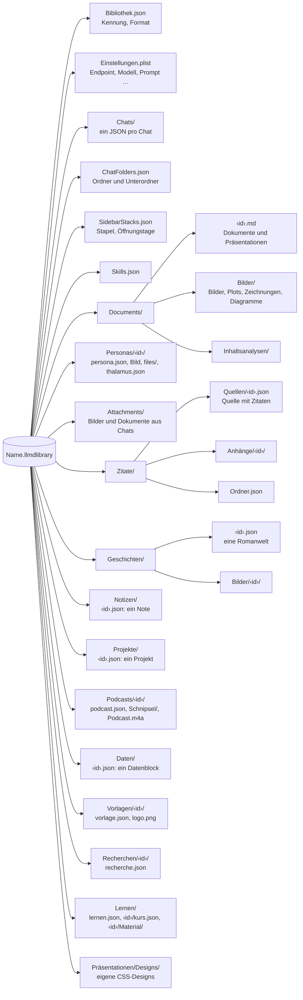

# Speicherformate

[← Übersicht](index.md) · [Funktionsweise](funktionen.md) · [Architektur](architektur.md) · [Code-Führer](code.md)

## Aufbau einer Bibliothek

Eine Bibliothek ist ein Ordner-Paket `Name.llmdlibrary` (im Finder ein einzelnes Objekt, Doppelklick öffnet es in LLM Designer). Alle Pfade darin sind relativ – die Bibliothek lässt sich frei verschieben.



`ChatFolders.json` ist eine Liste von Ordnern (`id`, `name`, `color`, `isCollapsed`). Ein Unterordner hat `parentID`, die ID eines Ordners der obersten Ebene; tiefer geht es nicht. Fehlt der Eltern-Ordner, steht der Unterordner oben.

`SidebarStacks.json` gehört zum automatischen Stapeln (Einstellung `sidebarArrangement` = `date` oder `stacks`, `sidebarStackMode` = `topics`, `types` oder `relevance`): `topics` sind die Themenstapel des Modells (`id`, `name`, `itemIDs`), `tidiedAt` das letzte Aufräumen, `expanded` die offenen Stapel, `activity` je Chat oder Dokument die Tage (`yyyy-MM-dd`), an denen es geöffnet wurde, höchstens 60 Tage zurück. Inhalte stehen darin nicht.

### Anhänge in Chats

`Attachments/` enthält die Bilder der Chats (`‹uuid›.jpg`, höchstens 1600 px) und die angehängten Dokumente. Eine Nachricht nennt sie in `images` und `documents` (beide optional; alte Chats bleiben lesbar). Zu einem Dokument gehören drei Arten von Dateien:

| Datei | Inhalt |
|---|---|
| `‹uuid›.pdf` (bzw. `.docx`, `.txt` …) | die Kopie des Originals |
| `‹uuid›.txt` | der Text, den das Modell liest: je Seite eine Marke `[Seite n]`, Scans per Texterkennung (Vision, Deutsch und Englisch) |
| `‹uuid›-abb‹n›.jpg` | die Abbildungen eines PDFs, ausgeschnitten mit ca. 180 dpi, höchstens 1600 px |

```json
"documents": [{
  "id": "…", "name": "Bericht.pdf", "fileName": "‹uuid›.pdf", "textFileName": "‹uuid›.txt",
  "pageCount": 12, "characterCount": 31450, "recognizedPages": [11, 12],
  "figures": [{ "id": "…", "number": 1, "page": 3, "caption": "Abb. 1: Umsatz 2020–2024",
                "imageFileName": "‹uuid›-abb1.jpg", "width": 1240, "height": 820,
                "description": "Balkendiagramm …", "describedBy": "qwen3.5-9b" }]
}]
```

Platzhalter (`[Abbildung 1, Seite 3: „…“]`) und Beschreibungen stehen nicht in der Textdatei, sondern werden beim Senden an die Bildunterschrift gesetzt; so lassen sich Abbildungen später beschreiben, ohne den Text neu zu lesen. Dateien, die kein Chat und kein Entwurf mehr nennt, räumt die App nach 15 Minuten weg.

Außerhalb der Bibliotheken merkt sich die App nur die Liste der zuletzt geöffneten Bibliotheken (Pfad + Bookmark) in ihren Voreinstellungen.

## Dokumente

Jedes Dokument ist eine Markdown-Datei mit kurzem Kopf:

```markdown
---
id: 3BC48041-12EC-4B73-87B7-BAA02A0AC3A3
title: Der Wasserkreislauf
customTitle: true
created: 2026-10-30T08:10:00Z
updated: 2026-10-30T08:12:00Z
font: serif
format: taschenbuch
---

# Der Wasserkreislauf

Text mit **fett**, <u>unterstrichen</u>, H<sub>2</sub>O und [@muster2020, S. 12].
```

Writer erweitert Markdown Pandoc-kompatibel:

| Element | Markdown |
|---|---|
| Kapitel | `# Titel {.chapter}` |
| Ausrichtung | `::: {.center}` … `:::` |
| Kasten | `::: {.box kind=merksatz position=right width=40 wrap=true}` … `:::` |
| Zwei Spalten | `::: {.columns count=2 gap=1cm rule=true}` … `\columnbreak` … `:::` |
| Hoch-/tiefgestellt | `<sup>…</sup>`, `<sub>…</sub>` |
| Farbe, Schrift, Größe | `<span style="color:#…; font-size:14pt">…</span>` |
| Lesezeichen | `<span id="lz-…" title="…">…</span>` |
| Kommentar | `<span class="comment" data-comment="k-…" data-thread="…">…</span>` |
| Bild, Plot, Abbildung | `{width=50%}`, `{.plot …}`, `{.chart}`, `{.drawing}`, `{.mermaid}` |
| Tabelle mit Formeln | Tabelle in `::: {#tab-… calc-3-1="SUMME(B2:B3)"}`; Spaltenbreiten als Anzahl der Striche |
| Zitation | `[@schluessel, S. 12]`, Literaturverzeichnis `[Literatur]` |
| Fußnote | `^[Text der Fußnote]` (Pandoc-Inline-Fußnote, Text als Inline-Markdown; nummeriert in der Reihenfolge im Text) |
| Inhaltsverzeichnis | `[TOC]` oder `[TOC]{.dynamic}` |
| Seitenumbruch | `\newpage` |

### Fassungen

Eine Fassung ist ein eigenes Dokument mit `fassungVon: <id>` im Kopf: der ID der Hauptfassung, aus der sie entstand (auch bei einer Fassung einer Fassung). Fehlt das Feld, ist das Dokument eine Hauptfassung. Fassungen lassen sich mit der Hauptfassung vergleichen und Absatz für Absatz in sie übernehmen.

### Herkunft

Der Kopf eines Dokuments kann `herkunft: fremd` oder `herkunft: intern` tragen. Fehlt das Feld, gilt der Text als eigener; so bleiben alle älteren Dokumente, wie sie sind. Skills haben dasselbe als optionales Feld `provenance`. Chats speichern ihre zugeschalteten Werkzeuggruppen in `actionGroups` und die Freigabestufe in `actionApproval`. In den Einstellungen der Bibliothek liegen `actionApprovalLevels` und `actionExportFolder`. Siehe [Action-Schicht](actions.md).

## Präsentationen

Eine Präsentation ist ein Dokument mit `kind: presentation` und den Hintergründen im Kopf. Jede Folie beginnt mit einer Kommentarzeile, die ihre Metadaten als JSON trägt; die Moderatorenkarte folgt als eigener Kommentar. Andere Markdown-Programme zeigen nur den Text.

```markdown
---
id: 422A2BDC-…
title: Wetter
kind: presentation
backgrounds: {"folie":{"kind":"design","design":"seide"}}
---

<!-- folie {"id":"…","rolle":"titel"} -->

# Wetter und Klima {.chapter}

<!-- folie {"id":"…","rolle":"folie","textbereich":{"x":0.1,"y":0.08,"b":0.5,"h":0.8},"bilder":[
  {"id":"…","quelle":"Bilder/wolke.png","x":0.6,"y":0.2,"b":0.3,"h":0.4},
  {"id":"…","inhalt":"**Merksatz**\n\nWasser geht nicht verloren.","kasten":"merksatz","x":0.55,"y":0.55,"b":0.38,"h":0.28,"lage":"vorne"}
]} -->

# Wolken

- Entstehen durch Abkühlung

<!-- moderation
Was der Vortragende sagt.
-->
```

| Schlüssel | Bedeutung |
|---|---|
| `rolle` | `titel`, `kapitel`, `folie` |
| `hintergrund` | eigener Hintergrund der Folie (Design, Farbe, Verlauf, Bild) |
| `textbereich` | Rahmen des Folientexts in Anteilen der Folie; fehlt er, gelten die Standardränder |
| `bilder` | freie Elemente, das letzte liegt oben |
| `quelle` | Bild: Pfad in der Bibliothek |
| `inhalt` | Textfeld: Writer-Markdown (Text, Tabelle, Code, Abbildung …) |
| `kasten`, `rahmen` | Textfeld als Kasten: Art (`definition`, `merksatz`, `beispiel`, `hinweis`, `achtung`, `eigener`) und Rahmen (`bar`, `outline`, `filled`) |
| `x`, `y`, `b`, `h` | Rahmen in Anteilen der Folienbreite/-höhe (Ursprung oben links) |
| `lage` | `umfliessen` (Vorgabe), `vorne`, `hinten` |


Zusätzliche Felder (seit 2026-11-07, alle optional): Eine Folie trägt `"ohnePlatzhalter": true`, wenn ihr Hinweis („Folientitel“) ausgeblendet ist. Ein Bild in `bilder` kann `zuschnitt` (`{"left","top","right","bottom"}`, Anteile, die je Seite wegfallen; die Datei bleibt ganz), `rand` (Breite in Punkten der 720-pt-Folie), `randfarbe` (Hex, z. B. `"FFFFFF"`) und `schatten` (`true`) haben.

## Zitate

`Zitate/Quellen/<id>.json` enthält eine Quelle mit ihren Wissensbausteinen:

```json
{
  "format": 1,
  "source": {
    "id": "…", "citekey": "muster2020", "type": "book",
    "title": "Grundlagen der Meteorologie",
    "authors": [{"family": "Muster", "given": "Erika"}],
    "year": 2020, "publisher": "Testverlag", "place": "Berlin"
  },
  "quotes": [
    {"id": "…", "sourceID": "…", "exactText": "Wolken sind …", "page": "12", "tags": ["Wolken"]}
  ]
}
```

## Romanwelten

`Geschichten/<id>.json` enthält eine ganze Welt als `{"format": 1, "world": {…}}`: Titel, Kalender, Zeitleiste, Bücher mit Akten/Kapiteln/Abschnitten und die Listen `figures`, `places`, `events`, `reasons`, `purposes`, `species`, `facts` sowie `gallery` (Bilder mit `caption`; jedes Buch, jeder Akt, jedes Kapitel und jeder Abschnitt hat ebenfalls eine `gallery`). Welt und Teile haben `linkedDocuments`: IDs von Writer-Dokumenten und Präsentationen, die dazugehören („Dazugehörige Dokumente“); die Dokumente bleiben in ihren Ordnern. Verweise zwischen Elementen sind IDs innerhalb derselben Datei. Ein Teil kann mit `manuscriptID` auf das Writer-Dokument mit seinem Text zeigen; die Welt enthält den Plan, das Dokument den Text. Bilder liegen in `Geschichten/Bilder/<id>/`, die Videocards der Figuren (`videos`) in `Geschichten/Videos/<id>/`. Unbekannte oder fehlende Felder werden beim Lesen übergangen.

## Notes

`Notizen/<id>.json` enthält ein Note als `{"format": 1, "note": {…}}`. Die Schlüssel sind deutsch; leere Felder (`text`, `gehoertZu`, `zu`, `dokumente`, `unter`) werden nicht geschrieben.

```json
{
  "format": 1,
  "note": {
    "id": "…",
    "titel": "Bachelorarbeit",
    "anzeige": "glas",
    "text": "Abgabe am 20.11.",
    "gehoertZu": [
      {"art": "dokument", "id": "…"},
      {"art": "romanwelt", "welt": "…", "teil": "…"}
    ],
    "todos": [
      {"id": "…", "text": "Konzept ausarbeiten", "erledigt": false, "dokumente": ["…"],
       "unter": [{"id": "…", "text": "Gliederung", "erledigt": true}]},
      {"id": "…", "text": "Literatur", "erledigt": false, "zu": true, "unter": [ … ]}
    ],
    "erstellt": "2026-11-11T09:00:00Z",
    "geaendert": "2026-11-11T09:30:00Z"
  }
}
```

| Schlüssel | Bedeutung |
|---|---|
| `anzeige` | Fortschrittsanzeige: `balken`, `ringe`, `glas`, `pflanze`, `rakete`, `gipfel`, `akku`, `mond`, `pizza`, `schnecke`, `tacho`, `pixel`; Unbekanntes wird `balken` |
| `gehoertZu` | Zugehörigkeiten: `dokument` (Writer-Dokument oder Präsentation) mit `id`; `romanwelt` mit `welt` und optional `teil` (ohne: die ganze Welt). Unbekannte Arten werden beim Lesen übergangen |
| `todos`, `unter` | ToDos und ihre Unter-ToDos, beliebig tief |
| `erledigt` | ein ToDo mit Unter-ToDos ist erledigt, wenn alle erledigt sind; die App gleicht das beim Ändern an |
| `zu` | Unter-ToDos eingeklappt |
| `dokumente` | IDs verknüpfter Writer-Dokumente und Präsentationen; die Dokumente bleiben in ihren Ordnern |

Die Dokumente, Präsentationen und Romanwelten selbst ändern sich durch eine Zuordnung nicht. Ein gelöschtes Note kommt in den Papierkorb. Die zuletzt gewählte Anzeige (`notesDefaultStyle`) und das zuletzt offene Note (`notesLastNote`) stehen in den Einstellungen der Bibliothek.

## Podcasts

Jeder Podcast hat einen eigenen Ordner `Podcasts/<id>/`:

| Datei | Inhalt |
|---|---|
| `podcast.json` | `{"format": 1, "podcast": {…}}` mit deutschen Schlüsseln |
| `Schnipsel/<zeilen-id>.wav` | die gesprochene Zeile (24 kHz mono, wie Qwen TTS sie liefert); lange Zeilen sind aus mehreren Stücken zusammengesetzt |
| `Podcast.m4a` | das fertige Gespräch (AAC), mit 0,25 s Pause zwischen Zeilen derselben Person und 0,45 s beim Sprecherwechsel |
| `Quellen/<name>.pdf` | Kopien der PDFs, die als eigene Quellen mitgegeben wurden |

```json
{
  "format": 1,
  "podcast": {
    "id": "…",
    "titel": "Predictive Coding",
    "frage": "Was ist Predictive Coding, und ist das ein zeitgemäßes Paradigma?",
    "laenge": 10,
    "sprache": "de",
    "sprachmodell": "klein",
    "denkmodus": true,
    "ton": "sachlich",
    "eigeneQuellen": {
      "nurDiese": false,
      "eintraege": [
        {"art": "url", "url": "https://…"},
        {"art": "pdf", "titel": "Studie", "datei": "Quellen/studie.pdf"}
      ]
    },
    "ordner": "…",
    "teilnehmer": [
      {"id": "…", "rolle": "moderator", "name": "Lena", "beschreibung": "Wissenschaftsjournalistin",
       "stimme": "serena", "position": "neugierig und unparteiisch"},
      {"id": "…", "rolle": "diskutant", "name": "Jonas", "beschreibung": "Neurowissenschaftler",
       "stimme": "aiden", "position": "hält Predictive Coding für das tragende Paradigma"}
    ],
    "referenzen": [
      {"art": "chat", "id": "…"},
      {"art": "dokument", "id": "…"},
      {"art": "romanwelt", "welt": "…", "teil": "…"}
    ],
    "recherche": {"notizen": "## Kernaussagen\n- …", "quellen": [{"titel": "Predictive Coding", "url": "https://de.wikipedia.org/wiki/…"}]},
    "gliederung": [{"titel": "Einstieg", "punkte": ["Begrüßung", "Die Frage"]}],
    "skript": [{"id": "…", "sprecher": "<teilnehmer-id>", "text": "Herzlich willkommen …", "dauer": 4.21}],
    "phase": "fertig",
    "dauer": 612.4,
    "erstellt": "2026-11-11T09:00:00Z",
    "geaendert": "2026-11-11T09:30:00Z"
  }
}
```

| Schlüssel | Bedeutung |
|---|---|
| `laenge` | Minuten: 5, 10 oder 15; anderes wird 10. Das Skript zielt auf etwa 140 Wörter pro Minute |
| `sprachmodell` | `klein` (Qwen TTS 0.6B, Vorgabe) oder `gross` (1.7B, natürlicher, aber mit gelegentlichem Rauschen) |
| `denkmodus` | das Modell denkt vor Recherche, Gliederung und Skript nach; fehlt der Schlüssel: an |
| `ton` | `sachlich`, `lebhaft`, `kontrovers`, `polemisch`, `hitzig`; fehlt er oder ist er unbekannt: `sachlich` |
| `eigeneQuellen` | Webseiten (`url`) und PDFs (`datei` unterhalb des Podcast-Ordners) der Person; `nurDiese`: keine Web- und Wikipedia-Suche, Faktenblatt und Gespräch stützen sich nur darauf. Wird nicht geschrieben, solange leer |
| `ordner` | Ordner der Seitenleiste, wie bei Chats und Dokumenten |
| `rolle` | `moderator` oder `diskutant`; genau eine Moderation |
| `stimme` | Stimme von Qwen TTS (`serena`, `aiden`, `sohee` …) |
| `referenzen` | Material: `chat` oder `dokument` (auch Präsentation) mit `id`; `romanwelt` mit `welt` und optional `teil`. Unbekannte Arten werden beim Lesen übergangen |
| `recherche` | Faktenblatt (`notizen`, Markdown) und die Seiten und Wikipedia-Artikel, die das Modell gelesen hat (`quellen`) |
| `gliederung` | die geplanten Abschnitte mit ihren Punkten |
| `skript` | die Beiträge in Reihenfolge; `dauer` (Sekunden) steht erst, wenn die Zeile gesprochen ist |
| `phase` | `entwurf`, `wartet`, `recherche`, `skript`, `audio`, `fertig`, `gestoppt`, `fehler` (dann mit `fehler`) |
| `dauer` | Sekunden der fertigen Audiodatei |

Ändert man den Text oder die Person einer Zeile, verliert sie ihren Schnipsel und ihre `dauer`; die Audiodatei gilt dann als veraltet, bis „Audio aktualisieren“ nur diese Zeilen neu spricht. Was beim Beenden der App gerade lief, steht nach dem Start als `gestoppt` da und lässt sich fortsetzen. Ein gelöschter Podcast kommt mit seinem ganzen Ordner in den Papierkorb.

## Projekte

`Projekte/<id>.json` enthält ein Projekt als `{"format": 1, "projekt": {…}}`: Seite, Aufgaben-Board, ToDo-Listen, Meilensteine, Verknüpfungen und Verlauf in einer Datei. Die Schlüssel sind deutsch; Tage stehen als `"2026-11-20"` (Kalender des Macs). Alles wird nachsichtig gelesen: Unbekanntes oder Fehlendes behält seinen Standard, ein Baustein unbekannter Art fällt weg, eine Aufgabe ohne bekannte Spalte kommt in die erste, ein Projekt ohne Spalten bekommt die fünf Standardspalten.

```json
{
  "format": 1,
  "projekt": {
    "id": "…", "titel": "Hausarbeit Statistik", "untertitel": "Regression an offenen Daten",
    "symbol": "graduationcap", "farbe": "teal", "status": "laeuft",
    "gestaltung": {"schrift": "georgia", "akzent": "pink", "hintergrund": "papier"},
    "bausteine": [
      {"id": "…", "art": "text", "x": 0, "y": 0, "b": 8, "h": 2, "text": "Ziel …",
       "stil": {"schrift": "didot", "groesse": 22, "farbe": "blue", "fett": true, "kursiv": true, "ausrichtung": "mitte"}},
      {"id": "…", "art": "fortschritt", "x": 8, "y": 0, "b": 4, "h": 4, "anzeige": "reise", "quelle": "alles"},
      {"id": "…", "art": "todos", "x": 0, "y": 4, "b": 6, "h": 5, "liste": "…"},
      {"id": "…", "art": "diagramm", "x": 0, "y": 9, "b": 12, "h": 5,
       "diagramm": {"art": "gantt", "quelle": "manuell", "werte": [{"id": "…", "titel": "Lesen", "wert": 1, "start": "2026-11-12", "ende": "2026-11-18"}]}},
      {"id": "…", "art": "haftnotiz", "x": 0, "y": 14, "b": 3, "h": 4, "text": "…", "farbe": "yellow"}
    ],
    "verknuepft": [
      {"art": "dokument", "id": "…"}, {"art": "chat", "id": "…"}, {"art": "note", "id": "…"},
      {"art": "romanwelt", "id": "…", "teil": "…"}, {"art": "romanwelt", "id": "…", "element": {"art": "figure", "id": "…"}}
    ],
    "todoListen": [{"id": "…", "titel": "Nächste Schritte", "todos": [{"id": "…", "text": "Mail ans Institut", "erledigt": false, "faellig": "2026-11-15", "verweis": {"art": "dokument", "id": "…"}}]}],
    "meilensteine": [{"id": "…", "titel": "Abgabe", "datum": "2026-11-20", "erledigt": false, "farbe": "red"}],
    "spalten": [{"id": "…", "titel": "Offen", "farbe": "blue"}, {"id": "…", "titel": "In Arbeit", "limit": 3}, {"id": "…", "titel": "Erledigt", "fertig": true}],
    "aufgaben": [
      {"id": "…", "titel": "Kapitel 3", "beschreibung": "…", "spalte": "…", "prioritaet": "hoch", "start": "2026-11-12", "faellig": "2026-11-15",
       "etiketten": ["Schreiben"],
       "akzeptanz": [{"id": "…", "text": "Quellen geprüft", "erfuellt": true}],
       "hindernisse": [{"id": "…", "text": "Daten fehlen", "loesung": "Beim Institut anfragen", "behoben": false}],
       "verweise": [{"art": "dokument", "id": "…"}],
       "erstellt": "…", "geaendert": "…"}
    ],
    "verlauf": [{"tag": "2026-11-12", "offen": 8, "erledigt": 12}],
    "erstellt": "2026-11-12T09:00:00Z", "geaendert": "2026-11-12T09:30:00Z"
  }
}
```

| Schlüssel | Bedeutung |
|---|---|
| `status` | `geplant`, `laeuft`, `pausiert`, `fertig` |
| `farbe`, `akzent`, Farben überall | die Ordnerfarben: `red`, `orange`, `yellow`, `green`, `teal`, `blue`, `purple`, `pink` |
| `gestaltung` | Schrift der Seite (Writer-Schriften, z. B. `georgia`, `didot`, `sans`), Akzent (ohne: Farbe des Projekts), Hintergrund `standard`, `papier`, `verlauf`, `punkte`, `blaupause` |
| `bausteine` | Platz im Raster mit 12 Spalten: `x` (Spalte 0–11), `y` (Zeile), `b` (Breite in Spalten), `h` (Höhe in Zeilen). Arten: `text`, `fortschritt`, `todos`, `meilensteine`, `diagramm`, `verknuepfungen`, `kennzahl`, `countdown`, `haftnotiz`, `hindernisse`, `board` |
| `stil` | nur, was vom Standard abweicht: `schrift`, `groesse` (8–96), `farbe`, `fett`, `kursiv`, `ausrichtung` (`links`, `mitte`, `rechts`) |
| `anzeige` | Fortschrittsanzeige: die zwölf von Notes und `reise`, `sternbild`, `sanduhr`, `skyline` |
| `quelle` | was Fortschritt oder Kennzahl zählt: `aufgaben`, `akzeptanz`, `todos`, `meilensteine`, `alles`; Kennzahlen auch `offeneAufgaben`, `hindernisse`, `verknuepfungen`, `restTage`, `manuell` (mit `wert` und `text`) |
| `liste`, `datum` | die ToDo-Liste eines ToDo-Bausteins; der Tag eines Countdowns (ohne: der nächste offene Meilenstein) |
| `diagramm` | `art`: `gantt`, `kreis`, `balken`, `verlauf`, `ablauf`; `quelle`: `aufgaben`, `meilensteine`, `spalten`, `prioritaet`, `etiketten`, `todos`, `verlauf`, `manuell`; `werte` nur bei eigenen Werten (`titel`, `wert`, `farbe`, `start`, `ende`, `erledigt`, `form`: `schritt`, `entscheidung`, `start`) |
| `verknuepft`, `verweise`, `verweis` | Chats, Dokumente/Präsentationen, Notes, Romanwelten mit optionalem `teil` oder `element`. Das Verknüpfte bleibt, wo es ist; ein gelöschtes hinterlässt einen Hinweis statt eines Fehlers |
| `spalten` | eigene Spalten des Boards; `fertig`: Aufgaben darin gelten als erledigt; `limit`: WIP-Grenze |
| `aufgaben` | in Board-Reihenfolge; `prioritaet`: `niedrig`, `mittel`, `hoch`, `dringend`; `akzeptanz`: woran man die Abnahme erkennt; `hindernisse` mit `loesung` |
| `verlauf` | ein Eintrag je Tag, an dem sich etwas geändert hat: offene und erledigte Aufgaben und ToDos zusammen, nie Text; höchstens 400 Tage |

Ein gelöschtes Projekt kommt in den Papierkorb. Ob die Kategorie „Projekte“ in der Seitenleiste eingeklappt ist (`projectsSectionCollapsed`), steht in den Einstellungen der Bibliothek.

## Data Studio

Ein **Datenblock** liegt in `Daten/<id>.json`:

```json
{
  "datenblock" : {
    "darstellung" : "{vorname} {nachname}\n{strasse}\n{plz} {ort}",
    "erstellt" : "2026-11-12T09:00:00Z",
    "farbe" : "blue",
    "felder" : [
      { "art" : "text", "id" : "…", "kuerzel" : "vorname", "name" : "Vorname", "wert" : "Mara" },
      { "art" : "datum", "id" : "…", "kuerzel" : "geburtsdatum", "name" : "Geburtsdatum", "wert" : "2001-02-03" }
    ],
    "geaendert" : "2026-11-12T09:05:00Z",
    "gruppe" : "Personen",
    "id" : "…",
    "kuerzel" : "absender",
    "name" : "Absender",
    "notiz" : "",
    "symbol" : "person.crop.rectangle"
  },
  "format" : 1
}
```

`art` ist `text`, `mehrzeilig`, `datum` (gespeichert `yyyy-MM-dd`, eingesetzt `dd.MM.yyyy`), `zahl`, `email`, `telefon` oder `link`. Kürzel bestehen aus Buchstaben, Ziffern, `-` und `_`; die App macht sie aus dem Namen („Straße“ → `strasse`, „User 1“ → `user1`) und hält sie eindeutig. `heute`, `titel`, `folie`, `folien` sind keine Blöcke.

**Platzhalter** in Texten: `{{kuerzel}}` (der ganze Block nach `darstellung`; leer: alle gefüllten Felder untereinander) und `{{kuerzel.feld}}`. Writer, Presenter, Notes und Projekte speichern sie so im Markdown bzw. Text; Export und Druck setzen die Werte ein (mehrzeilige Werte als Zeilen desselben Absatzes).

Eine **Vorlage** liegt in `Vorlagen/<id>/vorlage.json` (eigene Dateien wie `logo.png` daneben):

```json
{
  "format" : 1,
  "vorlage" : {
    "art" : "presenter",
    "beschreibung" : "…",
    "hintergruende" : { "folie" : { "design" : "…", "kind" : "design" }, "kapitel" : null, "titel" : null },
    "id" : "…",
    "master" : { "aufTitelfolie" : false, "fusszeile" : "{{titel}} · {{heute.kurz}}", "kopfzeile" : "", "linie" : true,
                 "logo" : "logo.png", "logoEcke" : "obenRechts", "logoGroesse" : 0.12, "seitenzahlen" : true },
    "name" : "Firmenmaster",
    "rollen" : [ { "kuerzel" : "firma", "name" : "Firma", "struktur" : "organisation" } ],
    "symbol" : "rectangle.on.rectangle"
  }
}
```

Eine Writer-Vorlage (`"art": "writer"`) hat statt `master`, `hintergruende` und `folien` die Schlüssel `text` (Markdown mit Platzhaltern), `schrift` und `seitenformat`. `rollen` sind die Platzhalter, die beim Erstellen einen Datenblock bekommen; `struktur` ist `person`, `organisation`, `anschrift`, `kontakt`, `bank` oder `frei`. Die mitgelieferten Vorlagen (Brief DIN 5008, Lebenslauf, Master: Klar) liegen nicht in der Bibliothek, sondern im Code (`eingebaut`).

Eine **Präsentation mit Master** trägt im Kopf ihres Dokuments `master: <id der Vorlage>`; Logo, Kopf- und Fußzeile kommen bei jedem Zeichnen aus der Vorlage.

## Rechercherista

Eine **Recherche** liegt in `Recherchen/<id>/recherche.json` (`{"format": 1, "recherche": {…}}`):

| Schlüssel | Inhalt |
|---|---|
| `titel`, `frage` | Titel und Forschungsauftrag |
| `quellenarten` | `wikipedia`, `web`, `arxiv`, `openalex` |
| `tiefe` | `ueberblick`, `gruendlich`, `sehrGruendlich` |
| `sprache`, `denkmodus` | `de`/`en`, Denkmodus an/aus |
| `phase` | `entwurf`, `orientierung`, `rueckfrage`, `planen`, `recherchieren`, `luecken`, `bericht`, `fertig`, `gestoppt`, `fehler` (eine laufende Phase wird beim Laden `gestoppt`) |
| `orientierung` | was Wikipedia zu den Begriffen sagte |
| `rueckfrage` | `{frage, optionen, antwort}`; `antwort` ist der Fokus (leere Frage mit leerer Antwort: nichts zu fragen) |
| `baum` | Fragen `{id, eltern, frage, status (offen/laeuft/fertig/uebersprungen), zusammenfassung, suchen, quellen, grund}`; die Wurzel hat kein `eltern` |
| `quellen` | `{id, nummer, art, titel, url, autoren, jahr, doi, auszug, zitationen, angenommen}`; `angenommen` fehlt (offen), `true` oder `false` (verworfen) |
| `bericht` | Markdown mit Belegen [n] und Quellenverzeichnis |
| `protokoll` | jede Suche und gelesene Seite |
| `chat`, `nurWikipedia` | der Chat, aus dem sie kam; nur Wikipedia, weil er private Dateien gelesen hatte |

## Learning Studio

`Lernen/lernen.json` hält, was keinem Kurs gehört:

```json
{
  "disziplinen" : [ { "baum" : "kirsche", "erstellt" : "…", "farbe" : "pink", "id" : "…", "name" : "Psychologie", "symbol" : "leaf" } ],
  "einstellungen" : { "algorithmus" : "fsrs", "behaltensrate" : 0.9, "intervallFaktor" : 1, "leichtBonus" : 1.3, "lernschritte" : [ 1, 10 ],
                      "maxIntervall" : 365, "neueProTag" : 20, "neulernschritte" : [ 10 ], "startfaktor" : 2.5, "wiederholungenProTag" : 200 },
  "format" : 1,
  "pausen" : [ { "angewandt" : false, "beginn" : "…", "bereich" : "alles", "ende" : "…", "grund" : "Urlaub", "id" : "…" } ]
}
```

`bereich` ist `alles`, `disziplin` (mit `disziplin`) oder `kurs` (mit `kurs`); `ende` fehlt bei einer offenen Pause. Ist eine Pause vorbei, verschiebt die App alle Karten im Bereich, die ab `beginn` fällig waren, um ihre Länge und setzt `angewandt`.

Ein **Kurs** liegt in `Lernen/<id>/kurs.json` (`{"format": 1, "kurs": {…}}`), seine PDFs in `Lernen/<id>/Material/`:

| Schlüssel | Inhalt |
|---|---|
| `disziplin`, `name`, `beschreibung`, `symbol`, `farbe` | Zuordnung und Aussehen |
| `pruefung` | Prüfungstag `yyyy-MM-dd` |
| `karten` | `{id, vorne, hinten, schlagwoerter, material, zustand (neu/lernen/wiederholen/neulernen), faellig, stabilitaet, schwierigkeit, faktor, intervall, schritt, wiederholungen, vergessen, zuletzt, zurueckgestellt, verlauf, erstellt}`; `verlauf` ist `[{datum, bewertung 1–4, zustand, intervall}]` |
| `material` | `{id, art (pdf/probeklausur/link/youtube/quelle/text), titel, datei, url, zitat (Citekey), text, zusammenfassung, hinzugefuegt}` |
| `verknuepft`, `projekte` | Verweise wie bei Projekten (`chat`, `dokument`, `note`, `romanwelt`) und Projekt-IDs |
| `abfragen` | `{id, datum, material, fragen: [{frage, antwort, bewertung (richtig/teilweise/falsch), rueckmeldung, loesung}]}` |
| `abgeschlossen` | Kurs abgeschlossen (trägt Früchte am Baum) |

## Git

Ist Git eingeschaltet, ist die Bibliothek selbst das Repository (`.git/` im Paket). Die App legt `.gitignore` und `.gitattributes` an; beide darf man ändern. Nicht versioniert werden `Einstellungen.plist` (enthält API-Schlüssel), `Chats/`, `ChatFolders.json`, `Attachments/`, `Personas/`, `SidebarStacks.json`, `llmd.token`/`llmd.sock`, `Podcasts/*/Schnipsel/`, die Schnappschüsse von Aufträgen und Dateien über 50 MB (die App trägt sie unter einer eigenen Überschrift in `.gitignore` ein). Commits der App haben unter dem Betreff eine Zeile je Ding (`- Dokument „Hausarbeit“: 2 Absätze geändert`); Commits von Agenten zusätzlich die Trailer `Auftrag:` und `Schritt:`. Ein optionaler `pre-commit`-Hook ruft `llmd git flush` auf; die App selbst ruft Git immer ohne Hooks auf. In `.git/config` steht der Merge-Treiber der App (`merge.llmd.driver = "…/Contents/Helpers/llmd" git merge-file %O %A %B %P`), den `.gitattributes` für `Documents/*.md` und `*.json` nennt; fehlt er (Klon auf einem anderen Mac), führt Git zeilenweise zusammen, und die App repariert Dateien mit Konfliktmarken beim nächsten Lesen. Den Wert schreibt die App bei jedem Start selbst; andere Programme startende Einstellungen in `.git/config` lehnt sie ab.
