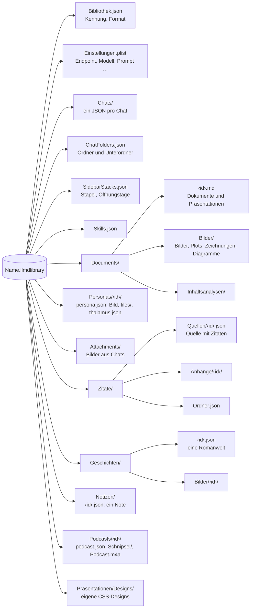

# Speicherformate

[← Übersicht](index.md) · [Funktionsweise](funktionen.md) · [Architektur](architektur.md) · [Code-Führer](code.md)

## Aufbau einer Bibliothek

Eine Bibliothek ist ein Ordner-Paket `Name.llmdlibrary` (im Finder ein einzelnes Objekt, Doppelklick öffnet es in LLM Designer). Alle Pfade darin sind relativ – die Bibliothek lässt sich frei verschieben.



`ChatFolders.json` ist eine Liste von Ordnern (`id`, `name`, `color`, `isCollapsed`). Ein Unterordner hat `parentID`, die ID eines Ordners der obersten Ebene; tiefer geht es nicht. Fehlt der Eltern-Ordner, steht der Unterordner oben.

`SidebarStacks.json` gehört zum automatischen Stapeln (Einstellung `sidebarArrangement` = `date` oder `stacks`, `sidebarStackMode` = `topics`, `types` oder `relevance`): `topics` sind die Themenstapel des Modells (`id`, `name`, `itemIDs`), `tidiedAt` das letzte Aufräumen, `expanded` die offenen Stapel, `activity` je Chat oder Dokument die Tage (`yyyy-MM-dd`), an denen es geöffnet wurde, höchstens 60 Tage zurück. Inhalte stehen darin nicht.

Außerhalb der Bibliotheken merkt sich die App nur die Liste der zuletzt geöffneten Bibliotheken (Pfad + Bookmark) in ihren Voreinstellungen.

## Dokumente

Jedes Dokument ist eine Markdown-Datei mit kurzem Kopf:

```markdown
---
id: 3BC48041-12EC-4B73-87B7-BAA02A0AC3A3
title: Der Wasserkreislauf
customTitle: true
created: 2026-10-30T08:10:00Z
updated: 2026-10-30T08:12:00Z
font: serif
format: taschenbuch
---

# Der Wasserkreislauf

Text mit **fett**, <u>unterstrichen</u>, H<sub>2</sub>O und [@muster2020, S. 12].
```

Writer erweitert Markdown Pandoc-kompatibel:

| Element | Markdown |
|---|---|
| Kapitel | `# Titel {.chapter}` |
| Ausrichtung | `::: {.center}` … `:::` |
| Kasten | `::: {.box kind=merksatz position=right width=40 wrap=true}` … `:::` |
| Zwei Spalten | `::: {.columns count=2 gap=1cm rule=true}` … `\columnbreak` … `:::` |
| Hoch-/tiefgestellt | `<sup>…</sup>`, `<sub>…</sub>` |
| Farbe, Schrift, Größe | `<span style="color:#…; font-size:14pt">…</span>` |
| Lesezeichen | `<span id="lz-…" title="…">…</span>` |
| Kommentar | `<span class="comment" data-comment="k-…" data-thread="…">…</span>` |
| Bild, Plot, Abbildung | `{width=50%}`, `{.plot …}`, `{.chart}`, `{.drawing}`, `{.mermaid}` |
| Tabelle mit Formeln | Tabelle in `::: {#tab-… calc-3-1="SUMME(B2:B3)"}`; Spaltenbreiten als Anzahl der Striche |
| Zitation | `[@schluessel, S. 12]`, Literaturverzeichnis `[Literatur]` |
| Fußnote | `^[Text der Fußnote]` (Pandoc-Inline-Fußnote, Text als Inline-Markdown; nummeriert in der Reihenfolge im Text) |
| Inhaltsverzeichnis | `[TOC]` oder `[TOC]{.dynamic}` |
| Seitenumbruch | `\newpage` |

### Herkunft

Der Kopf eines Dokuments kann `herkunft: fremd` oder `herkunft: intern` tragen. Fehlt das Feld, gilt der Text als eigener; so bleiben alle älteren Dokumente, wie sie sind. Skills haben dasselbe als optionales Feld `provenance`. Chats speichern ihre zugeschalteten Werkzeuggruppen in `actionGroups` und die Freigabestufe in `actionApproval`. In den Einstellungen der Bibliothek liegen `actionApprovalLevels` und `actionExportFolder`. Siehe [Action-Schicht](actions.md).

## Präsentationen

Eine Präsentation ist ein Dokument mit `kind: presentation` und den Hintergründen im Kopf. Jede Folie beginnt mit einer Kommentarzeile, die ihre Metadaten als JSON trägt; die Moderatorenkarte folgt als eigener Kommentar. Andere Markdown-Programme zeigen nur den Text.

```markdown
---
id: 422A2BDC-…
title: Wetter
kind: presentation
backgrounds: {"folie":{"kind":"design","design":"seide"}}
---

<!-- folie {"id":"…","rolle":"titel"} -->

# Wetter und Klima {.chapter}

<!-- folie {"id":"…","rolle":"folie","textbereich":{"x":0.1,"y":0.08,"b":0.5,"h":0.8},"bilder":[
  {"id":"…","quelle":"Bilder/wolke.png","x":0.6,"y":0.2,"b":0.3,"h":0.4},
  {"id":"…","inhalt":"**Merksatz**\n\nWasser geht nicht verloren.","kasten":"merksatz","x":0.55,"y":0.55,"b":0.38,"h":0.28,"lage":"vorne"}
]} -->

# Wolken

- Entstehen durch Abkühlung

<!-- moderation
Was der Vortragende sagt.
-->
```

| Schlüssel | Bedeutung |
|---|---|
| `rolle` | `titel`, `kapitel`, `folie` |
| `hintergrund` | eigener Hintergrund der Folie (Design, Farbe, Verlauf, Bild) |
| `textbereich` | Rahmen des Folientexts in Anteilen der Folie; fehlt er, gelten die Standardränder |
| `bilder` | freie Elemente, das letzte liegt oben |
| `quelle` | Bild: Pfad in der Bibliothek |
| `inhalt` | Textfeld: Writer-Markdown (Text, Tabelle, Code, Abbildung …) |
| `kasten`, `rahmen` | Textfeld als Kasten: Art (`definition`, `merksatz`, `beispiel`, `hinweis`, `achtung`, `eigener`) und Rahmen (`bar`, `outline`, `filled`) |
| `x`, `y`, `b`, `h` | Rahmen in Anteilen der Folienbreite/-höhe (Ursprung oben links) |
| `lage` | `umfliessen` (Vorgabe), `vorne`, `hinten` |


Zusätzliche Felder (seit 2026-11-07, alle optional): Eine Folie trägt `"ohnePlatzhalter": true`, wenn ihr Hinweis („Folientitel“) ausgeblendet ist. Ein Bild in `bilder` kann `zuschnitt` (`{"left","top","right","bottom"}`, Anteile, die je Seite wegfallen; die Datei bleibt ganz), `rand` (Breite in Punkten der 720-pt-Folie), `randfarbe` (Hex, z. B. `"FFFFFF"`) und `schatten` (`true`) haben.

## Zitate

`Zitate/Quellen/<id>.json` enthält eine Quelle mit ihren Wissensbausteinen:

```json
{
  "format": 1,
  "source": {
    "id": "…", "citekey": "muster2020", "type": "book",
    "title": "Grundlagen der Meteorologie",
    "authors": [{"family": "Muster", "given": "Erika"}],
    "year": 2020, "publisher": "Testverlag", "place": "Berlin"
  },
  "quotes": [
    {"id": "…", "sourceID": "…", "exactText": "Wolken sind …", "page": "12", "tags": ["Wolken"]}
  ]
}
```

## Romanwelten

`Geschichten/<id>.json` enthält eine ganze Welt als `{"format": 1, "world": {…}}`: Titel, Kalender, Zeitleiste, Bücher mit Akten/Kapiteln/Abschnitten und die Listen `figures`, `places`, `events`, `reasons`, `purposes`, `species`, `facts` sowie `gallery` (Bilder mit `caption`; jedes Buch, jeder Akt, jedes Kapitel und jeder Abschnitt hat ebenfalls eine `gallery`). Welt und Teile haben `linkedDocuments`: IDs von Writer-Dokumenten und Präsentationen, die dazugehören („Dazugehörige Dokumente“); die Dokumente bleiben in ihren Ordnern. Verweise zwischen Elementen sind IDs innerhalb derselben Datei. Ein Teil kann mit `manuscriptID` auf das Writer-Dokument mit seinem Text zeigen; die Welt enthält den Plan, das Dokument den Text. Bilder liegen in `Geschichten/Bilder/<id>/`, die Videocards der Figuren (`videos`) in `Geschichten/Videos/<id>/`. Unbekannte oder fehlende Felder werden beim Lesen übergangen.

## Notes

`Notizen/<id>.json` enthält ein Note als `{"format": 1, "note": {…}}`. Die Schlüssel sind deutsch; leere Felder (`text`, `gehoertZu`, `zu`, `dokumente`, `unter`) werden nicht geschrieben.

```json
{
  "format": 1,
  "note": {
    "id": "…",
    "titel": "Bachelorarbeit",
    "anzeige": "glas",
    "text": "Abgabe am 20.11.",
    "gehoertZu": [
      {"art": "dokument", "id": "…"},
      {"art": "romanwelt", "welt": "…", "teil": "…"}
    ],
    "todos": [
      {"id": "…", "text": "Konzept ausarbeiten", "erledigt": false, "dokumente": ["…"],
       "unter": [{"id": "…", "text": "Gliederung", "erledigt": true}]},
      {"id": "…", "text": "Literatur", "erledigt": false, "zu": true, "unter": [ … ]}
    ],
    "erstellt": "2026-11-11T09:00:00Z",
    "geaendert": "2026-11-11T09:30:00Z"
  }
}
```

| Schlüssel | Bedeutung |
|---|---|
| `anzeige` | Fortschrittsanzeige: `balken`, `ringe`, `glas`, `pflanze`, `rakete`, `gipfel`, `akku`, `mond`, `pizza`, `schnecke`, `tacho`, `pixel`; Unbekanntes wird `balken` |
| `gehoertZu` | Zugehörigkeiten: `dokument` (Writer-Dokument oder Präsentation) mit `id`; `romanwelt` mit `welt` und optional `teil` (ohne: die ganze Welt). Unbekannte Arten werden beim Lesen übergangen |
| `todos`, `unter` | ToDos und ihre Unter-ToDos, beliebig tief |
| `erledigt` | ein ToDo mit Unter-ToDos ist erledigt, wenn alle erledigt sind; die App gleicht das beim Ändern an |
| `zu` | Unter-ToDos eingeklappt |
| `dokumente` | IDs verknüpfter Writer-Dokumente und Präsentationen; die Dokumente bleiben in ihren Ordnern |

Die Dokumente, Präsentationen und Romanwelten selbst ändern sich durch eine Zuordnung nicht. Ein gelöschtes Note kommt in den Papierkorb. Die zuletzt gewählte Anzeige (`notesDefaultStyle`) und das zuletzt offene Note (`notesLastNote`) stehen in den Einstellungen der Bibliothek.

## Podcasts

Jeder Podcast hat einen eigenen Ordner `Podcasts/<id>/`:

| Datei | Inhalt |
|---|---|
| `podcast.json` | `{"format": 1, "podcast": {…}}` mit deutschen Schlüsseln |
| `Schnipsel/<zeilen-id>.wav` | die gesprochene Zeile (24 kHz mono, wie Qwen TTS sie liefert); lange Zeilen sind aus mehreren Stücken zusammengesetzt |
| `Podcast.m4a` | das fertige Gespräch (AAC), mit 0,25 s Pause zwischen Zeilen derselben Person und 0,45 s beim Sprecherwechsel |
| `Quellen/<name>.pdf` | Kopien der PDFs, die als eigene Quellen mitgegeben wurden |

```json
{
  "format": 1,
  "podcast": {
    "id": "…",
    "titel": "Predictive Coding",
    "frage": "Was ist Predictive Coding, und ist das ein zeitgemäßes Paradigma?",
    "laenge": 10,
    "sprache": "de",
    "sprachmodell": "klein",
    "denkmodus": true,
    "ton": "sachlich",
    "eigeneQuellen": {
      "nurDiese": false,
      "eintraege": [
        {"art": "url", "url": "https://…"},
        {"art": "pdf", "titel": "Studie", "datei": "Quellen/studie.pdf"}
      ]
    },
    "ordner": "…",
    "teilnehmer": [
      {"id": "…", "rolle": "moderator", "name": "Lena", "beschreibung": "Wissenschaftsjournalistin",
       "stimme": "serena", "position": "neugierig und unparteiisch"},
      {"id": "…", "rolle": "diskutant", "name": "Jonas", "beschreibung": "Neurowissenschaftler",
       "stimme": "aiden", "position": "hält Predictive Coding für das tragende Paradigma"}
    ],
    "referenzen": [
      {"art": "chat", "id": "…"},
      {"art": "dokument", "id": "…"},
      {"art": "romanwelt", "welt": "…", "teil": "…"}
    ],
    "recherche": {"notizen": "## Kernaussagen\n- …", "quellen": [{"titel": "Predictive Coding", "url": "https://de.wikipedia.org/wiki/…"}]},
    "gliederung": [{"titel": "Einstieg", "punkte": ["Begrüßung", "Die Frage"]}],
    "skript": [{"id": "…", "sprecher": "<teilnehmer-id>", "text": "Herzlich willkommen …", "dauer": 4.21}],
    "phase": "fertig",
    "dauer": 612.4,
    "erstellt": "2026-11-11T09:00:00Z",
    "geaendert": "2026-11-11T09:30:00Z"
  }
}
```

| Schlüssel | Bedeutung |
|---|---|
| `laenge` | Minuten: 5, 10 oder 15; anderes wird 10. Das Skript zielt auf etwa 140 Wörter pro Minute |
| `sprachmodell` | `klein` (Qwen TTS 0.6B, Vorgabe) oder `gross` (1.7B, natürlicher, aber mit gelegentlichem Rauschen) |
| `denkmodus` | das Modell denkt vor Recherche, Gliederung und Skript nach; fehlt der Schlüssel: an |
| `ton` | `sachlich`, `lebhaft`, `kontrovers`, `polemisch`, `hitzig`; fehlt er oder ist er unbekannt: `sachlich` |
| `eigeneQuellen` | Webseiten (`url`) und PDFs (`datei` unterhalb des Podcast-Ordners) der Person; `nurDiese`: keine Web- und Wikipedia-Suche, Faktenblatt und Gespräch stützen sich nur darauf. Wird nicht geschrieben, solange leer |
| `ordner` | Ordner der Seitenleiste, wie bei Chats und Dokumenten |
| `rolle` | `moderator` oder `diskutant`; genau eine Moderation |
| `stimme` | Stimme von Qwen TTS (`serena`, `aiden`, `sohee` …) |
| `referenzen` | Material: `chat` oder `dokument` (auch Präsentation) mit `id`; `romanwelt` mit `welt` und optional `teil`. Unbekannte Arten werden beim Lesen übergangen |
| `recherche` | Faktenblatt (`notizen`, Markdown) und die Seiten und Wikipedia-Artikel, die das Modell gelesen hat (`quellen`) |
| `gliederung` | die geplanten Abschnitte mit ihren Punkten |
| `skript` | die Beiträge in Reihenfolge; `dauer` (Sekunden) steht erst, wenn die Zeile gesprochen ist |
| `phase` | `entwurf`, `wartet`, `recherche`, `skript`, `audio`, `fertig`, `gestoppt`, `fehler` (dann mit `fehler`) |
| `dauer` | Sekunden der fertigen Audiodatei |

Ändert man den Text oder die Person einer Zeile, verliert sie ihren Schnipsel und ihre `dauer`; die Audiodatei gilt dann als veraltet, bis „Audio aktualisieren“ nur diese Zeilen neu spricht. Was beim Beenden der App gerade lief, steht nach dem Start als `gestoppt` da und lässt sich fortsetzen. Ein gelöschter Podcast kommt mit seinem ganzen Ordner in den Papierkorb.

